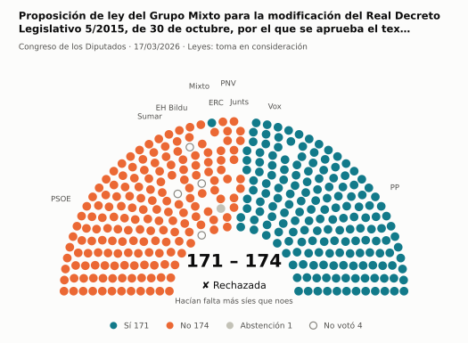
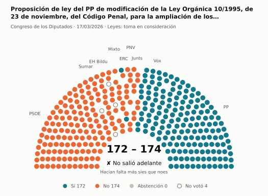
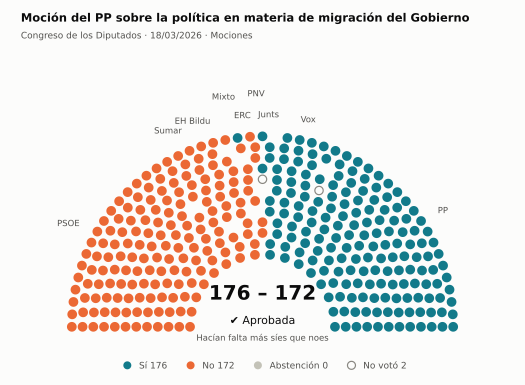
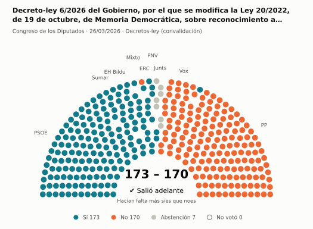
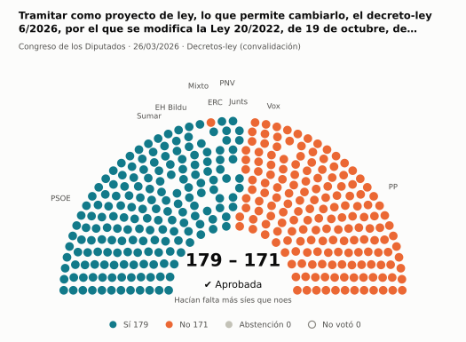
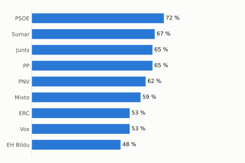
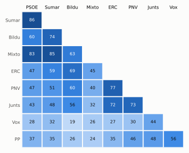

# Qué votó el Congreso en marzo de 2026

Las votaciones del Pleno del Congreso de los Diputados, explicadas sin tecnicismos. Datos oficiales del [Congreso](https://www.congreso.es/es/opendata/votaciones); este resumen se actualiza solo cada mes (última vez: 11/11/2026).

## En pocas palabras

- El Congreso votó **81 veces** en 4 días de pleno. **45 propuestas salieron adelante** y 36 no.
- 29 votaciones fueron sobre leyes, decretos o presupuestos. Otras 49 fueron peticiones al Gobierno que no le obligan (proposiciones no de ley y mociones).
- El Gobierno (PSOE y Sumar) perdió **17** de las 68 votaciones en las que sus grupos votaron lo mismo.
- La votación más reñida se decidió por 2 votos: Proposición de ley del PP de modificación de la Ley Orgánica 10/1995, de 23 de noviembre, del Código Penal, para la….
- Los diputados casi siempre votan lo mismo que su grupo: en todo el mes solo hubo 19 votos distintos (sin contar el Grupo Mixto).

## Las votaciones más importantes del mes

Elegidas por su importancia: pesan más las leyes y los decretos que las peticiones al Gobierno, y suben las que se decidieron por pocos votos o las que perdió el Gobierno. Cada punto del dibujo es un diputado, colocado con su grupo, y el color es lo que votó.

### 1. Proposición de ley del Grupo Mixto para la modificación del Real Decreto Legislativo 5/2015, de 30 de octubre, por el que se aprueba el texto…

**17 de marzo · Leyes: toma en consideración.** Primer paso de una ley propuesta por un grupo o una comunidad autónoma: el Congreso decide si empieza a tramitarla.

<picture>
  <source media="(prefers-color-scheme: dark)" srcset="img/2026-03/votacion-L15-S165-V001-oscuro.svg">
  
</picture>

**✘ No salió adelante** por 3 votos: 171 a favor, 174 en contra y 1 abstención.

- **A favor:** PP y Vox
- **En contra:** PSOE, Sumar, Junts, ERC, EH Bildu y PNV
- **Repartidos:** Grupo Mixto (Sí 1, No 6, Abstención 1)

[Datos oficiales](https://www.congreso.es/webpublica/opendata/votaciones/Leg15/Sesion165/20260317/Votacion001/VOT_20260317205747.json)

### 2. Proposición de ley del PP de modificación de la Ley Orgánica 10/1995, de 23 de noviembre, del Código Penal, para la ampliación de los supuestos en…

**17 de marzo · Leyes: toma en consideración.** Primer paso de una ley propuesta por un grupo o una comunidad autónoma: el Congreso decide si empieza a tramitarla.

<picture>
  <source media="(prefers-color-scheme: dark)" srcset="img/2026-03/votacion-L15-S165-V002-oscuro.svg">
  
</picture>

**✘ No salió adelante** por 2 votos: 172 a favor, 174 en contra y ninguna abstención.

- **A favor:** PP y Vox
- **En contra:** PSOE, Sumar, Junts, ERC, EH Bildu y PNV
- **Repartidos:** Grupo Mixto (Sí 2, No 6)

[Datos oficiales](https://www.congreso.es/webpublica/opendata/votaciones/Leg15/Sesion165/20260317/Votacion002/VOT_20260317205749.json)

### 3. Moción del PP sobre la política en materia de migración del Gobierno

**18 de marzo · Mociones.** Petición al Gobierno después de pedirle explicaciones en el Pleno. Expresa la opinión del Congreso, pero no obliga.

<picture>
  <source media="(prefers-color-scheme: dark)" srcset="img/2026-03/votacion-L15-S166-V003-oscuro.svg">
  
</picture>

**✔ Salió adelante** por 4 votos: 176 a favor, 172 en contra y ninguna abstención.

- **A favor:** PP, Vox y Junts
- **En contra:** PSOE, Sumar, ERC, EH Bildu y PNV
- **Repartidos:** Grupo Mixto (Sí 1, No 7)

[Datos oficiales](https://www.congreso.es/webpublica/opendata/votaciones/Leg15/Sesion166/20260318/Votacion003/VOT_20260318175327.json)

### 4. Decreto-ley 6/2026 del Gobierno, por el que se modifica la Ley 20/2022, de 19 de octubre, de Memoria Democrática, sobre reconocimiento a favor de…

**26 de marzo · Decretos-ley (convalidación).** El Gobierno aprobó esta norma por urgencia. Ya está en vigor, pero el Congreso tiene 30 días para confirmarla o tumbarla.

<picture>
  <source media="(prefers-color-scheme: dark)" srcset="img/2026-03/votacion-L15-S169-V053-oscuro.svg">
  
</picture>

**✔ Salió adelante** por 3 votos: 173 a favor, 170 en contra y 7 abstenciones.

- **A favor:** PSOE, Sumar, ERC, EH Bildu y PNV
- **En contra:** PP (136 de 137) y Vox
- **Se abstuvieron:** Junts
- **Repartidos:** Grupo Mixto (Sí 7, No 1)

[Datos oficiales](https://www.congreso.es/webpublica/opendata/votaciones/Leg15/Sesion169/20260326/Votacion053/VOT_20260326165140.json)

### 5. Tramitar como proyecto de ley, lo que permite cambiarlo, el decreto-ley 6/2026, por el que se modifica la Ley 20/2022, de 19 de octubre, de Memoria…

**26 de marzo · Decretos-ley (convalidación).** El Gobierno aprobó esta norma por urgencia. Ya está en vigor, pero el Congreso tiene 30 días para confirmarla o tumbarla.

<picture>
  <source media="(prefers-color-scheme: dark)" srcset="img/2026-03/votacion-L15-S169-V054-oscuro.svg">
  
</picture>

**✔ Salió adelante** por 8 votos: 179 a favor, 171 en contra y ninguna abstención.

- **A favor:** PSOE, Sumar, Junts, ERC, EH Bildu y PNV
- **En contra:** PP y Vox
- **Repartidos:** Grupo Mixto (Sí 7, No 1)

[Datos oficiales](https://www.congreso.es/webpublica/opendata/votaciones/Leg15/Sesion169/20260326/Votacion054/VOT_20260326165141.json)

## ¿Qué grupos votaron más veces lo que finalmente salió?

<picture>
  <source media="(prefers-color-scheme: dark)" srcset="img/2026-03/ganadora-oscuro.svg">
  
</picture>

Porcentaje de votaciones en que el grupo votó Sí y salió adelante, o votó No y no salió. Abstenerse no cuenta como acertar.

## ¿Quién vota con quién?

<picture>
  <source media="(prefers-color-scheme: dark)" srcset="img/2026-03/afinidad-oscuro.svg">
  
</picture>

Cada casilla dice en qué porcentaje de las votaciones dos grupos votaron lo mismo: 100 es que siempre coincidieron y 0 que nunca.

## ¿Qué tipo de cosas se votaron?

| Tipo | Votaciones | Salieron adelante | Qué es |
| --- | ---: | ---: | --- |
| Proposiciones no de ley | 31 | 18 | Petición al Gobierno para que haga algo. Expresa la opinión del Congreso, pero no obliga. |
| Mociones | 18 | 8 | Petición al Gobierno después de pedirle explicaciones en el Pleno. Expresa la opinión del Congreso, pero no obliga. |
| Leyes: enmiendas del Senado | 15 | 6 | El Senado propuso cambios a esta ley y el Congreso decide si los acepta. Es uno de los últimos pasos antes de que la ley se publique. |
| Decretos-ley (convalidación) | 6 | 6 | El Gobierno aprobó esta norma por urgencia. Ya está en vigor, pero el Congreso tiene 30 días para confirmarla o tumbarla. |
| Leyes: dictamen y votación final | 4 | 3 | Votación del texto de una ley después de trabajarla en comisión. |
| Leyes: toma en consideración | 4 | 2 | Primer paso de una ley propuesta por un grupo o una comunidad autónoma: el Congreso decide si empieza a tramitarla. |
| Tratados internacionales | 3 | 2 | El Congreso autoriza a España a comprometerse con un acuerdo con otro país u organismo. |

## Palabras que conviene saber

- **Pleno**: La reunión de los 350 diputados, donde se vota.
- **Grupo parlamentario**: Los diputados de un partido o coalición. Los partidos pequeños van juntos en el Grupo Mixto, aunque no piensen igual.
- **Abstención**: El diputado vota, pero ni a favor ni en contra.
- **No votó**: El diputado no votó: no estaba, estaba de baja o el escaño estaba vacío.
- **Mayoría simple**: Salen adelante las votaciones con más síes que noes. Es lo normal.
- **Mayoría absoluta**: 176 votos a favor, la mitad más uno de 350. La piden las leyes orgánicas (derechos fundamentales, sistema electoral…) y la primera votación de investidura.
- **Votación por llamamiento**: Cada diputado dice su voto en voz alta. Se usa en las investiduras y otras votaciones importantes.

---

**¿Quieres más detalle?** El [análisis detallado](2026-03-detalle.md) tiene la cohesión de cada grupo, un mapa de los diputados según cómo votan, qué diputados votaron distinto de su grupo, las ausencias y la lista completa de votaciones.

_Los resultados están calculados a partir de los votos: el Congreso no publica si cada votación salió adelante. Este proyecto no tiene relación con el Congreso. Método en [docs/DOCUMENTO_FUNCIONAL.md](../docs/DOCUMENTO_FUNCIONAL.md)._
