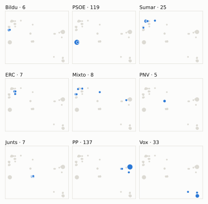
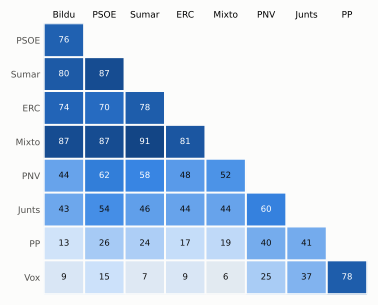

# Análisis detallado: abril de 2026

[← Volver al resumen del mes](2026-04.md)

_Generado automáticamente el 2026-11-11 con datos abiertos del [Congreso de los Diputados](https://www.congreso.es/es/opendata/votaciones). Solo plenos y Diputación Permanente. Método y límites en [docs/DOCUMENTO_FUNCIONAL.md](../docs/DOCUMENTO_FUNCIONAL.md)._

## Resumen

- **54 votaciones** en 6 días de pleno (sesiones 171, 172, 173, 174, 175 y 177).
- **34 aprobadas** y **17 rechazadas**, más 3 empates que obligaron a repetir.
- 10 votaciones se decidieron por 5 votos o menos.
- El grupo que más veces votó con el resultado final: **PP** (80 % de las votaciones nominales).
- Los grupos del Gobierno (PSOE y Sumar) votaron lo mismo en 41 de 54 votaciones nominales y perdieron 19 de ellas.
- 14 votos individuales se apartaron de la posición de su grupo (8 diputados).

## Cómo votó cada grupo

| Grupo | Diputados | Cohesión | Votó con el resultado | Decisivo | Posición Sí | Posición No | Posición Abst. |
| --- | ---: | ---: | ---: | ---: | ---: | ---: | ---: |
| PP | 137 | 100 % | 80 % | 23 | 38 | 14 | 2 |
| PSOE | 121 | 100 % | 46 % | 9 | 15 | 33 | 6 |
| Vox | 33 | 100 % | 67 % | 22 | 33 | 17 | 4 |
| Sumar | 26 | 99 % | 41 % | 7 | 21 | 26 | 7 |
| Mixto | 8 | 70 % | 39 % | 6 | 19 | 30 | 5 |
| Junts | 7 | 99 % | 59 % | 6 | 16 | 22 | 16 |
| ERC | 7 | 100 % | 35 % | 7 | 18 | 22 | 14 |
| EH Bildu | 6 | 100 % | 33 % | 4 | 15 | 31 | 8 |
| PNV | 5 | 100 % | 58 % | 3 | 20 | 15 | 17 |

*Cohesión*: índice de acuerdo interno (100 % = todo el grupo votó igual). *Votó con el resultado*: el grupo votó Sí y salió aprobada, o No y salió rechazada. *Decisivo*: votaciones cuyo resultado habría cambiado si el grupo se hubiera abstenido en bloque. El Grupo Mixto reúne partidos distintos: su posición es la de su mayoría.

## Mapa de diputados

<picture>
  <source media="(prefers-color-scheme: dark)" srcset="img/2026-04/mapa-oscuro.svg">
  
</picture>

Cada punto es un diputado; dos diputados están cerca si votaron parecido. Un punto más grande reúne a varios que votaron exactamente igual. En cada panel, el grupo en azul y el resto del Congreso en gris.

*Cómo se calcula*: componentes principales de los votos (Sí, No, abstención) en 53 votaciones con algún desacuerdo. El eje horizontal recoge el 84 % de la variación y el vertical el 7 %. Los ejes no tienen nombre ni sentido político propio; por convención, el PP queda a la derecha. No se sitúa a 3 diputados que votó en menos de la mitad.

## Afinidad entre grupos

<picture>
  <source media="(prefers-color-scheme: dark)" srcset="img/2026-04/afinidad-oscuro.svg">
  
</picture>

Porcentaje de votaciones nominales en que los dos grupos tomaron la misma posición. Los grupos están ordenados según el mapa de diputados.

Ver la tabla

|  | PP | PSOE | Vox | Sumar | Mixto | Junts | ERC | EH Bildu | PNV |
| --- | :---: | :---: | :---: | :---: | :---: | :---: | :---: | :---: | :---: |
| PP | 100 % | 26 % | 78 % | 24 % | 19 % | 41 % | 17 % | 13 % | 40 % |
| PSOE | 26 % | 100 % | 15 % | 87 % | 87 % | 54 % | 70 % | 76 % | 62 % |
| Vox | 78 % | 15 % | 100 % | 7 % | 6 % | 37 % | 9 % | 9 % | 25 % |
| Sumar | 24 % | 87 % | 7 % | 100 % | 91 % | 46 % | 78 % | 80 % | 58 % |
| Mixto | 19 % | 87 % | 6 % | 91 % | 100 % | 44 % | 81 % | 87 % | 52 % |
| Junts | 41 % | 54 % | 37 % | 46 % | 44 % | 100 % | 44 % | 43 % | 60 % |
| ERC | 17 % | 70 % | 9 % | 78 % | 81 % | 44 % | 100 % | 74 % | 48 % |
| EH Bildu | 13 % | 76 % | 9 % | 80 % | 87 % | 43 % | 74 % | 100 % | 44 % |
| PNV | 40 % | 62 % | 25 % | 58 % | 52 % | 60 % | 48 % | 44 % | 100 % |

## Quién sacó adelante las votaciones

| Grupos que votaron Sí | Votaciones | Escaños |
| --- | ---: | ---: |
| PP + Vox | 11 | 170 |
| PP + Vox + Junts | 6 | 177 |
| PP + Vox + PNV | 3 | 175 |
| PSOE + Sumar + Mixto + Junts + ERC + EH Bildu + PNV | 2 | 180 |
| PP + Vox + Junts + PNV | 2 | 182 |
| PP + PSOE + Sumar + Mixto + Junts + ERC + PNV | 2 | 311 |
| PSOE + Sumar + Mixto + ERC + EH Bildu + PNV | 1 | 173 |
| PP + PSOE + Sumar + Mixto + PNV | 1 | 297 |

De 34 votaciones nominales aprobadas. Otras 6 salieron con combinaciones que se dieron menos veces. La posición de cada grupo es la de la mayoría de sus diputados.

## Votaciones que perdieron los grupos del Gobierno

| Fecha | Asunto | Tipo | PSOE y Sumar votaron | Resultado | Sí | No |
| --- | --- | --- | :---: | --- | ---: | ---: |
| 14 de abril | Proposición de Ley del Grupo Parlamentario Socialista, sobre la habilitación legal de la Comisión Nacional de los Mercados y la Competencia como coordinador de… | Leyes: toma en consideración | Sí | Rechazada | 163 | 174 |
| 15 de abril | Moción consecuencia de interpelación urgente del Grupo Parlamentario Popular en el Congreso, sobre el estado de la infraestructura ferroviaria y las conexiones… *(Votación separada por puntos. Punto 6.)* | Mociones | No | Aprobada | 170 | 166 |
| 15 de abril | Moción consecuencia de interpelación urgente del Grupo Parlamentario Popular en el Congreso, sobre el estado de la infraestructura ferroviaria y las conexiones… *(Votación separada por puntos. Punto 7.)* | Mociones | No | Aprobada | 170 | 162 |
| 15 de abril | Moción consecuencia de interpelación urgente del Grupo Parlamentario Popular en el Congreso, sobre el estado de la infraestructura ferroviaria y las conexiones… *(Votación separada por puntos. Punto 9.)* | Mociones | No | Aprobada | 170 | 167 |
| 21 de abril | Proposición de Ley del Grupo Parlamentario Popular en el Congreso, de medidas administrativas y procesales para la seguridad jurídica de la ordenación territor… | Leyes: toma en consideración | No | Aprobada | 178 | 163 |
| 22 de abril | Proposición no de Ley del Grupo Parlamentario Popular en el Congreso, para la adopción de medidas urgentes en la lucha contra la inseguridad ciudadana causada… *(Votación separada por puntos. Punto 1.)* | Proposiciones no de ley | No | Aprobada | 169 | 161 |
| 22 de abril | Proposición no de Ley del Grupo Parlamentario Popular en el Congreso, para la adopción de medidas urgentes en la lucha contra la inseguridad ciudadana causada… *(Votación separada por puntos. Punto 2.)* | Proposiciones no de ley | No | Aprobada | 169 | 163 |
| 22 de abril | Proposición no de Ley del Grupo Parlamentario Popular en el Congreso, para la adopción de medidas urgentes en la lucha contra la inseguridad ciudadana causada… *(Votación separada por puntos. Punto 3.)* | Proposiciones no de ley | No | Aprobada | 173 | 162 |
| 22 de abril | Proposición no de Ley del Grupo Parlamentario Popular en el Congreso, para la adopción de medidas urgentes en la lucha contra la inseguridad ciudadana causada… *(Votación separada por puntos. Punto 4.)* | Proposiciones no de ley | No | Aprobada | 176 | 163 |
| 22 de abril | Proposición no de Ley del Grupo Parlamentario Popular en el Congreso, para la adopción de medidas urgentes en la lucha contra la inseguridad ciudadana causada… *(Votación separada por puntos. Punto 5.)* | Proposiciones no de ley | No | Aprobada | 174 | 169 |
| 22 de abril | Proposición no de Ley del Grupo Parlamentario Popular en el Congreso, para la adopción de medidas urgentes en la lucha contra la inseguridad ciudadana causada… *(Votación separada por puntos. Punto 6.)* | Proposiciones no de ley | No | Aprobada | 167 | 163 |
| 22 de abril | Proposición no de Ley del Grupo Parlamentario Popular en el Congreso, para la adopción de medidas urgentes en la lucha contra la inseguridad ciudadana causada… *(Votación separada por puntos. Punto 7.)* | Proposiciones no de ley | No | Aprobada | 176 | 163 |
| 22 de abril | Moción consecuencia de interpelación urgente del Grupo Parlamentario Popular en el Congreso, sobre el infierno fiscal al que ha condenado el Gobierno a todos l… *(Votación separada por puntos. Punto 1.)* | Mociones | No | Aprobada | 177 | 163 |
| 28 de abril | Proposición de Ley del Grupo Parlamentario Republicano, para la constitución de un consorcio de inversiones entre la Administración General del Estado y la Gen… | Leyes: toma en consideración | Sí | Rechazada | 168 | 181 |
| 28 de abril | Real Decreto-ley 8/2026, de 20 de marzo, de medidas en el alquiler en respuesta a las consecuencias económicas y sociales de la Guerra de Irán. | Decretos-ley (convalidación) | Sí | Rechazada | 166 | 177 |

Y 4 más (ver «Todas las votaciones»).

Además, PSOE y Sumar votaron distinto entre sí en 7 votaciones.

## Votaciones más ajustadas

| Fecha | Asunto | Resultado | Sí | No | Abst. |
| --- | --- | :---: | ---: | ---: | ---: |
| 15 de abril | Proposición no de Ley del Grupo Parlamentario Socialista, para documentar el "bibliocausto español" y reconocer el compromiso con la cultura de libreros, bibli… | Empate (se repite) | 169 | 169 | 8 |
| 15 de abril | Proposición no de Ley del Grupo Parlamentario Socialista, para documentar el "bibliocausto español" y reconocer el compromiso con la cultura de libreros, bibli… | Empate (se repite) | 169 | 169 | 8 |
| 30 de abril | Proposición no de Ley del Grupo Parlamentario Popular en el Congreso, relativa a los retrasos del Estado en infraestructuras y actuaciones hídricas en Andalucí… | Empate (se repite) | 170 | 170 | 1 |
| 15 de abril | Proposición no de Ley del Grupo Parlamentario Socialista, para documentar el "bibliocausto español" y reconocer el compromiso con la cultura de libreros, bibli… | Aprobada | 170 | 169 | 7 |
| 30 de abril | Proposición no de Ley del Grupo Parlamentario Popular en el Congreso, relativa a los retrasos del Estado en infraestructuras y actuaciones hídricas en Andalucí… | Aprobada | 172 | 171 | 0 |
| 15 de abril | Moción consecuencia de interpelación urgente del Grupo Parlamentario Popular en el Congreso, sobre el estado de la infraestructura ferroviaria y las conexiones… *(Votación separada por puntos. Punto 5.)* | Rechazada | 170 | 173 | 2 |
| 15 de abril | Moción consecuencia de interpelación urgente del Grupo Parlamentario Popular en el Congreso, sobre el estado de la infraestructura ferroviaria y las conexiones… *(Votación separada por puntos. Punto 9.)* | Aprobada | 170 | 167 | 9 |
| 15 de abril | Moción consecuencia de interpelación urgente del Grupo Parlamentario Popular en el Congreso, sobre el estado de la infraestructura ferroviaria y las conexiones… *(Votación separada por puntos. Punto 6.)* | Aprobada | 170 | 166 | 9 |
| 22 de abril | Proposición no de Ley del Grupo Parlamentario Popular en el Congreso, para la adopción de medidas urgentes en la lucha contra la inseguridad ciudadana causada… *(Votación separada por puntos. Punto 6.)* | Aprobada | 167 | 163 | 13 |
| 22 de abril | Proposición no de Ley del Grupo Parlamentario Popular en el Congreso, para la adopción de medidas urgentes en la lucha contra la inseguridad ciudadana causada… *(Votación separada por puntos. Punto 5.)* | Aprobada | 174 | 169 | 1 |

Votaciones decididas por 10 votos o menos (o a esa distancia de la mayoría que exigían). Las públicas por llamamiento no tienen hemiciclo: el voto de cada diputado solo consta en el Diario de Sesiones.

## Qué se votó, por tipo de asunto

| Tipo de asunto | Votaciones | Aprobadas | No aprobadas |
| --- | ---: | ---: | ---: |
| Mociones | 26 | 16 | 10 |
| Proposiciones no de ley | 15 | 11 | 4 |
| Leyes: toma en consideración | 6 | 2 | 4 |
| Tratados internacionales | 3 | 3 | 0 |
| Decretos-ley (convalidación) | 3 | 2 | 1 |
| Enmiendas a la totalidad | 1 | 0 | 1 |

Las proposiciones no de ley y las mociones expresan la posición del Congreso pero no obligan al Gobierno. Las leyes pasan por varias votaciones (toma en consideración, totalidad, dictamen, Senado), así que una misma ley puede aparecer varias veces.

## Votos distintos de su grupo

| Diputado | Grupo | Votos distintos de su grupo |
| --- | --- | ---: |
| Rivera Arias, Engracia | Sumar | 6 |
| Cervera Pinart, Josep Maria | Junts | 2 |
| Asarta Cuevas, Alberto | Vox | 1 |
| Chamorro Delmo, Ricardo | Vox | 1 |
| De los Santos González, Jaime Miguel | PP | 1 |
| Floriano Corrales, Carlos Javier | PP | 1 |
| Pagès i Massó, Josep | Junts | 1 |
| Puy Fraga, Pedro | PP | 1 |

Un voto aislado puede ser un error al pulsar, no una decisión política: el Congreso no publica las correcciones. Se excluye el Grupo Mixto.

## Diputados que más veces no votaron

| Diputado | Grupo | No votó | % de votaciones |
| --- | --- | ---: | ---: |
| Montero Cuadrado, María Jesús | PSOE | 51 | 94 % |
| Díaz Pérez, Yolanda | Sumar | 39 | 72 % |
| Sánchez Pérez-Castejón, Pedro | PSOE | 31 | 57 % |
| Sánchez García, José María | Vox | 20 | 37 % |
| Núñez Feijóo, Alberto | PP | 18 | 33 % |
| Pisarello Prados, Gerardo | Sumar | 18 | 33 % |
| Hispán Iglesias de Ussel, Pablo | PP | 17 | 31 % |
| Cruset Domènech, Josep Maria | Junts | 3 | 6 % |
| Legarda Uriarte, Mikel | PNV | 3 | 6 % |
| Rego Candamil, Néstor | Mixto | 3 | 6 % |
| Agirretxea Urresti, Joseba Andoni | PNV | 2 | 4 % |
| Delgado Arce, Celso Luis | PP | 2 | 4 % |
| Hernández Quero, Carlos | Vox | 2 | 4 % |
| Renteria Lasanta, Nerea | PNV | 2 | 4 % |
| Requena Ruiz, Juan Diego | PP | 2 | 4 % |

«No vota» incluye ausencias justificadas (baja, maternidad o paternidad) y escaños vacantes; el portal no las distingue.

## Todas las votaciones

Posición de cada grupo: la opción que votó la mayoría de sus diputados (*Div.*: empate dentro del grupo). El número enlaza al JSON oficial o, en las votaciones por llamamiento, al Diario de Sesiones.

### 14 de abril (sesión 171)

| Nº | Asunto | Resultado | Sí | No | Abst. | PP | PSOE | Vox | Sumar | Mixto | Junts | ERC | EH Bildu | PNV | Decisivos |
| ---: | --- | --- | ---: | ---: | ---: | :---: | :---: | :---: | :---: | :---: | :---: | :---: | :---: | :---: | --- |
| [1](https://www.congreso.es/webpublica/opendata/votaciones/Leg15/Sesion171/20260414/Votacion001/VOT_20260414203032.json) | Proposición de Ley del Grupo Parlamentario Junts per Catalunya, Orgánica sobre la regulación del uso de velos integrales y la delegación en la Comunidad Autóno… | Rechazada | 7 | 327 | 13 | No | No | No | No | No | Sí | Abst. | No | Abst. |  |
| [2](https://www.congreso.es/webpublica/opendata/votaciones/Leg15/Sesion171/20260414/Votacion002/VOT_20260414203033.json) | Proposición de Ley del Grupo Parlamentario Socialista, sobre la habilitación legal de la Comisión Nacional de los Mercados y la Competencia como coordinador de… | Rechazada | 163 | 174 | 8 | No | Sí | No | Sí | Sí | No | Abst. | Sí | Sí | PP, Vox |

### 15 de abril (sesión 172)

| Nº | Asunto | Resultado | Sí | No | Abst. | PP | PSOE | Vox | Sumar | Mixto | Junts | ERC | EH Bildu | PNV | Decisivos |
| ---: | --- | --- | ---: | ---: | ---: | :---: | :---: | :---: | :---: | :---: | :---: | :---: | :---: | :---: | --- |
| [1](https://www.congreso.es/webpublica/opendata/votaciones/Leg15/Sesion172/20260415/Votacion001/VOT_20260415133904.json) | Proposición no de Ley del Grupo Parlamentario Republicano, sobre el reconocimiento de las víctimas del Patronato de Protección a la Mujer. Se vota en los térmi… | Aprobada | 176 | 170 | 0 | No | Sí | No | Sí | Sí | Sí | Sí | Sí | Sí | EH Bildu, Junts, Mixto, ERC, PSOE, Sumar |
| [2](https://www.congreso.es/webpublica/opendata/votaciones/Leg15/Sesion172/20260415/Votacion002/VOT_20260415133905.json) | Proposición no de Ley del Grupo Parlamentario Socialista, para documentar el "bibliocausto español" y reconocer el compromiso con la cultura de libreros, bibli… | Empate (se repite) | 169 | 169 | 8 | No | Sí | No | Sí | Sí | Abst. | Sí | Sí | Sí | PP, Vox |
| [3](https://www.congreso.es/webpublica/opendata/votaciones/Leg15/Sesion172/20260415/Votacion003/VOT_20260415133907.json) | Proposición no de Ley del Grupo Parlamentario Socialista, para documentar el "bibliocausto español" y reconocer el compromiso con la cultura de libreros, bibli… | Empate (se repite) | 169 | 169 | 8 | No | Sí | No | Sí | Sí | Abst. | Sí | Sí | Sí | PP, Vox |
| [4](https://www.congreso.es/webpublica/opendata/votaciones/Leg15/Sesion172/20260415/Votacion004/VOT_20260415133908.json) | Proposición no de Ley del Grupo Parlamentario Socialista, para documentar el "bibliocausto español" y reconocer el compromiso con la cultura de libreros, bibli… | Aprobada | 170 | 169 | 7 | No | Sí | No | Sí | Sí | Abst. | Sí | Sí | Sí | EH Bildu, Mixto, ERC, PSOE, Sumar, PNV |
| [5](https://www.congreso.es/webpublica/opendata/votaciones/Leg15/Sesion172/20260415/Votacion005/VOT_20260415133910.json) | Moción consecuencia de interpelación urgente del Grupo Parlamentario Popular en el Congreso, sobre el estado de la infraestructura ferroviaria y las conexiones… *(Votación separada por puntos. Punto 1.)* | Aprobada | 170 | 0 | 175 | Sí | Abst. | Sí | Abst. | Abst. | Abst. | Abst. | Abst. | Abst. |  |
| [6](https://www.congreso.es/webpublica/opendata/votaciones/Leg15/Sesion172/20260415/Votacion006/VOT_20260415133912.json) | Moción consecuencia de interpelación urgente del Grupo Parlamentario Popular en el Congreso, sobre el estado de la infraestructura ferroviaria y las conexiones… *(Votación separada por puntos. Punto 2.)* | Aprobada | 177 | 6 | 163 | Sí | Abst. | Sí | Abst. | Abst. | Sí | Abst. | No | Abst. |  |
| [7](https://www.congreso.es/webpublica/opendata/votaciones/Leg15/Sesion172/20260415/Votacion007/VOT_20260415133914.json) | Moción consecuencia de interpelación urgente del Grupo Parlamentario Popular en el Congreso, sobre el estado de la infraestructura ferroviaria y las conexiones… *(Votación separada por puntos. Punto 3.)* | Rechazada | 169 | 175 | 1 | Sí | No | Sí | No | No | No | No | No | No | Junts, ERC, PSOE, Sumar |
| [8](https://www.congreso.es/webpublica/opendata/votaciones/Leg15/Sesion172/20260415/Votacion008/VOT_20260415133915.json) | Moción consecuencia de interpelación urgente del Grupo Parlamentario Popular en el Congreso, sobre el estado de la infraestructura ferroviaria y las conexiones… *(Votación separada por puntos. Punto 4.)* | Aprobada | 170 | 0 | 176 | Sí | Abst. | Sí | Abst. | Abst. | Abst. | Abst. | Abst. | Abst. |  |
| [9](https://www.congreso.es/webpublica/opendata/votaciones/Leg15/Sesion172/20260415/Votacion009/VOT_20260415133917.json) | Moción consecuencia de interpelación urgente del Grupo Parlamentario Popular en el Congreso, sobre el estado de la infraestructura ferroviaria y las conexiones… *(Votación separada por puntos. Punto 5.)* | Rechazada | 170 | 173 | 2 | Sí | No | Sí | No | No | No | No | No | No | EH Bildu, Junts, Mixto, ERC, PSOE, Sumar, PNV |
| [10](https://www.congreso.es/webpublica/opendata/votaciones/Leg15/Sesion172/20260415/Votacion010/VOT_20260415133918.json) | Moción consecuencia de interpelación urgente del Grupo Parlamentario Popular en el Congreso, sobre el estado de la infraestructura ferroviaria y las conexiones… *(Votación separada por puntos. Punto 6.)* | Aprobada | 170 | 166 | 9 | Sí | No | Sí | No | No | No | Abst. | No | No | PP, Vox |
| [11](https://www.congreso.es/webpublica/opendata/votaciones/Leg15/Sesion172/20260415/Votacion011/VOT_20260415133919.json) | Moción consecuencia de interpelación urgente del Grupo Parlamentario Popular en el Congreso, sobre el estado de la infraestructura ferroviaria y las conexiones… *(Votación separada por puntos. Punto 7.)* | Aprobada | 170 | 162 | 14 | Sí | No | Sí | No | No | No | Abst. | No | Abst. | PP, Vox |
| [12](https://www.congreso.es/webpublica/opendata/votaciones/Leg15/Sesion172/20260415/Votacion012/VOT_20260415133920.json) | Moción consecuencia de interpelación urgente del Grupo Parlamentario Popular en el Congreso, sobre el estado de la infraestructura ferroviaria y las conexiones… *(Votación separada por puntos. Punto 8.)* | Aprobada | 180 | 8 | 158 | Sí | Abst. | Sí | Abst. | Abst. | Sí | Abst. | No | Sí |  |
| [13](https://www.congreso.es/webpublica/opendata/votaciones/Leg15/Sesion172/20260415/Votacion013/VOT_20260415133922.json) | Moción consecuencia de interpelación urgente del Grupo Parlamentario Popular en el Congreso, sobre el estado de la infraestructura ferroviaria y las conexiones… *(Votación separada por puntos. Punto 9.)* | Aprobada | 170 | 167 | 9 | Sí | No | Sí | No | No | No | Abst. | No | No | PP, Vox |
| [14](https://www.congreso.es/webpublica/opendata/votaciones/Leg15/Sesion172/20260415/Votacion014/VOT_20260415133923.json) | Moción consecuencia de interpelación urgente del Grupo Parlamentario Popular en el Congreso, sobre el estado de la infraestructura ferroviaria y las conexiones… *(Votación separada por puntos. Punto 10.)* | Aprobada | 169 | 0 | 177 | Sí | Abst. | Sí | Abst. | Abst. | Abst. | Abst. | Abst. | Abst. |  |
| [15](https://www.congreso.es/webpublica/opendata/votaciones/Leg15/Sesion172/20260415/Votacion015/VOT_20260415133924.json) | Moción consecuencia de interpelación urgente del Grupo Parlamentario Popular en el Congreso, sobre el estado de la infraestructura ferroviaria y las conexiones… *(Votación separada por puntos. Punto 11.)* | Rechazada | 138 | 167 | 41 | Sí | No | Abst. | No | No | No | Abst. | No | No | PSOE |
| [16](https://www.congreso.es/webpublica/opendata/votaciones/Leg15/Sesion172/20260415/Votacion016/VOT_20260415133925.json) | Acuerdo entre el Reino de España y el Sultanato de Omán sobre exención recíproca de visados para titulares de pasaportes diplomáticos, especiales y de servicio… | Aprobada | 293 | 0 | 52 | Sí | Sí | Abst. | Sí | Sí | Abst. | Abst. | Abst. | Sí |  |
| [17](https://www.congreso.es/webpublica/opendata/votaciones/Leg15/Sesion172/20260415/Votacion017/VOT_20260415133927.json) | Convenio entre el Reino de España y el Principado de Andorra para la realización de una interconexión eléctrica de 220 kV, hecho en Belem el 18 de noviembre de… | Aprobada | 306 | 0 | 38 | Sí | Sí | Abst. | Sí | Sí | Sí | Sí | Abst. | Sí |  |
| [18](https://www.congreso.es/webpublica/opendata/votaciones/Leg15/Sesion172/20260415/Votacion018/VOT_20260415133929.json) | Acuerdo de Sede entre el Reino de España y el Secretariado de la Unión por el Mediterráneo, hecho ad referendum en Barcelona el 28 de noviembre de 2025. | Aprobada | 307 | 31 | 6 | Sí | Sí | No | Sí | Sí | Sí | Sí | Abst. | Sí |  |

### 21 de abril (sesión 173)

| Nº | Asunto | Resultado | Sí | No | Abst. | PP | PSOE | Vox | Sumar | Mixto | Junts | ERC | EH Bildu | PNV | Decisivos |
| ---: | --- | --- | ---: | ---: | ---: | :---: | :---: | :---: | :---: | :---: | :---: | :---: | :---: | :---: | --- |
| [1](https://www.congreso.es/webpublica/opendata/votaciones/Leg15/Sesion173/20260421/Votacion001/VOT_20260421201008.json) | Proposición de Ley del Grupo Parlamentario Popular en el Congreso, de medidas administrativas y procesales para la seguridad jurídica de la ordenación territor… | Aprobada | 178 | 163 | 6 | Sí | No | Sí | No | No | Sí | No | No | Abst. | PP, Vox |
| [2](https://www.congreso.es/webpublica/opendata/votaciones/Leg15/Sesion173/20260421/Votacion002/VOT_20260421201010.json) | Proposición de Ley del Grupo Parlamentario Socialista, de modificación de la regulación sobre la crioconservación de ovocitos. | Aprobada | 306 | 33 | 8 | Sí | Sí | No | Sí | Sí | Abst. | Sí | Sí | Sí |  |

### 22 de abril (sesión 174)

| Nº | Asunto | Resultado | Sí | No | Abst. | PP | PSOE | Vox | Sumar | Mixto | Junts | ERC | EH Bildu | PNV | Decisivos |
| ---: | --- | --- | ---: | ---: | ---: | :---: | :---: | :---: | :---: | :---: | :---: | :---: | :---: | :---: | --- |
| [1](https://www.congreso.es/webpublica/opendata/votaciones/Leg15/Sesion174/20260422/Votacion001/VOT_20260422151942.json) | Proposición no de Ley del Grupo Parlamentario Popular en el Congreso, para la adopción de medidas urgentes en la lucha contra la inseguridad ciudadana causada… *(Votación separada por puntos. Punto 1.)* | Aprobada | 169 | 161 | 12 | Sí | No | Sí | No | No | Abst. | No | No | Abst. | PP, Vox |
| [2](https://www.congreso.es/webpublica/opendata/votaciones/Leg15/Sesion174/20260422/Votacion002/VOT_20260422151944.json) | Proposición no de Ley del Grupo Parlamentario Popular en el Congreso, para la adopción de medidas urgentes en la lucha contra la inseguridad ciudadana causada… *(Votación separada por puntos. Punto 2.)* | Aprobada | 169 | 163 | 13 | Sí | No | Sí | No | No | Abst. | No | No | Abst. | PP, Vox |
| [3](https://www.congreso.es/webpublica/opendata/votaciones/Leg15/Sesion174/20260422/Votacion003/VOT_20260422151946.json) | Proposición no de Ley del Grupo Parlamentario Popular en el Congreso, para la adopción de medidas urgentes en la lucha contra la inseguridad ciudadana causada… *(Votación separada por puntos. Punto 3.)* | Aprobada | 173 | 162 | 8 | Sí | No | Sí | No | No | Abst. | No | No | Sí | PP, Vox |
| [4](https://www.congreso.es/webpublica/opendata/votaciones/Leg15/Sesion174/20260422/Votacion004/VOT_20260422151948.json) | Proposición no de Ley del Grupo Parlamentario Popular en el Congreso, para la adopción de medidas urgentes en la lucha contra la inseguridad ciudadana causada… *(Votación separada por puntos. Punto 4.)* | Aprobada | 176 | 163 | 6 | Sí | No | Sí | No | No | Sí | No | No | Abst. | PP, Vox |
| [5](https://www.congreso.es/webpublica/opendata/votaciones/Leg15/Sesion174/20260422/Votacion005/VOT_20260422151949.json) | Proposición no de Ley del Grupo Parlamentario Popular en el Congreso, para la adopción de medidas urgentes en la lucha contra la inseguridad ciudadana causada… *(Votación separada por puntos. Punto 5.)* | Aprobada | 174 | 169 | 1 | Sí | No | Sí | No | No | No | No | No | Sí | PP, PNV, Vox |
| [6](https://www.congreso.es/webpublica/opendata/votaciones/Leg15/Sesion174/20260422/Votacion006/VOT_20260422151951.json) | Proposición no de Ley del Grupo Parlamentario Popular en el Congreso, para la adopción de medidas urgentes en la lucha contra la inseguridad ciudadana causada… *(Votación separada por puntos. Punto 6.)* | Aprobada | 167 | 163 | 13 | Sí | No | Sí | No | No | Abst. | No | No | Abst. | PP, Vox |
| [7](https://www.congreso.es/webpublica/opendata/votaciones/Leg15/Sesion174/20260422/Votacion007/VOT_20260422151952.json) | Proposición no de Ley del Grupo Parlamentario Popular en el Congreso, para la adopción de medidas urgentes en la lucha contra la inseguridad ciudadana causada… *(Votación separada por puntos. Punto 7.)* | Aprobada | 176 | 163 | 6 | Sí | No | Sí | No | No | Sí | No | No | Abst. | PP, Vox |
| [8](https://www.congreso.es/webpublica/opendata/votaciones/Leg15/Sesion174/20260422/Votacion008/VOT_20260422151953.json) | Proposición no de Ley del Grupo Parlamentario Socialista, para impulsar la erradicación del matrimonio forzado a nivel global. | Aprobada | 176 | 33 | 136 | Abst. | Sí | No | Sí | Sí | Sí | Sí | Sí | Sí |  |
| [9](https://www.congreso.es/webpublica/opendata/votaciones/Leg15/Sesion174/20260422/Votacion009/VOT_20260422151955.json) | Moción consecuencia de interpelación urgente del Grupo Parlamentario Mixto (Sra. Belarra Urteaga), relativa a los planes del Gobierno para abandonar la guerra… *(Votación separada por puntos. Punto 1.)* | Rechazada | 20 | 300 | 25 | No | No | No | Abst. | Sí | No | Sí | Sí | No |  |
| [10](https://www.congreso.es/webpublica/opendata/votaciones/Leg15/Sesion174/20260422/Votacion010/VOT_20260422151956.json) | Moción consecuencia de interpelación urgente del Grupo Parlamentario Mixto (Sra. Belarra Urteaga), relativa a los planes del Gobierno para abandonar la guerra… *(Votación separada por puntos. Punto 2.)* | Rechazada | 43 | 300 | 1 | No | No | No | Sí | Sí | No | Sí | Sí | No |  |
| [11](https://www.congreso.es/webpublica/opendata/votaciones/Leg15/Sesion174/20260422/Votacion011/VOT_20260422151958.json) | Moción consecuencia de interpelación urgente del Grupo Parlamentario Mixto (Sra. Belarra Urteaga), relativa a los planes del Gobierno para abandonar la guerra… *(Votación separada por puntos. Punto 3.)* | Rechazada | 45 | 299 | 1 | No | No | No | Sí | Sí | No | Sí | Sí | No |  |
| [12](https://www.congreso.es/webpublica/opendata/votaciones/Leg15/Sesion174/20260422/Votacion012/VOT_20260422151959.json) | Moción consecuencia de interpelación urgente del Grupo Parlamentario Mixto (Sra. Belarra Urteaga), relativa a los planes del Gobierno para abandonar la guerra… *(Votación separada por puntos. Punto 4.)* | Rechazada | 38 | 298 | 7 | No | No | No | Sí | Sí | No | Sí | Abst. | No |  |
| [13](https://www.congreso.es/webpublica/opendata/votaciones/Leg15/Sesion174/20260422/Votacion013/VOT_20260422152000.json) | Moción consecuencia de interpelación urgente del Grupo Parlamentario VOX, sobre cuáles van a ser las prioridades del Gobierno en el desarrollo de las políticas… | Rechazada | 33 | 310 | 0 | No | No | Sí | No | No | No | No | No | No |  |
| [14](https://www.congreso.es/webpublica/opendata/votaciones/Leg15/Sesion174/20260422/Votacion014/VOT_20260422152001.json) | Moción consecuencia de interpelación urgente del Grupo Parlamentario Popular en el Congreso, sobre el infierno fiscal al que ha condenado el Gobierno a todos l… *(Votación separada por puntos. Punto 1.)* | Aprobada | 177 | 163 | 5 | Sí | No | Sí | No | No | Sí | No | No | Abst. | PP, Vox |
| [15](https://www.congreso.es/webpublica/opendata/votaciones/Leg15/Sesion174/20260422/Votacion015/VOT_20260422152002.json) | Moción consecuencia de interpelación urgente del Grupo Parlamentario Popular en el Congreso, sobre el infierno fiscal al que ha condenado el Gobierno a todos l… *(Votación separada por puntos. Punto 2.)* | Aprobada | 214 | 125 | 6 | Sí | No | Sí | Sí | No | Sí | Sí | Abst. | Sí | PP |
| [16](https://www.congreso.es/webpublica/opendata/votaciones/Leg15/Sesion174/20260422/Votacion016/VOT_20260422152004.json) | Moción consecuencia de interpelación urgente del Grupo Parlamentario Popular en el Congreso, sobre el infierno fiscal al que ha condenado el Gobierno a todos l… *(Votación separada por puntos. Punto 3.)* | Rechazada | 161 | 178 | 6 | Sí | No | No | Sí | No | No | No | No | Abst. | PSOE, Vox |
| [17](https://www.congreso.es/webpublica/opendata/votaciones/Leg15/Sesion174/20260422/Votacion017/VOT_20260422152006.json) | Moción consecuencia de interpelación urgente del Grupo Parlamentario Mixto (Sr. Catalán Higueras), sobre cuándo se van a licitar y adjudicar las obras de const… | Aprobada | 170 | 20 | 155 | Sí | Abst. | Sí | Abst. | No | Abst. | No | No | Abst. |  |

### 28 de abril (sesión 175)

| Nº | Asunto | Resultado | Sí | No | Abst. | PP | PSOE | Vox | Sumar | Mixto | Junts | ERC | EH Bildu | PNV | Decisivos |
| ---: | --- | --- | ---: | ---: | ---: | :---: | :---: | :---: | :---: | :---: | :---: | :---: | :---: | :---: | --- |
| [1](https://www.congreso.es/webpublica/opendata/votaciones/Leg15/Sesion175/20260428/Votacion001/VOT_20260428200327.json) | Proposición de Ley del Grupo Parlamentario Republicano, para la constitución de un consorcio de inversiones entre la Administración General del Estado y la Gen… | Rechazada | 168 | 181 | 0 | No | Sí | No | Sí | Sí | No | Sí | Sí | No | PP, Vox |
| [2](https://www.congreso.es/webpublica/opendata/votaciones/Leg15/Sesion175/20260428/Votacion002/VOT_20260428200329.json) | Proposición de Ley del Grupo Parlamentario VOX, de modificación del Código Civil, para la protección de los menores tutelados en situación de desamparo. | Rechazada | 33 | 178 | 138 | Abst. | No | Sí | No | No | No | No | No | No |  |
| [3](https://www.congreso.es/webpublica/opendata/votaciones/Leg15/Sesion175/20260428/Votacion003/VOT_20260428200330.json) | Real Decreto-ley 8/2026, de 20 de marzo, de medidas en el alquiler en respuesta a las consecuencias económicas y sociales de la Guerra de Irán. | Rechazada | 166 | 177 | 5 | No | Sí | No | Sí | Sí | No | Sí | Sí | Abst. | PP, Vox |

### 30 de abril (sesión 177)

| Nº | Asunto | Resultado | Sí | No | Abst. | PP | PSOE | Vox | Sumar | Mixto | Junts | ERC | EH Bildu | PNV | Decisivos |
| ---: | --- | --- | ---: | ---: | ---: | :---: | :---: | :---: | :---: | :---: | :---: | :---: | :---: | :---: | --- |
| [1](https://www.congreso.es/webpublica/opendata/votaciones/Leg15/Sesion177/20260430/Votacion001/VOT_20260430125140.json) | Proposición no de Ley del Grupo Parlamentario VOX, relativa al colapso del Sistema Nacional de Salud provocado por el Gobierno de España. | Rechazada | 33 | 315 | 0 | No | No | Sí | No | No | No | No | No | No |  |
| [2](https://www.congreso.es/webpublica/opendata/votaciones/Leg15/Sesion177/20260430/Votacion002/VOT_20260430125141.json) | Proposición no de Ley del Grupo Parlamentario Popular en el Congreso, relativa a los retrasos del Estado en infraestructuras y actuaciones hídricas en Andalucí… | Empate (se repite) | 170 | 170 | 1 | Sí | No | Sí | No | No | No | No | No | — | EH Bildu, Junts, Mixto, ERC, PSOE, Sumar |
| [3](https://www.congreso.es/webpublica/opendata/votaciones/Leg15/Sesion177/20260430/Votacion003/VOT_20260430125143.json) | Proposición no de Ley del Grupo Parlamentario Popular en el Congreso, relativa a los retrasos del Estado en infraestructuras y actuaciones hídricas en Andalucí… | Aprobada | 172 | 171 | 0 | Sí | No | Sí | No | No | No | No | No | — | PP, Vox |
| [4](https://www.congreso.es/webpublica/opendata/votaciones/Leg15/Sesion177/20260430/Votacion004/VOT_20260430125145.json) | Moción consecuencia de interpelación urgente del Grupo Parlamentario Mixto (Sra. Valido García), sobre el impacto de la crisis generada por la guerra de Irán e… | Aprobada | 189 | 119 | 40 | Sí | No | Abst. | Sí | Sí | Abst. | Sí | Sí | Sí | PP |
| [5](https://www.congreso.es/webpublica/opendata/votaciones/Leg15/Sesion177/20260430/Votacion005/VOT_20260430125148.json) | Moción consecuencia de interpelación urgente del Grupo Parlamentario Popular en el Congreso, sobre la política económica de este Gobierno y cómo impacta a las… *(Votación separada por puntos. Punto 1.)* | Aprobada | 177 | 155 | 16 | Sí | No | Sí | No | No | Abst. | Abst. | No | Sí | PP, Vox |
| [6](https://www.congreso.es/webpublica/opendata/votaciones/Leg15/Sesion177/20260430/Votacion006/VOT_20260430125150.json) | Moción consecuencia de interpelación urgente del Grupo Parlamentario Popular en el Congreso, sobre la política económica de este Gobierno y cómo impacta a las… *(Votación separada por puntos. Punto 2.)* | Aprobada | 179 | 164 | 5 | Sí | No | Sí | No | No | Sí | No | No | Abst. | PP, Vox |
| [7](https://www.congreso.es/webpublica/opendata/votaciones/Leg15/Sesion177/20260430/Votacion007/VOT_20260430125151.json) | Moción consecuencia de interpelación urgente del Grupo Parlamentario Popular en el Congreso, sobre la política económica de este Gobierno y cómo impacta a las… *(Votación separada por puntos. Punto 3.)* | Aprobada | 184 | 164 | 0 | Sí | No | Sí | No | No | Sí | No | No | Sí | PP, Vox |
| [8](https://www.congreso.es/webpublica/opendata/votaciones/Leg15/Sesion177/20260430/Votacion008/VOT_20260430125153.json) | Moción consecuencia de interpelación urgente del Grupo Parlamentario Popular en el Congreso, sobre la política económica de este Gobierno y cómo impacta a las… *(Votación separada por puntos. Punto 4.)* | Aprobada | 320 | 11 | 16 | Sí | Sí | Sí | Sí | No | Abst. | Abst. | No | Sí |  |
| [9](https://www.congreso.es/webpublica/opendata/votaciones/Leg15/Sesion177/20260430/Votacion009/VOT_20260430125155.json) | Moción consecuencia de interpelación urgente del Grupo Parlamentario VOX, sobre cuáles van a ser las prioridades del Gobierno en cuanto a la conservación de la… | Rechazada | 171 | 177 | 0 | Sí | No | Sí | No | No | No | No | No | No | Junts, Mixto, ERC, PSOE, Sumar |
| [10](https://www.congreso.es/webpublica/opendata/votaciones/Leg15/Sesion177/20260430/Votacion010/VOT_20260430125157.json) | Real Decreto-ley 9/2026, de 14 de abril, de medidas urgentes en materia de transporte. | Aprobada | 316 | 32 | 0 | Sí | Sí | No | Sí | Sí | Sí | Sí | Sí | Sí |  |
| [11](https://www.congreso.es/webpublica/opendata/votaciones/Leg15/Sesion177/20260430/Votacion011/VOT_20260430125159.json) | Tramitación como Proyecto de Ley por el procedimiento de urgencia del Real Decreto-ley 9/2026, de 14 de abril, de medidas urgentes en materia de transporte. | Aprobada | 348 | 0 | 0 | Sí | Sí | Sí | Sí | Sí | Sí | Sí | Sí | Sí |  |
| [12](https://www.congreso.es/webpublica/opendata/votaciones/Leg15/Sesion177/20260430/Votacion012/VOT_20260430125200.json) | Votación conjunta de las enmiendas a la totalidad de devolución al Proyecto de reforma del artículo 43 de la Constitución Española, presentadas por los Grupos… | Rechazada | 171 | 177 | 0 | Sí | No | Sí | No | No | No | No | No | No | Junts, Mixto, ERC, PSOE, Sumar |
