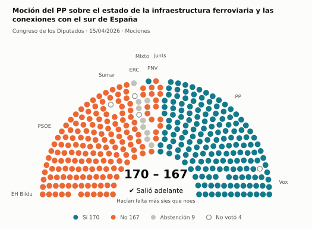
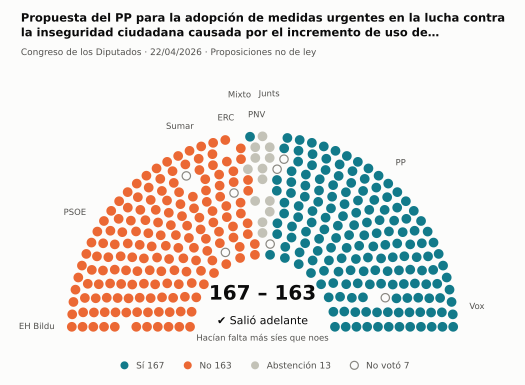
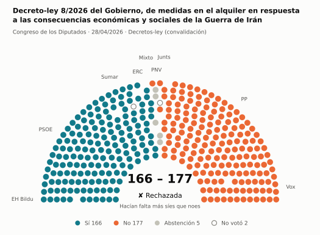
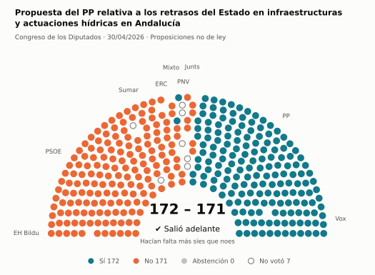
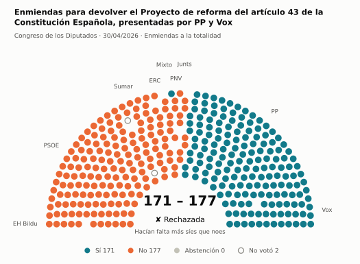
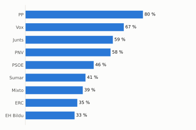
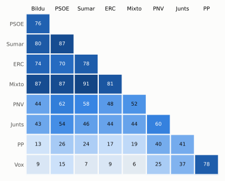

# Qué votó el Congreso en abril de 2026

Las votaciones del Pleno del Congreso de los Diputados, explicadas sin tecnicismos. Datos oficiales del [Congreso](https://www.congreso.es/es/opendata/votaciones); este resumen se actualiza solo cada mes (última vez: 10/11/2026).

## En pocas palabras

- El Congreso votó **54 veces** en 6 días de pleno. **34 propuestas salieron adelante** y 17 no; hubo además 3 empates, que se repiten.
- 10 votaciones fueron sobre leyes, decretos o presupuestos. Otras 41 fueron peticiones al Gobierno que no le obligan (proposiciones no de ley y mociones).
- El Gobierno (PSOE y Sumar) perdió **19** de las 41 votaciones en las que sus grupos votaron lo mismo.
- La votación más reñida se decidió por 1 voto: Propuesta del PSOE para documentar el "bibliocausto español" y reconocer el compromiso con la cultura de libreros, bibl….
- Los diputados casi siempre votan lo mismo que su grupo: en todo el mes solo hubo 14 votos distintos (sin contar el Grupo Mixto).

## Las votaciones más importantes del mes

Elegidas por su importancia: pesan más las leyes y los decretos que las peticiones al Gobierno, y suben las que se decidieron por pocos votos o las que perdió el Gobierno. Cada punto del dibujo es un diputado, colocado con su grupo, y el color es lo que votó.

### 1. Moción del PP sobre el estado de la infraestructura ferroviaria y las conexiones con el sur de España

**15 de abril · Mociones.** Petición al Gobierno después de pedirle explicaciones en el Pleno. Expresa la opinión del Congreso, pero no obliga.

<picture>
  <source media="(prefers-color-scheme: dark)" srcset="img/2026-04/votacion-L15-S172-V013-oscuro.svg">
  
</picture>

**✔ Salió adelante** por 3 votos: 170 a favor, 167 en contra y 9 abstenciones.

- **A favor:** PP y Vox
- **En contra:** PSOE, Sumar, Junts, EH Bildu y PNV
- **Se abstuvieron:** ERC
- **Repartidos:** Grupo Mixto (Sí 1, No 5, Abstención 2)

Este asunto tuvo 11 votaciones este mes; aquí se muestra la más disputada. [Datos oficiales](https://www.congreso.es/webpublica/opendata/votaciones/Leg15/Sesion172/20260415/Votacion013/VOT_20260415133922.json)

### 2. Propuesta del PP para la adopción de medidas urgentes en la lucha contra la inseguridad ciudadana causada por el incremento de uso de armas blancas

**22 de abril · Proposiciones no de ley.** Petición al Gobierno para que haga algo. Expresa la opinión del Congreso, pero no obliga.

<picture>
  <source media="(prefers-color-scheme: dark)" srcset="img/2026-04/votacion-L15-S174-V006-oscuro.svg">
  
</picture>

**✔ Salió adelante** por 4 votos: 167 a favor, 163 en contra y 13 abstenciones.

- **A favor:** PP y Vox
- **En contra:** PSOE, Sumar, ERC y EH Bildu
- **Se abstuvieron:** Junts y PNV
- **Repartidos:** Grupo Mixto (Sí 1, No 6, Abstención 1)

Este asunto tuvo 7 votaciones este mes; aquí se muestra la más disputada. [Datos oficiales](https://www.congreso.es/webpublica/opendata/votaciones/Leg15/Sesion174/20260422/Votacion006/VOT_20260422151951.json)

### 3. Decreto-ley 8/2026 del Gobierno, de medidas en el alquiler en respuesta a las consecuencias económicas y sociales de la Guerra de Irán

**28 de abril · Decretos-ley (convalidación).** El Gobierno aprobó esta norma por urgencia. Ya está en vigor, pero el Congreso tiene 30 días para confirmarla o tumbarla.

<picture>
  <source media="(prefers-color-scheme: dark)" srcset="img/2026-04/votacion-L15-S175-V003-oscuro.svg">
  
</picture>

**✘ No salió adelante** por 11 votos: 166 a favor, 177 en contra y 5 abstenciones.

- **A favor:** PSOE, Sumar, ERC y EH Bildu
- **En contra:** PP, Vox y Junts
- **Se abstuvieron:** PNV
- **Repartidos:** Grupo Mixto (Sí 7, No 1)

[Datos oficiales](https://www.congreso.es/webpublica/opendata/votaciones/Leg15/Sesion175/20260428/Votacion003/VOT_20260428200330.json)

### 4. Propuesta del PP relativa a los retrasos del Estado en infraestructuras y actuaciones hídricas en Andalucía

**30 de abril · Proposiciones no de ley.** Petición al Gobierno para que haga algo. Expresa la opinión del Congreso, pero no obliga.

<picture>
  <source media="(prefers-color-scheme: dark)" srcset="img/2026-04/votacion-L15-S177-V003-oscuro.svg">
  
</picture>

**✔ Salió adelante** por 1 voto: 172 a favor, 171 en contra y ninguna abstención.

- **A favor:** PP y Vox
- **En contra:** PSOE, Sumar, Junts, ERC y EH Bildu
- **Repartidos:** Grupo Mixto (Sí 2, No 6)

[Datos oficiales](https://www.congreso.es/webpublica/opendata/votaciones/Leg15/Sesion177/20260430/Votacion003/VOT_20260430125143.json)

### 5. Enmiendas para devolver el Proyecto de reforma del artículo 43 de la Constitución Española, presentadas por PP y Vox

**30 de abril · Enmiendas a la totalidad.** Un grupo intenta devolver la ley a quien la propuso o sustituirla por otra. Si no sale adelante, la ley sigue su camino.

<picture>
  <source media="(prefers-color-scheme: dark)" srcset="img/2026-04/votacion-L15-S177-V012-oscuro.svg">
  
</picture>

**✘ No salió adelante** por 6 votos: 171 a favor, 177 en contra y ninguna abstención.

- **A favor:** PP y Vox
- **En contra:** PSOE, Sumar, Junts, ERC, EH Bildu y PNV
- **Repartidos:** Grupo Mixto (Sí 1, No 7)

[Datos oficiales](https://www.congreso.es/webpublica/opendata/votaciones/Leg15/Sesion177/20260430/Votacion012/VOT_20260430125200.json)

## ¿Qué grupos votaron más veces lo que finalmente salió?

<picture>
  <source media="(prefers-color-scheme: dark)" srcset="img/2026-04/ganadora-oscuro.svg">
  
</picture>

Porcentaje de votaciones en que el grupo votó Sí y salió adelante, o votó No y no salió. Abstenerse no cuenta como acertar.

## ¿Quién vota con quién?

<picture>
  <source media="(prefers-color-scheme: dark)" srcset="img/2026-04/afinidad-oscuro.svg">
  
</picture>

Cada casilla dice en qué porcentaje de las votaciones dos grupos votaron lo mismo: 100 es que siempre coincidieron y 0 que nunca.

## ¿Qué tipo de cosas se votaron?

| Tipo | Votaciones | Salieron adelante | Qué es |
| --- | ---: | ---: | --- |
| Mociones | 26 | 16 | Petición al Gobierno después de pedirle explicaciones en el Pleno. Expresa la opinión del Congreso, pero no obliga. |
| Proposiciones no de ley | 15 | 11 | Petición al Gobierno para que haga algo. Expresa la opinión del Congreso, pero no obliga. |
| Leyes: toma en consideración | 6 | 2 | Primer paso de una ley propuesta por un grupo o una comunidad autónoma: el Congreso decide si empieza a tramitarla. |
| Tratados internacionales | 3 | 3 | El Congreso autoriza a España a comprometerse con un acuerdo con otro país u organismo. |
| Decretos-ley (convalidación) | 3 | 2 | El Gobierno aprobó esta norma por urgencia. Ya está en vigor, pero el Congreso tiene 30 días para confirmarla o tumbarla. |
| Enmiendas a la totalidad | 1 | 0 | Un grupo intenta devolver la ley a quien la propuso o sustituirla por otra. Si no sale adelante, la ley sigue su camino. |

## Palabras que conviene saber

- **Pleno**: La reunión de los 350 diputados, donde se vota.
- **Grupo parlamentario**: Los diputados de un partido o coalición. Los partidos pequeños van juntos en el Grupo Mixto, aunque no piensen igual.
- **Abstención**: El diputado vota, pero ni a favor ni en contra.
- **No votó**: El diputado no votó: no estaba, estaba de baja o el escaño estaba vacío.
- **Mayoría simple**: Salen adelante las votaciones con más síes que noes. Es lo normal.
- **Mayoría absoluta**: 176 votos a favor, la mitad más uno de 350. La piden las leyes orgánicas (derechos fundamentales, sistema electoral…) y la primera votación de investidura.
- **Votación por llamamiento**: Cada diputado dice su voto en voz alta. Se usa en las investiduras y otras votaciones importantes.

---

**¿Quieres más detalle?** El [análisis detallado](2026-04-detalle.md) tiene la cohesión de cada grupo, un mapa de los diputados según cómo votan, qué diputados votaron distinto de su grupo, las ausencias y la lista completa de votaciones.

_Los resultados están calculados a partir de los votos: el Congreso no publica si cada votación salió adelante. Este proyecto no tiene relación con el Congreso. Método en [docs/DOCUMENTO_FUNCIONAL.md](../docs/DOCUMENTO_FUNCIONAL.md)._
