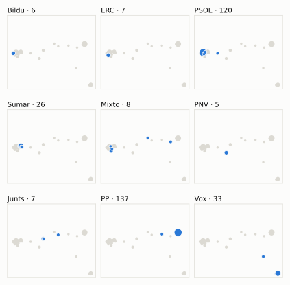
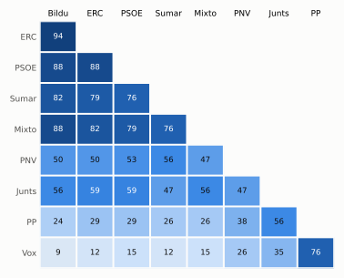
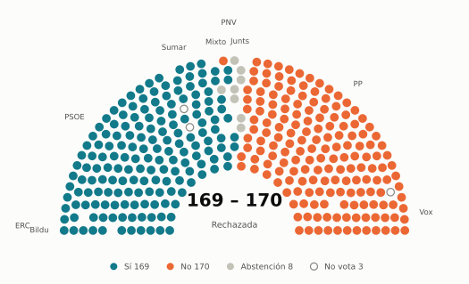
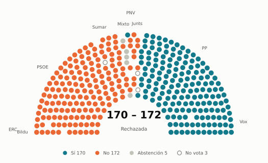

# Votaciones del Congreso: mayo de 2026

_Generado automáticamente el 2026-11-10 con datos abiertos del [Congreso de los Diputados](https://www.congreso.es/es/opendata/votaciones). Solo plenos y Diputación Permanente. Método y límites en [docs/DOCUMENTO_FUNCIONAL.md](../docs/DOCUMENTO_FUNCIONAL.md)._

## Resumen

- **34 votaciones** en 4 días de pleno (sesiones 179, 180, 181 y 183).
- **25 aprobadas** y **9 rechazadas**.
- 4 votaciones se decidieron por 5 votos o menos.
- El grupo que más veces votó con el resultado final: **PP** (74 % de las votaciones nominales).
- Los grupos del Gobierno (PSOE y Sumar) votaron lo mismo en 25 de 34 votaciones nominales y perdieron 8 de ellas.
- 5 votos individuales se apartaron de la posición de su grupo (5 diputados).

## Cómo votó cada grupo

| Grupo | Diputados | Cohesión | Votó con el resultado | Decisivo | Posición Sí | Posición No | Posición Abst. |
| --- | ---: | ---: | ---: | ---: | ---: | ---: | ---: |
| PP | 137 | 100 % | 74 % | 13 | 26 | 5 | 3 |
| PSOE | 121 | 100 % | 56 % | 6 | 18 | 13 | 3 |
| Vox | 33 | 100 % | 59 % | 11 | 21 | 12 | 1 |
| Sumar | 26 | 99 % | 53 % | 6 | 17 | 13 | 4 |
| Mixto | 8 | 69 % | 47 % | 2 | 16 | 16 | 2 |
| Junts | 7 | 100 % | 71 % | 3 | 17 | 12 | 5 |
| ERC | 7 | 100 % | 50 % | 4 | 16 | 15 | 3 |
| Bildu | 6 | 100 % | 50 % | 2 | 16 | 15 | 3 |
| PNV | 5 | 100 % | 56 % | 1 | 17 | 6 | 11 |

*Cohesión*: índice de acuerdo interno (100 % = todo el grupo votó igual). *Votó con el resultado*: el grupo votó Sí y salió aprobada, o No y salió rechazada. *Decisivo*: votaciones cuyo resultado habría cambiado si el grupo se hubiera abstenido en bloque. El Grupo Mixto reúne partidos distintos: su posición es la de su mayoría.

## Mapa de diputados

<picture>
  <source media="(prefers-color-scheme: dark)" srcset="img/2026-05/mapa-oscuro.svg">
  
</picture>

Cada punto es un diputado; dos diputados están cerca si votaron parecido. Un punto más grande reúne a varios que votaron exactamente igual. En cada panel, el grupo en azul y el resto del Congreso en gris.

*Cómo se calcula*: componentes principales de los votos (Sí, No, abstención) en 31 votaciones con algún desacuerdo. El eje horizontal recoge el 85 % de la variación y el vertical el 7 %. Los ejes no tienen nombre ni sentido político propio; por convención, el PP queda a la derecha. No se sitúa a 1 diputado que votó en menos de la mitad.

## Afinidad entre grupos

<picture>
  <source media="(prefers-color-scheme: dark)" srcset="img/2026-05/afinidad-oscuro.svg">
  
</picture>

Porcentaje de votaciones nominales en que los dos grupos tomaron la misma posición. Los grupos están ordenados según el mapa de diputados.

Ver la tabla

|  | PP | PSOE | Vox | Sumar | Mixto | Junts | ERC | Bildu | PNV |
| --- | :---: | :---: | :---: | :---: | :---: | :---: | :---: | :---: | :---: |
| PP | 100 % | 29 % | 76 % | 26 % | 26 % | 56 % | 29 % | 24 % | 38 % |
| PSOE | 29 % | 100 % | 15 % | 76 % | 79 % | 59 % | 88 % | 88 % | 53 % |
| Vox | 76 % | 15 % | 100 % | 12 % | 15 % | 35 % | 12 % | 9 % | 26 % |
| Sumar | 26 % | 76 % | 12 % | 100 % | 76 % | 47 % | 79 % | 82 % | 56 % |
| Mixto | 26 % | 79 % | 15 % | 76 % | 100 % | 56 % | 82 % | 88 % | 47 % |
| Junts | 56 % | 59 % | 35 % | 47 % | 56 % | 100 % | 59 % | 56 % | 47 % |
| ERC | 29 % | 88 % | 12 % | 79 % | 82 % | 59 % | 100 % | 94 % | 50 % |
| Bildu | 24 % | 88 % | 9 % | 82 % | 88 % | 56 % | 94 % | 100 % | 50 % |
| PNV | 38 % | 53 % | 26 % | 56 % | 47 % | 47 % | 50 % | 50 % | 100 % |

## Quién sacó adelante las votaciones

| Grupos que votaron Sí | Votaciones | Escaños |
| --- | ---: | ---: |
| PP + Vox | 3 | 170 |
| PP + PSOE + Sumar + Mixto + Junts + ERC + Bildu + PNV | 3 | 317 |
| PP + Vox + Junts | 3 | 177 |
| Todos los grupos | 3 | 350 |
| PP + PSOE + Sumar + Mixto + Junts + ERC + Bildu | 2 | 312 |
| PP + Vox + Junts + PNV | 2 | 182 |
| PSOE + Sumar + Mixto + Junts + ERC + Bildu | 1 | 175 |
| PP + PSOE + Vox + ERC + PNV | 1 | 303 |

De 25 votaciones nominales aprobadas. Otras 7 salieron con combinaciones que se dieron menos veces. La posición de cada grupo es la de la mayoría de sus diputados.

## Votaciones que perdieron los grupos del Gobierno

| Fecha | Asunto | Tipo | PSOE y Sumar votaron | Resultado | Sí | No |
| --- | --- | --- | :---: | --- | ---: | ---: |
| 19 de mayo | Proposición de Ley del Grupo Parlamentario Popular en el Congreso, Orgánica contra la ocupación ilegal de inmuebles y para la convivencia vecinal y la protecci… | Leyes: toma en consideración | No | Aprobada | 171 | 164 |
| 20 de mayo | Proposición no de Ley del Grupo Parlamentario Socialista, relativa al parque público de vivienda y al refuerzo de la transparencia y los mecanismos de control… *(Votación separada por puntos. Resto de la Proposición no de…)* | Proposiciones no de ley | Sí | Rechazada | 164 | 175 |
| 20 de mayo | Proposición no de Ley del Grupo Parlamentario Plurinacional SUMAR, para frenar la especulación inmobiliaria y garantizar el acceso a una vivienda digna. Se vot… | Proposiciones no de ley | Sí | Rechazada | 169 | 170 |
| 20 de mayo | Moción consecuencia de interpelación urgente del Grupo Parlamentario Mixto (Sra. Belarra Urteaga), referida a la política del Gobierno en materia educativa. Se… | Mociones | Sí | Rechazada | 169 | 170 |
| 20 de mayo | Moción consecuencia de interpelación urgente del Grupo Parlamentario Popular en el Congreso, sobre las políticas en materia de vivienda de este Gobierno. *(Votación separada por puntos. Punto 1.)* | Mociones | No | Aprobada | 178 | 164 |
| 20 de mayo | Moción consecuencia de interpelación urgente del Grupo Parlamentario Popular en el Congreso, sobre las políticas en materia de vivienda de este Gobierno. *(Votación separada por puntos. Punto 3.)* | Mociones | No | Aprobada | 177 | 169 |
| 20 de mayo | Moción consecuencia de interpelación urgente del Grupo Parlamentario Popular en el Congreso, sobre las políticas en materia de vivienda de este Gobierno. *(Votación separada por puntos. Punto 4.)* | Mociones | No | Aprobada | 183 | 162 |
| 26 de mayo | Proposición de Ley del Grupo Parlamentario Plurinacional SUMAR, para la promoción del consumo de alimentos y bebidas saludables. | Leyes: toma en consideración | Sí | Rechazada | 166 | 178 |

Además, PSOE y Sumar votaron distinto entre sí en 8 votaciones.

## Votaciones más ajustadas

**20 de mayo** · Proposición no de Ley del Grupo Parlamentario Plurinacional SUMAR, para frenar la especulación inmobiliaria y garantizar el acceso a una vivienda digna. Se vot…

<picture>
  <source media="(prefers-color-scheme: dark)" srcset="img/2026-05/hemiciclo-L15-S180-V005-oscuro.svg">
  
</picture>

**20 de mayo** · Moción consecuencia de interpelación urgente del Grupo Parlamentario Mixto (Sra. Belarra Urteaga), referida a la política del Gobierno en materia educativa. Se…

<picture>
  <source media="(prefers-color-scheme: dark)" srcset="img/2026-05/hemiciclo-L15-S180-V006-oscuro.svg">
  
</picture>

**28 de mayo** · Moción consecuencia de interpelación urgente del Grupo Parlamentario Popular en el Congreso, sobre la situación de las Fuerzas y Cuerpos de Seguridad del Estad… *(Votación separada por puntos. Punto 3.)*

<picture>
  <source media="(prefers-color-scheme: dark)" srcset="img/2026-05/hemiciclo-L15-S183-V005-oscuro.svg">
  
</picture>

**28 de mayo** · Moción consecuencia de interpelación urgente del Grupo Parlamentario Popular en el Congreso, sobre la situación de las Fuerzas y Cuerpos de Seguridad del Estad… *(Votación separada por puntos. Punto 1.)*

<picture>
  <source media="(prefers-color-scheme: dark)" srcset="img/2026-05/hemiciclo-L15-S183-V003-oscuro.svg">
  
</picture>

Cada punto es un escaño, agrupado por grupo parlamentario; el color es su voto.

| Fecha | Asunto | Resultado | Sí | No | Abst. |
| --- | --- | :---: | ---: | ---: | ---: |
| 20 de mayo | Proposición no de Ley del Grupo Parlamentario Plurinacional SUMAR, para frenar la especulación inmobiliaria y garantizar el acceso a una vivienda digna. Se vot… | Rechazada | 169 | 170 | 8 |
| 20 de mayo | Moción consecuencia de interpelación urgente del Grupo Parlamentario Mixto (Sra. Belarra Urteaga), referida a la política del Gobierno en materia educativa. Se… | Rechazada | 169 | 170 | 8 |
| 28 de mayo | Moción consecuencia de interpelación urgente del Grupo Parlamentario Popular en el Congreso, sobre la situación de las Fuerzas y Cuerpos de Seguridad del Estad… *(Votación separada por puntos. Punto 3.)* | Rechazada | 170 | 171 | 6 |
| 28 de mayo | Moción consecuencia de interpelación urgente del Grupo Parlamentario Popular en el Congreso, sobre la situación de las Fuerzas y Cuerpos de Seguridad del Estad… *(Votación separada por puntos. Punto 1.)* | Rechazada | 170 | 172 | 5 |
| 28 de mayo | Moción consecuencia de interpelación urgente del Grupo Parlamentario Popular en el Congreso, sobre la situación de las Fuerzas y Cuerpos de Seguridad del Estad… *(Votación separada por puntos. Punto 7.)* | Rechazada | 170 | 176 | 1 |
| 19 de mayo | Proposición de Ley del Grupo Parlamentario Popular en el Congreso, Orgánica contra la ocupación ilegal de inmuebles y para la convivencia vecinal y la protecci… | Aprobada | 171 | 164 | 11 |
| 26 de mayo | Proposición del Sr. Álvaro Vidal y otros 20 Diputados, de reforma del Reglamento del Congreso. | Aprobada | 178 | 171 | 0 |
| 28 de mayo | Moción consecuencia de interpelación urgente del Grupo Parlamentario VOX, sobre las medidas del Gobierno para resolver los problemas de la justicia en España. | Rechazada | 170 | 177 | 0 |
| 28 de mayo | Moción consecuencia de interpelación urgente Grupo Parlamentario VOX, sobre cuál va a ser la prioridad del Gobierno en materia de seguridad. | Rechazada | 169 | 176 | 0 |
| 20 de mayo | Moción consecuencia de interpelación urgente del Grupo Parlamentario Popular en el Congreso, sobre las políticas en materia de vivienda de este Gobierno. *(Votación separada por puntos. Punto 3.)* | Aprobada | 177 | 169 | 1 |

Votaciones decididas por 10 votos o menos (o a esa distancia de la mayoría que exigían). Las públicas por llamamiento no tienen hemiciclo: el voto de cada diputado solo consta en el Diario de Sesiones.

## Qué se votó, por tipo de asunto

| Tipo de asunto | Votaciones | Aprobadas | No aprobadas |
| --- | ---: | ---: | ---: |
| Mociones | 15 | 9 | 6 |
| Proposiciones no de ley | 7 | 5 | 2 |
| Leyes: toma en consideración | 5 | 4 | 1 |
| Decretos-ley (convalidación) | 4 | 4 | 0 |
| Organización de la Cámara | 2 | 2 | 0 |
| Leyes: dictamen y votación final | 1 | 1 | 0 |

Las proposiciones no de ley y las mociones expresan la posición del Congreso pero no obligan al Gobierno. Las leyes pasan por varias votaciones (toma en consideración, totalidad, dictamen, Senado), así que una misma ley puede aparecer varias veces.

## Votos distintos de su grupo

| Diputado | Grupo | Votos distintos de su grupo |
| --- | --- | ---: |
| Canelo Matito, Andrea | PSOE | 1 |
| Gil de Reboleño Lastortres, Esther | Sumar | 1 |
| Ogou i Corbi, Viviane | Sumar | 1 |
| Pisarello Prados, Gerardo | Sumar | 1 |
| Santiago Romero, Enrique Fernando | Sumar | 1 |

Un voto aislado puede ser un error al pulsar, no una decisión política: el Congreso no publica las correcciones. Se excluye el Grupo Mixto.

## Diputados que más veces no votaron

| Diputado | Grupo | No votó | % de votaciones |
| --- | --- | ---: | ---: |
| Montero Cuadrado, María Jesús | PSOE | 34 | 100 % |
| Nogueras i Camero, Míriam | Junts | 16 | 47 % |
| Sánchez Pérez-Castejón, Pedro | PSOE | 15 | 44 % |
| Hernando Fraile, Rafael Antonio | PP | 14 | 41 % |
| Figaredo Álvarez-Sala, José María | Vox | 13 | 38 % |
| Núñez Feijóo, Alberto | PP | 2 | 6 % |
| Pisarello Prados, Gerardo | Sumar | 2 | 6 % |
| Boada Danés, Júlia | Sumar | 1 | 3 % |
| Cantalapiedra Álvarez, María de las Mercedes | PP | 1 | 3 % |
| Cruz Santana, Gabriel | PSOE | 1 | 3 % |
| Díaz Pérez, Yolanda | Sumar | 1 | 3 % |
| Gavin i Valls, Isidre | Junts | 1 | 3 % |
| Hoces Íñiguez, Ignacio | Vox | 1 | 3 % |
| Ogou i Corbi, Viviane | Sumar | 1 | 3 % |
| Otero García, Mercedes | PSOE | 1 | 3 % |

«No vota» incluye ausencias justificadas (baja, maternidad o paternidad) y escaños vacantes; el portal no las distingue.

## Todas las votaciones

Posición de cada grupo: la opción que votó la mayoría de sus diputados (*Div.*: empate dentro del grupo). El número enlaza al JSON oficial o, en las votaciones por llamamiento, al Diario de Sesiones.

### 19 de mayo (sesión 179)

| Nº | Asunto | Resultado | Sí | No | Abst. | PP | PSOE | Vox | Sumar | Mixto | Junts | ERC | Bildu | PNV | Decisivos |
| ---: | --- | --- | ---: | ---: | ---: | :---: | :---: | :---: | :---: | :---: | :---: | :---: | :---: | :---: | --- |
| [1](https://www.congreso.es/webpublica/opendata/votaciones/Leg15/Sesion179/20260519/Votacion001/VOT_20260519203502.json) | Proposición de Ley del Grupo Parlamentario Popular en el Congreso, Orgánica contra la ocupación ilegal de inmuebles y para la convivencia vecinal y la protecci… | Aprobada | 171 | 164 | 11 | Sí | No | Sí | No | No | Abst. | No | No | Abst. | PP, Vox |
| [2](https://www.congreso.es/webpublica/opendata/votaciones/Leg15/Sesion179/20260519/Votacion002/VOT_20260519203504.json) | Proposición de Ley del Grupo Parlamentario Socialista, Orgánica para la modificación de la Ley Orgánica 5/1985, de 19 de junio, del Régimen Electoral General. | Aprobada | 313 | 33 | 1 | Sí | Sí | No | Sí | Sí | Sí | Sí | Sí | Sí |  |

### 20 de mayo (sesión 180)

| Nº | Asunto | Resultado | Sí | No | Abst. | PP | PSOE | Vox | Sumar | Mixto | Junts | ERC | Bildu | PNV | Decisivos |
| ---: | --- | --- | ---: | ---: | ---: | :---: | :---: | :---: | :---: | :---: | :---: | :---: | :---: | :---: | --- |
| [1](https://www.congreso.es/webpublica/opendata/votaciones/Leg15/Sesion180/20260520/Votacion001/VOT_20260520142319.json) | Proposición no de Ley del Grupo Parlamentario Socialista, relativa al parque público de vivienda y al refuerzo de la transparencia y los mecanismos de control… *(Votación separada por puntos. Punto 2.)* | Aprobada | 173 | 32 | 142 | Abst. | Sí | No | Sí | Sí | Sí | Sí | Sí | Abst. |  |
| [2](https://www.congreso.es/webpublica/opendata/votaciones/Leg15/Sesion180/20260520/Votacion002/VOT_20260520142321.json) | Proposición no de Ley del Grupo Parlamentario Socialista, relativa al parque público de vivienda y al refuerzo de la transparencia y los mecanismos de control… *(Votación separada por puntos. Punto 3.)* | Aprobada | 310 | 32 | 5 | Sí | Sí | No | Sí | Sí | Sí | Sí | Sí | Abst. |  |
| [3](https://www.congreso.es/webpublica/opendata/votaciones/Leg15/Sesion180/20260520/Votacion003/VOT_20260520142323.json) | Proposición no de Ley del Grupo Parlamentario Socialista, relativa al parque público de vivienda y al refuerzo de la transparencia y los mecanismos de control… *(Votación separada por puntos. Punto 7.)* | Aprobada | 310 | 32 | 5 | Sí | Sí | No | Sí | Sí | Sí | Sí | Sí | Abst. |  |
| [4](https://www.congreso.es/webpublica/opendata/votaciones/Leg15/Sesion180/20260520/Votacion004/VOT_20260520142324.json) | Proposición no de Ley del Grupo Parlamentario Socialista, relativa al parque público de vivienda y al refuerzo de la transparencia y los mecanismos de control… *(Votación separada por puntos. Resto de la Proposición no de…)* | Rechazada | 164 | 175 | 7 | No | Sí | No | Sí | Sí | No | Sí | Sí | Abst. | PP, Vox |
| [5](https://www.congreso.es/webpublica/opendata/votaciones/Leg15/Sesion180/20260520/Votacion005/VOT_20260520142326.json) | Proposición no de Ley del Grupo Parlamentario Plurinacional SUMAR, para frenar la especulación inmobiliaria y garantizar el acceso a una vivienda digna. Se vot… | Rechazada | 169 | 170 | 8 | No | Sí | No | Sí | Sí | Abst. | Sí | Sí | Sí | PP, Vox |
| [6](https://www.congreso.es/webpublica/opendata/votaciones/Leg15/Sesion180/20260520/Votacion006/VOT_20260520142328.json) | Moción consecuencia de interpelación urgente del Grupo Parlamentario Mixto (Sra. Belarra Urteaga), referida a la política del Gobierno en materia educativa. Se… | Rechazada | 169 | 170 | 8 | No | Sí | No | Sí | Sí | Abst. | Sí | Sí | Sí | PP, Vox |
| [7](https://www.congreso.es/webpublica/opendata/votaciones/Leg15/Sesion180/20260520/Votacion007/VOT_20260520142329.json) | Moción consecuencia de interpelación urgente del Grupo Parlamentario Popular en el Congreso, sobre las políticas en materia de vivienda de este Gobierno. *(Votación separada por puntos. Punto 1.)* | Aprobada | 178 | 164 | 5 | Sí | No | Sí | No | No | Sí | No | No | Abst. | PP, Vox |
| [8](https://www.congreso.es/webpublica/opendata/votaciones/Leg15/Sesion180/20260520/Votacion008/VOT_20260520142331.json) | Moción consecuencia de interpelación urgente del Grupo Parlamentario Popular en el Congreso, sobre las políticas en materia de vivienda de este Gobierno. *(Votación separada por puntos. Punto 2.)* | Aprobada | 178 | 48 | 120 | Sí | Abst. | Sí | No | No | Sí | No | No | No | PP |
| [9](https://www.congreso.es/webpublica/opendata/votaciones/Leg15/Sesion180/20260520/Votacion009/VOT_20260520142333.json) | Moción consecuencia de interpelación urgente del Grupo Parlamentario Popular en el Congreso, sobre las políticas en materia de vivienda de este Gobierno. *(Votación separada por puntos. Punto 3.)* | Aprobada | 177 | 169 | 1 | Sí | No | Sí | No | No | Sí | No | No | No | PP, Vox |
| [10](https://www.congreso.es/webpublica/opendata/votaciones/Leg15/Sesion180/20260520/Votacion010/VOT_20260520142334.json) | Moción consecuencia de interpelación urgente del Grupo Parlamentario Popular en el Congreso, sobre las políticas en materia de vivienda de este Gobierno. *(Votación separada por puntos. Punto 4.)* | Aprobada | 183 | 162 | 2 | Sí | No | Sí | No | No | Sí | No | No | Sí | PP, Vox |
| [11](https://www.congreso.es/webpublica/opendata/votaciones/Leg15/Sesion180/20260520/Votacion011/VOT_20260520142336.json) | Moción consecuencia de interpelación urgente del Grupo Parlamentario Popular en el Congreso, sobre las políticas en materia de vivienda de este Gobierno. *(Votación separada por puntos. Punto 5.)* | Aprobada | 183 | 45 | 119 | Sí | Abst. | Sí | No | No | Sí | No | No | Sí |  |
| [12](https://www.congreso.es/webpublica/opendata/votaciones/Leg15/Sesion180/20260520/Votacion012/VOT_20260520142337.json) | Real Decreto-ley 10/2026, de 28 de abril, por el que se aprueban medidas tributarias urgentes y otras medidas de apoyo en respuesta a los daños causados a las… | Aprobada | 315 | 0 | 32 | Sí | Sí | Abst. | Sí | Sí | Sí | Sí | Sí | Sí |  |
| [13](https://www.congreso.es/webpublica/opendata/votaciones/Leg15/Sesion180/20260520/Votacion013/VOT_20260520142338.json) | Tramitación como Proyecto de Ley por el procedimiento de urgencia del Real Decreto-ley 10/2026, de 28 de abril, por el que se aprueban medidas tributarias urge… | Aprobada | 347 | 0 | 0 | Sí | Sí | Sí | Sí | Sí | Sí | Sí | Sí | Sí |  |

### 26 de mayo (sesión 181)

| Nº | Asunto | Resultado | Sí | No | Abst. | PP | PSOE | Vox | Sumar | Mixto | Junts | ERC | Bildu | PNV | Decisivos |
| ---: | --- | --- | ---: | ---: | ---: | :---: | :---: | :---: | :---: | :---: | :---: | :---: | :---: | :---: | --- |
| [1](https://www.congreso.es/webpublica/opendata/votaciones/Leg15/Sesion181/20260526/Votacion001/VOT_20260526210640.json) | Proposición de Ley del Grupo Parlamentario Plurinacional SUMAR, para la promoción del consumo de alimentos y bebidas saludables. | Rechazada | 166 | 178 | 5 | No | Sí | No | Sí | Sí | No | Sí | Sí | Abst. | PP, Vox |
| [2](https://www.congreso.es/webpublica/opendata/votaciones/Leg15/Sesion181/20260526/Votacion002/VOT_20260526210642.json) | Proposición de Ley del Grupo Parlamentario Popular en el Congreso, de modificación de la Ley 49/1960, de 21 de julio, sobre propiedad horizontal. | Aprobada | 306 | 33 | 10 | Sí | Sí | Sí | No | Abst. | No | Sí | Abst. | Sí |  |
| [3](https://www.congreso.es/webpublica/opendata/votaciones/Leg15/Sesion181/20260526/Votacion003/VOT_20260526210644.json) | Proposición del Sr. Álvaro Vidal y otros 20 Diputados, de reforma del Reglamento del Congreso. | Aprobada | 178 | 171 | 0 | No | Sí | No | Sí | Sí | Sí | Sí | Sí | Sí | Junts, Mixto, ERC, PSOE, Sumar |

### 28 de mayo (sesión 183)

| Nº | Asunto | Resultado | Sí | No | Abst. | PP | PSOE | Vox | Sumar | Mixto | Junts | ERC | Bildu | PNV | Decisivos |
| ---: | --- | --- | ---: | ---: | ---: | :---: | :---: | :---: | :---: | :---: | :---: | :---: | :---: | :---: | --- |
| [1](https://www.congreso.es/webpublica/opendata/votaciones/Leg15/Sesion183/20260528/Votacion001/VOT_20260528125334.json) | Proposición no de Ley del Grupo Parlamentario Popular en el Congreso, para la eliminación de la cita previa en las oficinas de la Administración General del Es… | Aprobada | 186 | 2 | 159 | Sí | Abst. | Sí | Abst. | Sí | Sí | Abst. | Abst. | Sí |  |
| [2](https://www.congreso.es/webpublica/opendata/votaciones/Leg15/Sesion183/20260528/Votacion002/VOT_20260528125336.json) | Proposición no de Ley del Grupo Parlamentario Socialista, sobre el 40 Aniversario de España en la Unión Europea. Se vota en los términos de la enmienda transac… | Aprobada | 163 | 37 | 143 | Abst. | Sí | No | Sí | No | Abst. | Sí | Sí | Sí |  |
| [3](https://www.congreso.es/webpublica/opendata/votaciones/Leg15/Sesion183/20260528/Votacion003/VOT_20260528125337.json) | Moción consecuencia de interpelación urgente del Grupo Parlamentario Popular en el Congreso, sobre la situación de las Fuerzas y Cuerpos de Seguridad del Estad… *(Votación separada por puntos. Punto 1.)* | Rechazada | 170 | 172 | 5 | Sí | No | Sí | No | Abst. | No | No | No | No | Bildu, Junts, ERC, PSOE, Sumar, PNV |
| [4](https://www.congreso.es/webpublica/opendata/votaciones/Leg15/Sesion183/20260528/Votacion004/VOT_20260528125339.json) | Moción consecuencia de interpelación urgente del Grupo Parlamentario Popular en el Congreso, sobre la situación de las Fuerzas y Cuerpos de Seguridad del Estad… *(Votación separada por puntos. Punto 2.)* | Aprobada | 170 | 146 | 30 | Sí | No | Sí | Abst. | No | No | No | No | Abst. | PP, Vox |
| [5](https://www.congreso.es/webpublica/opendata/votaciones/Leg15/Sesion183/20260528/Votacion005/VOT_20260528125340.json) | Moción consecuencia de interpelación urgente del Grupo Parlamentario Popular en el Congreso, sobre la situación de las Fuerzas y Cuerpos de Seguridad del Estad… *(Votación separada por puntos. Punto 3.)* | Rechazada | 170 | 171 | 6 | Sí | No | Sí | No | No | No | No | No | Abst. | Bildu, Junts, Mixto, ERC, PSOE, Sumar |
| [6](https://www.congreso.es/webpublica/opendata/votaciones/Leg15/Sesion183/20260528/Votacion006/VOT_20260528125341.json) | Moción consecuencia de interpelación urgente del Grupo Parlamentario Popular en el Congreso, sobre la situación de las Fuerzas y Cuerpos de Seguridad del Estad… *(Votación separada por puntos. Punto 4.)* | Aprobada | 196 | 145 | 5 | Sí | No | Sí | Sí | No | No | No | No | Abst. | PP |
| [7](https://www.congreso.es/webpublica/opendata/votaciones/Leg15/Sesion183/20260528/Votacion007/VOT_20260528125343.json) | Moción consecuencia de interpelación urgente del Grupo Parlamentario Popular en el Congreso, sobre la situación de las Fuerzas y Cuerpos de Seguridad del Estad… *(Votación separada por puntos. Punto 5.)* | Aprobada | 171 | 145 | 31 | Sí | No | Sí | Abst. | No | No | No | No | Abst. | PP, Vox |
| [8](https://www.congreso.es/webpublica/opendata/votaciones/Leg15/Sesion183/20260528/Votacion008/VOT_20260528125345.json) | Moción consecuencia de interpelación urgente del Grupo Parlamentario Popular en el Congreso, sobre la situación de las Fuerzas y Cuerpos de Seguridad del Estad… *(Votación separada por puntos. Punto 6.)* | Aprobada | 174 | 145 | 27 | Sí | No | Sí | Abst. | No | No | No | No | Sí | PP, Vox |
| [9](https://www.congreso.es/webpublica/opendata/votaciones/Leg15/Sesion183/20260528/Votacion009/VOT_20260528125346.json) | Moción consecuencia de interpelación urgente del Grupo Parlamentario Popular en el Congreso, sobre la situación de las Fuerzas y Cuerpos de Seguridad del Estad… *(Votación separada por puntos. Punto 7.)* | Rechazada | 170 | 176 | 1 | Sí | No | Sí | No | No | No | No | No | No | ERC, PSOE, Sumar |
| [10](https://www.congreso.es/webpublica/opendata/votaciones/Leg15/Sesion183/20260528/Votacion010/VOT_20260528125347.json) | Moción consecuencia de interpelación urgente del Grupo Parlamentario VOX, sobre las medidas del Gobierno para resolver los problemas de la justicia en España. | Rechazada | 170 | 177 | 0 | Sí | No | Sí | No | No | No | No | No | No | PSOE, Sumar |
| [11](https://www.congreso.es/webpublica/opendata/votaciones/Leg15/Sesion183/20260528/Votacion011/VOT_20260528125348.json) | Moción consecuencia de interpelación urgente Grupo Parlamentario VOX, sobre cuál va a ser la prioridad del Gobierno en materia de seguridad. | Rechazada | 169 | 176 | 0 | Sí | No | Sí | No | No | No | No | No | No | PSOE, Sumar |
| [12](https://www.congreso.es/webpublica/opendata/votaciones/Leg15/Sesion183/20260528/Votacion012/VOT_20260528125351.json) | Real Decreto-ley 11/2026, de 12 de mayo, por el que se modifica la aportación de los usuarios y sus beneficiarios en la prestación farmacéutica ambulatoria. | Aprobada | 164 | 33 | 149 | Abst. | Sí | No | Sí | Sí | Abst. | Abst. | Sí | Sí |  |
| [13](https://www.congreso.es/webpublica/opendata/votaciones/Leg15/Sesion183/20260528/Votacion013/VOT_20260528125353.json) | Tramitación como Proyecto de Ley por el procedimiento de urgencia del Real Decreto-ley 11/2026, de 12 de mayo, por el que se modifica la aportación de los usua… | Aprobada | 347 | 0 | 0 | Sí | Sí | Sí | Sí | Sí | Sí | Sí | Sí | Sí |  |
| [14](https://www.congreso.es/webpublica/opendata/votaciones/Leg15/Sesion183/20260528/Votacion014/VOT_20260528125355.json) | Dictamen de la Comisión del Estatuto sobre declaración de actividades de Excmos. Sres. Diputados. | Aprobada | 343 | 0 | 0 | Sí | Sí | Sí | Sí | Sí | Sí | Sí | Sí | Sí |  |
| [15](https://www.congreso.es/webpublica/opendata/votaciones/Leg15/Sesion183/20260528/Votacion015/VOT_20260528125356.json) | Propuesta de la Comisión Constitucional, de creación de una Subcomisión al objeto de analizar la eventual adopción de medidas legislativas relativas al uso de… | Aprobada | 303 | 31 | 14 | Sí | Sí | Sí | No | No | Sí | Abst. | Abst. | Sí |  |
| [16](https://www.congreso.es/webpublica/opendata/votaciones/Leg15/Sesion183/20260528/Votacion016/VOT_20260528125358.json) | Acuerdo de tramitación directa y en lectura única de la Proposición de Ley Orgánica para la modificación de la Ley Orgánica 5/1985, de 19 de junio, del Régimen… | Aprobada | 313 | 33 | 1 | Sí | Sí | No | Sí | Sí | Sí | Sí | Sí | Sí |  |
