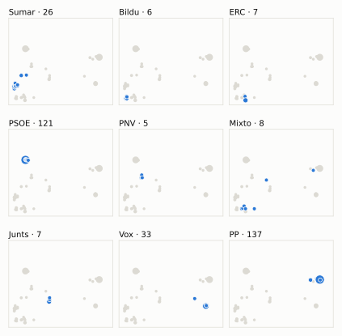
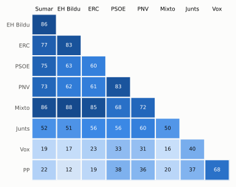

# Análisis detallado: junio de 2026

[← Volver al resumen del mes](2026-06.md)

_Generado automáticamente el 2026-11-10 con datos abiertos del [Congreso de los Diputados](https://www.congreso.es/es/opendata/votaciones). Solo plenos y Diputación Permanente. Método y límites en [docs/DOCUMENTO_FUNCIONAL.md](../docs/DOCUMENTO_FUNCIONAL.md)._

## Resumen

- **103 votaciones** en 5 días de pleno (sesiones 185, 186, 188, 189 y 191).
- **52 aprobadas** y **49 rechazadas**, más 2 empates que obligaron a repetir.
- 16 votaciones se decidieron por 5 votos o menos.
- El grupo que más veces votó con el resultado final: **PSOE** (77 % de las votaciones nominales).
- Los grupos del Gobierno (PSOE y Sumar) votaron lo mismo en 77 de 103 votaciones nominales y perdieron 15 de ellas.
- 21 votos individuales se apartaron de la posición de su grupo (18 diputados).

## Cómo votó cada grupo

| Grupo | Diputados | Cohesión | Votó con el resultado | Decisivo | Posición Sí | Posición No | Posición Abst. |
| --- | ---: | ---: | ---: | ---: | ---: | ---: | ---: |
| PP | 137 | 100 % | 61 % | 17 | 56 | 35 | 12 |
| PSOE | 121 | 100 % | 77 % | 30 | 32 | 62 | 9 |
| Vox | 33 | 100 % | 54 % | 14 | 46 | 49 | 8 |
| Sumar | 26 | 99 % | 61 % | 21 | 48 | 54 | 1 |
| Mixto | 8 | 73 % | 59 % | 12 | 50 | 39 | 5 |
| Junts | 7 | 100 % | 65 % | 10 | 41 | 37 | 25 |
| ERC | 7 | 100 % | 57 % | 12 | 57 | 40 | 6 |
| EH Bildu | 6 | 100 % | 50 % | 11 | 46 | 49 | 8 |
| PNV | 5 | 99 % | 73 % | 11 | 41 | 51 | 11 |

*Cohesión*: índice de acuerdo interno (100 % = todo el grupo votó igual). *Votó con el resultado*: el grupo votó Sí y salió aprobada, o No y salió rechazada. *Decisivo*: votaciones cuyo resultado habría cambiado si el grupo se hubiera abstenido en bloque. El Grupo Mixto reúne partidos distintos: su posición es la de su mayoría.

## Mapa de diputados

<picture>
  <source media="(prefers-color-scheme: dark)" srcset="img/2026-06/mapa-oscuro.svg">
  
</picture>

Cada punto es un diputado; dos diputados están cerca si votaron parecido. Un punto más grande reúne a varios que votaron exactamente igual. En cada panel, el grupo en azul y el resto del Congreso en gris.

*Cómo se calcula*: componentes principales de los votos (Sí, No, abstención) en 101 votaciones con algún desacuerdo. El eje horizontal recoge el 74 % de la variación y el vertical el 11 %. Los ejes no tienen nombre ni sentido político propio; por convención, el PP queda a la derecha.

## Afinidad entre grupos

<picture>
  <source media="(prefers-color-scheme: dark)" srcset="img/2026-06/afinidad-oscuro.svg">
  
</picture>

Porcentaje de votaciones nominales en que los dos grupos tomaron la misma posición. Los grupos están ordenados según el mapa de diputados.

Ver la tabla

|  | PP | PSOE | Vox | Sumar | Mixto | Junts | ERC | EH Bildu | PNV |
| --- | :---: | :---: | :---: | :---: | :---: | :---: | :---: | :---: | :---: |
| PP | 100 % | 38 % | 68 % | 22 % | 20 % | 37 % | 19 % | 12 % | 36 % |
| PSOE | 38 % | 100 % | 33 % | 75 % | 68 % | 56 % | 60 % | 63 % | 83 % |
| Vox | 68 % | 33 % | 100 % | 19 % | 16 % | 40 % | 23 % | 17 % | 31 % |
| Sumar | 22 % | 75 % | 19 % | 100 % | 86 % | 52 % | 77 % | 86 % | 73 % |
| Mixto | 20 % | 68 % | 16 % | 86 % | 100 % | 50 % | 85 % | 88 % | 72 % |
| Junts | 37 % | 56 % | 40 % | 52 % | 50 % | 100 % | 56 % | 51 % | 60 % |
| ERC | 19 % | 60 % | 23 % | 77 % | 85 % | 56 % | 100 % | 83 % | 61 % |
| EH Bildu | 12 % | 63 % | 17 % | 86 % | 88 % | 51 % | 83 % | 100 % | 62 % |
| PNV | 36 % | 83 % | 31 % | 73 % | 72 % | 60 % | 61 % | 62 % | 100 % |

## Quién sacó adelante las votaciones

| Grupos que votaron Sí | Votaciones | Escaños |
| --- | ---: | ---: |
| PSOE + Sumar + Mixto + Junts + ERC + EH Bildu + PNV | 10 | 180 |
| PP + Vox + Junts | 5 | 177 |
| PP + Vox | 4 | 170 |
| PP + Vox + ERC | 4 | 177 |
| PP + Vox + Junts + ERC | 4 | 184 |
| Todos los grupos | 4 | 350 |
| PP + PSOE + Sumar + Mixto + PNV | 4 | 297 |
| PP + PSOE + Sumar + Mixto + Junts + ERC + EH Bildu + PNV | 3 | 317 |

De 52 votaciones nominales aprobadas. Otras 14 salieron con combinaciones que se dieron menos veces. La posición de cada grupo es la de la mayoría de sus diputados.

## Votaciones que perdieron los grupos del Gobierno

| Fecha | Asunto | Tipo | PSOE y Sumar votaron | Resultado | Sí | No |
| --- | --- | --- | :---: | --- | ---: | ---: |
| 11 de junio | Proposición de Ley de modificación del Real Decreto Legislativo 8/2015, de 30 de octubre, por el que se aprueba el texto refundido de la Ley General de la Segu… *(Enmiendas presentadas por el Grupo Parlamentario Popular en…)* | Leyes: dictamen y votación final | No | Aprobada | 171 | 168 |
| 11 de junio | Proposición de Ley de modificación del Real Decreto Legislativo 8/2015, de 30 de octubre, por el que se aprueba el texto refundido de la Ley General de la Segu… *(Corrección técnica Enmienda de corrección técnica nº 1 pres…)* | Leyes: dictamen y votación final | No | Aprobada | 194 | 154 |
| 11 de junio | Moción consecuencia de interpelación urgente del Grupo Parlamentario Popular en el Congreso, sobre el desempeño de la Ministra de Inclusión, Seguridad Social y… *(Votación separada por puntos. Punto 1.)* | Mociones | No | Aprobada | 177 | 169 |
| 11 de junio | Moción consecuencia de interpelación urgente del Grupo Parlamentario Popular en el Congreso, sobre el desempeño de la Ministra de Inclusión, Seguridad Social y… *(Votación separada por puntos. Punto 2.)* | Mociones | No | Aprobada | 170 | 169 |
| 11 de junio | Moción consecuencia de interpelación urgente del Grupo Parlamentario Popular en el Congreso, sobre el desempeño de la Ministra de Inclusión, Seguridad Social y… *(Votación separada por puntos. Punto 3.)* | Mociones | No | Aprobada | 178 | 170 |
| 11 de junio | Moción consecuencia de interpelación urgente del Grupo Parlamentario Popular en el Congreso, sobre el desempeño de la Ministra de Inclusión, Seguridad Social y… *(Votación separada por puntos. Punto 4.)* | Mociones | No | Aprobada | 170 | 161 |
| 16 de junio | Proposición de Ley del Grupo Parlamentario Socialista, para la modificación de la Ley 16/1983, de 24 de octubre, de creación del Instituto de la Mujer y de det… | Leyes: toma en consideración | Sí | Rechazada | 166 | 174 |
| 18 de junio | Proposición no de Ley del Grupo Parlamentario Popular en el Congreso, relativa a la defensa del transporte en España ante los incumplimientos de la Ley de Movi… *(Votación separada por puntos. Punto 5.)* | Proposiciones no de ley | No | Aprobada | 185 | 152 |
| 18 de junio | Proposición no de Ley del Grupo Parlamentario Popular en el Congreso, relativa a la defensa del transporte en España ante los incumplimientos de la Ley de Movi… *(Votación separada por puntos. Punto 6.)* | Proposiciones no de ley | No | Aprobada | 185 | 152 |
| 18 de junio | Moción consecuencia de interpelación urgente del Grupo Parlamentario Popular en el Congreso, sobre la valoración que hace el Vicepresidente Primero del Gobiern… | Mociones | No | Aprobada | 177 | 164 |
| 23 de junio | Proposición del Grupo Parlamentario Popular en el Congreso, de reforma del Reglamento del Congreso relativa a las sesiones de control al Gobierno. | Leyes: toma en consideración | No | Aprobada | 175 | 171 |
| 25 de junio | Moción consecuencia de interpelación urgente del Grupo Parlamentario Popular en el Congreso, sobre la insostenible situación del Gobierno de España y sus respo… *(Votación separada por puntos. Punto 3.)* | Mociones | No | Aprobada | 178 | 171 |
| 25 de junio | Moción consecuencia de interpelación urgente del Grupo Parlamentario Popular en el Congreso, sobre la insostenible situación del Gobierno de España y sus respo… *(Votación separada por puntos. Punto 4.)* | Mociones | No | Aprobada | 177 | 171 |
| 25 de junio | Moción consecuencia de interpelación urgente del Grupo Parlamentario Popular en el Congreso, sobre la insostenible situación del Gobierno de España y sus respo… *(Votación separada por puntos. Punto 5.)* | Mociones | No | Aprobada | 171 | 166 |
| 25 de junio | Real Decreto-ley 15/2026, de 9 de junio, de autorización de operaciones de crédito extraordinarias a organismos y entidades integrantes del sector público inst… | Decretos-ley (convalidación) | Sí | Rechazada | 173 | 176 |

Además, PSOE y Sumar votaron distinto entre sí en 26 votaciones.

## Votaciones más ajustadas

| Fecha | Asunto | Resultado | Sí | No | Abst. |
| --- | --- | :---: | ---: | ---: | ---: |
| 11 de junio | Moción consecuencia de interpelación urgente del Grupo Parlamentario Popular en el Congreso, sobre el desempeño de la Ministra de Inclusión, Seguridad Social y… *(Votación separada por puntos. Punto 2.)* | Empate (se repite) | 170 | 170 | 8 |
| 11 de junio | Moción consecuencia de interpelación urgente del Grupo Parlamentario Popular en el Congreso, sobre el desempeño de la Ministra de Inclusión, Seguridad Social y… *(Votación separada por puntos. Punto 2.)* | Empate (se repite) | 170 | 170 | 8 |
| 11 de junio | Moción consecuencia de interpelación urgente del Grupo Parlamentario Popular en el Congreso, sobre el desempeño de la Ministra de Inclusión, Seguridad Social y… *(Votación separada por puntos. Punto 2.)* | Aprobada | 170 | 169 | 8 |
| 25 de junio | Proposición no de Ley del Grupo Parlamentario Socialista, para impulsar la educación afectivo-sexual y emocional en el ámbito educativo. Se vota en los término… | Aprobada | 172 | 170 | 7 |
| 25 de junio | Moción consecuencia de interpelación urgente del Grupo Parlamentario Republicano, sobre el impacto en el sector agroalimentario y en la cohesión territorial de… | Aprobada | 172 | 170 | 7 |
| 25 de junio | Proposición de Ley Orgánica por la que se modifica la Ley Orgánica 10/1995, de 23 de noviembre, del Código Penal, para penalizar las terapias de conversión dir… *(Votación de conjunto. Votación de conjunto de la Proposició…)* | Aprobada (necesita 176) | 178 | 32 | 138 |
| 11 de junio | Proposición de Ley de modificación del Real Decreto Legislativo 8/2015, de 30 de octubre, por el que se aprueba el texto refundido de la Ley General de la Segu… *(Enmiendas presentadas por el Grupo Parlamentario Popular en…)* | Aprobada | 171 | 168 | 8 |
| 18 de junio | Proyecto de Ley del Cine y de la Cultura Audiovisual. *(Enmiendas a la totalidad de devolución. Votación conjunta d…)* | Rechazada | 172 | 175 | 0 |
| 25 de junio | Proposición de Ley Orgánica por la que se modifica la Ley Orgánica 10/1995, de 23 de noviembre, del Código Penal, para penalizar las terapias de conversión dir… *(Enmiendas presentadas por el Grupo Parlamentario Popular en…)* | Rechazada | 169 | 172 | 7 |
| 25 de junio | Proposición de Ley Orgánica de transferencia de la titularidad y competencias de la autopista del Atlántico (AP-9) a la Comunidad Autónoma de Galicia. *(Votación de conjunto. Votación de conjunto de la Proposició…)* | Aprobada (necesita 176) | 179 | 169 | 0 |

Votaciones decididas por 10 votos o menos (o a esa distancia de la mayoría que exigían). Las públicas por llamamiento no tienen hemiciclo: el voto de cada diputado solo consta en el Diario de Sesiones.

## Qué se votó, por tipo de asunto

| Tipo de asunto | Votaciones | Aprobadas | No aprobadas |
| --- | ---: | ---: | ---: |
| Leyes: dictamen y votación final | 40 | 10 | 30 |
| Mociones | 21 | 13 | 8 |
| Proposiciones no de ley | 17 | 12 | 5 |
| Decretos-ley (convalidación) | 7 | 6 | 1 |
| Tratados internacionales | 6 | 6 | 0 |
| Leyes: toma en consideración | 6 | 3 | 3 |
| Enmiendas a la totalidad | 5 | 1 | 4 |
| Organización de la Cámara | 1 | 1 | 0 |

Las proposiciones no de ley y las mociones expresan la posición del Congreso pero no obligan al Gobierno. Las leyes pasan por varias votaciones (toma en consideración, totalidad, dictamen, Senado), así que una misma ley puede aparecer varias veces.

## Votos distintos de su grupo

| Diputado | Grupo | Votos distintos de su grupo |
| --- | --- | ---: |
| Andala Ubbi, Teslem | Sumar | 2 |
| Ibáñez Mezquita, Alberto | Sumar | 2 |
| Vidal Matas, Vicenç | Sumar | 2 |
| Agirretxea Urresti, Joseba Andoni | PNV | 1 |
| Aragonés Mendiguchía, Carlos | PP | 1 |
| Díaz Pérez, Yolanda | Sumar | 1 |
| Hernández Quero, Carlos | Vox | 1 |
| López Cano, Ignacio | PSOE | 1 |
| Martín Urriza, Carlos | Sumar | 1 |
| Ogou i Corbi, Viviane | Sumar | 1 |
| Pozueta Fernández, Isabel | EH Bildu | 1 |
| Quintanilla Navarro, Miguel Ángel | PP | 1 |
| Rives Arcayna, Caridad | PSOE | 1 |
| Sagastizabal Unzetabarrenetxea, Idoia | PNV | 1 |
| Santiago Romero, Enrique Fernando | Sumar | 1 |

Un voto aislado puede ser un error al pulsar, no una decisión política: el Congreso no publica las correcciones. Se excluye el Grupo Mixto.

## Diputados que más veces no votaron

| Diputado | Grupo | No votó | % de votaciones |
| --- | --- | ---: | ---: |
| Pisarello Prados, Gerardo | Sumar | 44 | 43 % |
| Ortega Smith-Molina, Francisco Javier | Vox | 30 | 29 % |
| Calvo Gómez, Pilar | Junts | 29 | 28 % |
| Rufián Romero, Gabriel | ERC | 27 | 26 % |
| Cobo Vega, Manuel | PP | 22 | 21 % |
| Pedreño Molina, Juan Luis | PP | 22 | 21 % |
| Recas Martín, Alda | Sumar | 20 | 19 % |
| Vidal Sáez, Aina | Sumar | 20 | 19 % |
| Rego Candamil, Néstor | Mixto | 7 | 7 % |
| Núñez Feijóo, Alberto | PP | 6 | 6 % |
| Guijarro García, Txema | Sumar | 5 | 5 % |
| Díaz Pérez, Yolanda | Sumar | 4 | 4 % |
| Sánchez Pérez-Castejón, Pedro | PSOE | 4 | 4 % |
| Delgado Arce, Celso Luis | PP | 3 | 3 % |
| Hernando Fraile, Rafael Antonio | PP | 3 | 3 % |

«No vota» incluye ausencias justificadas (baja, maternidad o paternidad) y escaños vacantes; el portal no las distingue.

## Todas las votaciones

Posición de cada grupo: la opción que votó la mayoría de sus diputados (*Div.*: empate dentro del grupo). El número enlaza al JSON oficial o, en las votaciones por llamamiento, al Diario de Sesiones.

### 11 de junio (sesión 185)

| Nº | Asunto | Resultado | Sí | No | Abst. | PP | PSOE | Vox | Sumar | Mixto | Junts | ERC | EH Bildu | PNV | Decisivos |
| ---: | --- | --- | ---: | ---: | ---: | :---: | :---: | :---: | :---: | :---: | :---: | :---: | :---: | :---: | --- |
| [1](https://www.congreso.es/webpublica/opendata/votaciones/Leg15/Sesion185/20260611/Votacion001/VOT_20260611145700.json) | Proposición de Ley Orgánica por la que se modifica el artículo ochenta de la Ley Orgánica 1/1979, de 26 de septiembre, General Penitenciaria, para reconocer, a… *(Enmienda presentada por el Grupo Parlamentario Junts per Ca…)* | Rechazada | 14 | 325 | 8 | No | No | No | No | No | Sí | Sí | Abst. | No |  |
| [2](https://www.congreso.es/webpublica/opendata/votaciones/Leg15/Sesion185/20260611/Votacion002/VOT_20260611145702.json) | Proposición de Ley Orgánica por la que se modifica el artículo ochenta de la Ley Orgánica 1/1979, de 26 de septiembre, General Penitenciaria, para reconocer, a… *(Enmienda presentada por el Grupo Parlamentario VOX Enmienda…)* | Rechazada | 33 | 313 | 0 | No | No | Sí | No | No | No | No | No | No |  |
| [3](https://www.congreso.es/webpublica/opendata/votaciones/Leg15/Sesion185/20260611/Votacion003/VOT_20260611145704.json) | Proposición de Ley de modificación del Real Decreto Legislativo 8/2015, de 30 de octubre, por el que se aprueba el texto refundido de la Ley General de la Segu… *(Enmiendas presentadas por el Grupo Parlamentario Mixto (Sra…)* | Rechazada | 54 | 260 | 33 | No | No | Abst. | Sí | Sí | Sí | Sí | Sí | Sí |  |
| [4](https://www.congreso.es/webpublica/opendata/votaciones/Leg15/Sesion185/20260611/Votacion004/VOT_20260611145705.json) | Proposición de Ley de modificación del Real Decreto Legislativo 8/2015, de 30 de octubre, por el que se aprueba el texto refundido de la Ley General de la Segu… *(Enmiendas presentadas por el Grupo Parlamentario Mixto (Sra…)* | Rechazada | 19 | 328 | 0 | No | No | No | No | Sí | No | Sí | Sí | No |  |
| [5](https://www.congreso.es/webpublica/opendata/votaciones/Leg15/Sesion185/20260611/Votacion005/VOT_20260611145707.json) | Proposición de Ley de modificación del Real Decreto Legislativo 8/2015, de 30 de octubre, por el que se aprueba el texto refundido de la Ley General de la Segu… *(Enmiendas presentadas por el Grupo Parlamentario Mixto (Sra…)* | Rechazada | 42 | 304 | 0 | No | No | No | Sí | Sí | No | Sí | Sí | No |  |
| [6](https://www.congreso.es/webpublica/opendata/votaciones/Leg15/Sesion185/20260611/Votacion006/VOT_20260611145708.json) | Proposición de Ley de modificación del Real Decreto Legislativo 8/2015, de 30 de octubre, por el que se aprueba el texto refundido de la Ley General de la Segu… *(Enmiendas presentadas por el Grupo Parlamentario Mixto (Sr.…)* | Rechazada | 19 | 294 | 33 | No | No | Abst. | No | Sí | No | Sí | Sí | No |  |
| [7](https://www.congreso.es/webpublica/opendata/votaciones/Leg15/Sesion185/20260611/Votacion007/VOT_20260611145709.json) | Proposición de Ley de modificación del Real Decreto Legislativo 8/2015, de 30 de octubre, por el que se aprueba el texto refundido de la Ley General de la Segu… *(Enmiendas presentadas por el Grupo Parlamentario Mixto (Sr.…)* | Rechazada | 42 | 304 | 0 | No | No | No | Sí | Sí | No | Sí | Sí | No |  |
| [8](https://www.congreso.es/webpublica/opendata/votaciones/Leg15/Sesion185/20260611/Votacion008/VOT_20260611145711.json) | Proposición de Ley de modificación del Real Decreto Legislativo 8/2015, de 30 de octubre, por el que se aprueba el texto refundido de la Ley General de la Segu… *(Enmiendas presentadas por el Grupo Parlamentario Euskal Her…)* | Rechazada | 42 | 304 | 1 | No | No | No | Sí | Sí | No | Sí | Sí | No |  |
| [9](https://www.congreso.es/webpublica/opendata/votaciones/Leg15/Sesion185/20260611/Votacion009/VOT_20260611145712.json) | Proposición de Ley de modificación del Real Decreto Legislativo 8/2015, de 30 de octubre, por el que se aprueba el texto refundido de la Ley General de la Segu… *(Enmiendas presentadas por el Grupo Parlamentario Euskal Her…)* | Rechazada | 19 | 327 | 0 | No | No | No | No | Sí | No | Sí | Sí | No |  |
| [10](https://www.congreso.es/webpublica/opendata/votaciones/Leg15/Sesion185/20260611/Votacion010/VOT_20260611145713.json) | Proposición de Ley de modificación del Real Decreto Legislativo 8/2015, de 30 de octubre, por el que se aprueba el texto refundido de la Ley General de la Segu… *(Enmiendas presentadas por el Grupo Parlamentario Junts per…)* | Rechazada | 48 | 156 | 143 | Abst. | No | Sí | No | Abst. | Sí | Sí | No | No | PSOE |
| [11](https://www.congreso.es/webpublica/opendata/votaciones/Leg15/Sesion185/20260611/Votacion011/VOT_20260611145715.json) | Proposición de Ley de modificación del Real Decreto Legislativo 8/2015, de 30 de octubre, por el que se aprueba el texto refundido de la Ley General de la Segu… *(Enmiendas presentadas por el Grupo Parlamentario Junts per…)* | Rechazada | 40 | 164 | 143 | Abst. | No | Sí | No | Abst. | Sí | No | No | No |  |
| [12](https://www.congreso.es/webpublica/opendata/votaciones/Leg15/Sesion185/20260611/Votacion012/VOT_20260611145716.json) | Proposición de Ley de modificación del Real Decreto Legislativo 8/2015, de 30 de octubre, por el que se aprueba el texto refundido de la Ley General de la Segu… *(Enmiendas presentadas por el Grupo Parlamentario Republican…)* | Rechazada | 41 | 305 | 0 | No | No | No | Sí | Sí | No | Sí | Sí | No |  |
| [13](https://www.congreso.es/webpublica/opendata/votaciones/Leg15/Sesion185/20260611/Votacion013/VOT_20260611145717.json) | Proposición de Ley de modificación del Real Decreto Legislativo 8/2015, de 30 de octubre, por el que se aprueba el texto refundido de la Ley General de la Segu… *(Enmiendas presentadas por el Grupo Parlamentario Republican…)* | Rechazada | 19 | 328 | 0 | No | No | No | No | Sí | No | Sí | Sí | No |  |
| [14](https://www.congreso.es/webpublica/opendata/votaciones/Leg15/Sesion185/20260611/Votacion014/VOT_20260611145719.json) | Proposición de Ley de modificación del Real Decreto Legislativo 8/2015, de 30 de octubre, por el que se aprueba el texto refundido de la Ley General de la Segu… *(Enmienda presentada por el Grupo Parlamentario Plurinaciona…)* | Rechazada | 41 | 306 | 0 | No | No | No | Sí | Sí | No | Sí | Sí | No |  |
| [15](https://www.congreso.es/webpublica/opendata/votaciones/Leg15/Sesion185/20260611/Votacion015/VOT_20260611145720.json) | Proposición de Ley de modificación del Real Decreto Legislativo 8/2015, de 30 de octubre, por el que se aprueba el texto refundido de la Ley General de la Segu… *(Enmienda presentada por el Grupo Parlamentario Plurinaciona…)* | Rechazada | 54 | 291 | 0 | No | No | No | Sí | Sí | Sí | Sí | Sí | Sí |  |
| [16](https://www.congreso.es/webpublica/opendata/votaciones/Leg15/Sesion185/20260611/Votacion016/VOT_20260611145721.json) | Proposición de Ley de modificación del Real Decreto Legislativo 8/2015, de 30 de octubre, por el que se aprueba el texto refundido de la Ley General de la Segu… *(Enmiendas presentadas por el Grupo Parlamentario VOX Votaci…)* | Rechazada | 32 | 177 | 138 | Abst. | No | Sí | No | No | No | No | No | No |  |
| [17](https://www.congreso.es/webpublica/opendata/votaciones/Leg15/Sesion185/20260611/Votacion017/VOT_20260611145722.json) | Proposición de Ley de modificación del Real Decreto Legislativo 8/2015, de 30 de octubre, por el que se aprueba el texto refundido de la Ley General de la Segu… *(Enmiendas presentadas por el Grupo Parlamentario Popular en…)* | Aprobada | 171 | 168 | 8 | Sí | No | Sí | No | No | Abst. | No | No | No | PP, Vox |
| [18](https://www.congreso.es/webpublica/opendata/votaciones/Leg15/Sesion185/20260611/Votacion018/VOT_20260611145723.json) | Proposición de Ley de modificación del Real Decreto Legislativo 8/2015, de 30 de octubre, por el que se aprueba el texto refundido de la Ley General de la Segu… *(Enmiendas presentadas por el Grupo Parlamentario Popular en…)* | Rechazada | 138 | 176 | 34 | Sí | No | Abst. | No | No | No | No | No | No | PSOE |
| [19](https://www.congreso.es/webpublica/opendata/votaciones/Leg15/Sesion185/20260611/Votacion019/VOT_20260611145724.json) | Proposición de Ley de modificación del Real Decreto Legislativo 8/2015, de 30 de octubre, por el que se aprueba el texto refundido de la Ley General de la Segu… *(Enmiendas presentadas por el Grupo Parlamentario Popular en…)* | Rechazada | 171 | 177 | 0 | Sí | No | Sí | No | No | No | No | No | No | Junts, Mixto, ERC, PSOE, Sumar |
| [20](https://www.congreso.es/webpublica/opendata/votaciones/Leg15/Sesion185/20260611/Votacion020/VOT_20260611145726.json) | Proposición de Ley de modificación del Real Decreto Legislativo 8/2015, de 30 de octubre, por el que se aprueba el texto refundido de la Ley General de la Segu… *(Corrección técnica Enmienda de corrección técnica nº 1 pres…)* | Aprobada | 194 | 154 | 0 | Sí | No | Sí | No | Sí | Sí | No | Sí | Sí | PP |
| [21](https://www.congreso.es/webpublica/opendata/votaciones/Leg15/Sesion185/20260611/Votacion021/VOT_20260611145727.json) | Proposición no de Ley de los Grupos Parlamentarios Euskal Herria Bildu, Vasco (EAJ-PNV), Plurinacional SUMAR y Mixto, relativa al cese de actividad del polígon… *(Votación separada por puntos. Punto 1.)* | Rechazada | 51 | 290 | 7 | No | No | No | Sí | Sí | Abst. | Sí | Sí | Sí |  |
| [22](https://www.congreso.es/webpublica/opendata/votaciones/Leg15/Sesion185/20260611/Votacion022/VOT_20260611145728.json) | Proposición no de Ley de los Grupos Parlamentarios Euskal Herria Bildu, Vasco (EAJ-PNV), Plurinacional SUMAR y Mixto, relativa al cese de actividad del polígon… *(Votación separada por puntos. Punto 2.)* | Rechazada | 51 | 290 | 7 | No | No | No | Sí | Sí | Abst. | Sí | Sí | Sí |  |
| [23](https://www.congreso.es/webpublica/opendata/votaciones/Leg15/Sesion185/20260611/Votacion023/VOT_20260611145729.json) | Proposición no de Ley de los Grupos Parlamentarios Euskal Herria Bildu, Vasco (EAJ-PNV), Plurinacional SUMAR y Mixto, relativa al cese de actividad del polígon… *(Votación separada por puntos. Punto 3.)* | Rechazada | 51 | 290 | 7 | No | No | No | Sí | Sí | Abst. | Sí | Sí | Sí |  |
| [24](https://www.congreso.es/webpublica/opendata/votaciones/Leg15/Sesion185/20260611/Votacion024/VOT_20260611145730.json) | Proposición no de Ley de los Grupos Parlamentarios Euskal Herria Bildu, Vasco (EAJ-PNV), Plurinacional SUMAR y Mixto, relativa al cese de actividad del polígon… *(Votación separada por puntos. Punto 4.)* | Rechazada | 51 | 289 | 7 | No | No | No | Sí | Sí | Abst. | Sí | Sí | Sí |  |
| [25](https://www.congreso.es/webpublica/opendata/votaciones/Leg15/Sesion185/20260611/Votacion025/VOT_20260611145732.json) | Proposición no de Ley del Grupo Parlamentario Popular en el Congreso, de defensa del derecho a la participación en los asuntos públicos. Se vota en sus término… | Aprobada | 176 | 28 | 144 | Sí | Abst. | Sí | No | Div. | Abst. | Abst. | Abst. | Sí |  |
| [26](https://www.congreso.es/webpublica/opendata/votaciones/Leg15/Sesion185/20260611/Votacion026/VOT_20260611145733.json) | Moción consecuencia de interpelación urgente del Grupo Parlamentario Mixto (Sr. Rego Candamil), relativa a la reversión de las decisiones sobre el incremento d… *(Votación separada por puntos. Punto 1.)* | Rechazada | 45 | 302 | 0 | No | No | No | Sí | Sí | No | Sí | Sí | No |  |
| [27](https://www.congreso.es/webpublica/opendata/votaciones/Leg15/Sesion185/20260611/Votacion027/VOT_20260611145735.json) | Moción consecuencia de interpelación urgente del Grupo Parlamentario Mixto (Sr. Rego Candamil), relativa a la reversión de las decisiones sobre el incremento d… *(Votación separada por puntos. Punto 2.)* | Aprobada | 167 | 45 | 135 | Abst. | Sí | No | Sí | Sí | No | Sí | Sí | No |  |
| [28](https://www.congreso.es/webpublica/opendata/votaciones/Leg15/Sesion185/20260611/Votacion028/VOT_20260611145736.json) | Moción consecuencia de interpelación urgente del Grupo Parlamentario Mixto (Sr. Rego Candamil), relativa a la reversión de las decisiones sobre el incremento d… *(Votación separada por puntos. Punto 3.)* | Aprobada | 178 | 169 | 0 | No | Sí | No | Sí | Sí | Sí | Sí | Sí | Sí | PSOE, Sumar |
| [29](https://www.congreso.es/webpublica/opendata/votaciones/Leg15/Sesion185/20260611/Votacion029/VOT_20260611145737.json) | Moción consecuencia de interpelación urgente del Grupo Parlamentario Mixto (Sr. Rego Candamil), relativa a la reversión de las decisiones sobre el incremento d… *(Votación separada por puntos. Punto 4.)* | Rechazada | 45 | 295 | 7 | No | No | No | Sí | Sí | Abst. | Sí | Sí | No |  |
| [30](https://www.congreso.es/webpublica/opendata/votaciones/Leg15/Sesion185/20260611/Votacion030/VOT_20260611145738.json) | Moción consecuencia de interpelación urgente del Grupo Parlamentario Mixto (Sr. Rego Candamil), relativa a la reversión de las decisiones sobre el incremento d… *(Votación separada por puntos. Punto 5.)* | Rechazada | 45 | 303 | 0 | No | No | No | Sí | Sí | No | Sí | Sí | No |  |
| [31](https://www.congreso.es/webpublica/opendata/votaciones/Leg15/Sesion185/20260611/Votacion031/VOT_20260611145739.json) | Moción consecuencia de interpelación urgente del Grupo Parlamentario Popular en el Congreso, sobre el desempeño de la Ministra de Inclusión, Seguridad Social y… *(Votación separada por puntos. Punto 1.)* | Aprobada | 177 | 169 | 1 | Sí | No | Sí | No | No | Sí | No | No | No | PP, Vox |
| [32](https://www.congreso.es/webpublica/opendata/votaciones/Leg15/Sesion185/20260611/Votacion032/VOT_20260611145741.json) | Moción consecuencia de interpelación urgente del Grupo Parlamentario Popular en el Congreso, sobre el desempeño de la Ministra de Inclusión, Seguridad Social y… *(Votación separada por puntos. Punto 2.)* | Empate (se repite) | 170 | 170 | 8 | Sí | No | Sí | No | No | Abst. | No | No | No | EH Bildu, Mixto, ERC, PSOE, Sumar, PNV |
| [33](https://www.congreso.es/webpublica/opendata/votaciones/Leg15/Sesion185/20260611/Votacion033/VOT_20260611145743.json) | Moción consecuencia de interpelación urgente del Grupo Parlamentario Popular en el Congreso, sobre el desempeño de la Ministra de Inclusión, Seguridad Social y… *(Votación separada por puntos. Punto 2.)* | Empate (se repite) | 170 | 170 | 8 | Sí | No | Sí | No | No | Abst. | No | No | No | EH Bildu, Mixto, ERC, PSOE, Sumar, PNV |
| [34](https://www.congreso.es/webpublica/opendata/votaciones/Leg15/Sesion185/20260611/Votacion034/VOT_20260611145745.json) | Moción consecuencia de interpelación urgente del Grupo Parlamentario Popular en el Congreso, sobre el desempeño de la Ministra de Inclusión, Seguridad Social y… *(Votación separada por puntos. Punto 2.)* | Aprobada | 170 | 169 | 8 | Sí | No | Sí | No | No | Abst. | No | No | No | PP, Vox |
| [35](https://www.congreso.es/webpublica/opendata/votaciones/Leg15/Sesion185/20260611/Votacion035/VOT_20260611145746.json) | Moción consecuencia de interpelación urgente del Grupo Parlamentario Popular en el Congreso, sobre el desempeño de la Ministra de Inclusión, Seguridad Social y… *(Votación separada por puntos. Punto 3.)* | Aprobada | 178 | 170 | 0 | Sí | No | Sí | No | No | Sí | No | No | No | PP, Vox |
| [36](https://www.congreso.es/webpublica/opendata/votaciones/Leg15/Sesion185/20260611/Votacion036/VOT_20260611145747.json) | Moción consecuencia de interpelación urgente del Grupo Parlamentario Popular en el Congreso, sobre el desempeño de la Ministra de Inclusión, Seguridad Social y… *(Votación separada por puntos. Punto 4.)* | Aprobada | 170 | 161 | 15 | Sí | No | Sí | No | No | Abst. | Abst. | No | No | PP, Vox |
| [37](https://www.congreso.es/webpublica/opendata/votaciones/Leg15/Sesion185/20260611/Votacion037/VOT_20260611145748.json) | Moción consecuencia de interpelación urgente del Grupo Parlamentario VOX, sobre las medidas que va a tomar el Gobierno para garantizar la correcta educación de… | Rechazada | 169 | 179 | 0 | Sí | No | Sí | No | No | No | No | No | No | PSOE, Sumar |
| [38](https://www.congreso.es/webpublica/opendata/votaciones/Leg15/Sesion185/20260611/Votacion038/VOT_20260611145749.json) | Proposición de Ley Orgánica por la que se modifica el artículo ochenta de la Ley Orgánica 1/1979, de 26 de septiembre, General Penitenciaria, para reconocer, a… *(Votación del dictamen.)* | Aprobada | 324 | 19 | 2 | Sí | Sí | Sí | Sí | No | Sí | No | No | Sí |  |
| [39](https://www.congreso.es/webpublica/opendata/votaciones/Leg15/Sesion185/20260611/Votacion039/VOT_20260611145750.json) | Proposición de Ley Orgánica por la que se modifica el artículo ochenta de la Ley Orgánica 1/1979, de 26 de septiembre, General Penitenciaria, para reconocer, a… *(Votación de conjunto. Votación de conjunto de la Proposició…)* | Aprobada (necesita 176) | 323 | 21 | 2 | Sí | Sí | Sí | Sí | No | Sí | No | No | Sí |  |
| [40](https://www.congreso.es/webpublica/opendata/votaciones/Leg15/Sesion185/20260611/Votacion040/VOT_20260611145751.json) | Votación del dictamen de la Proposición de Ley de modificación del Real Decreto Legislativo 8/2015, de 30 de octubre, por el que se aprueba el texto refundido… | Aprobada | 180 | 0 | 168 | Abst. | Sí | Abst. | Sí | Sí | Sí | Sí | Sí | Sí |  |
| [41](https://www.congreso.es/webpublica/opendata/votaciones/Leg15/Sesion185/20260611/Votacion041/VOT_20260611145752.json) | Proposición del Grupo Parlamentario Socialista, de reforma de los artículos 101 y 104 del Reglamento del Congreso para actualizar y mejorar el régimen de la di… | Aprobada | 179 | 169 | 0 | No | Sí | No | Sí | Sí | Sí | Sí | Sí | Sí | PSOE, Sumar |
| [42](https://www.congreso.es/webpublica/opendata/votaciones/Leg15/Sesion185/20260611/Votacion042/VOT_20260611145754.json) | Proposición de Ley del Parlamento de Cataluña, de modificación de algunas disposiciones normativas procesales con relación al derecho de morir dignamente. | Aprobada | 178 | 169 | 0 | No | Sí | No | Sí | Sí | Sí | Sí | Sí | Sí | PSOE, Sumar |

### 16 de junio (sesión 186)

| Nº | Asunto | Resultado | Sí | No | Abst. | PP | PSOE | Vox | Sumar | Mixto | Junts | ERC | EH Bildu | PNV | Decisivos |
| ---: | --- | --- | ---: | ---: | ---: | :---: | :---: | :---: | :---: | :---: | :---: | :---: | :---: | :---: | --- |
| [1](https://www.congreso.es/webpublica/opendata/votaciones/Leg15/Sesion186/20260616/Votacion001/VOT_20260616202223.json) | Proposición de Ley del Grupo Parlamentario Popular en el Congreso, Orgánica de modificación de la Ley Orgánica 6/1985, de 1 de julio, del Poder Judicial, para… | Rechazada | 170 | 174 | 0 | Sí | No | Sí | No | No | No | No | No | No | EH Bildu, Junts, Mixto, ERC, PSOE, Sumar, PNV |
| [2](https://www.congreso.es/webpublica/opendata/votaciones/Leg15/Sesion186/20260616/Votacion002/VOT_20260616202226.json) | Proposición de Ley del Grupo Parlamentario Socialista, para la modificación de la Ley 16/1983, de 24 de octubre, de creación del Instituto de la Mujer y de det… | Rechazada | 166 | 174 | 4 | No | Sí | No | Sí | Sí | No | Sí | Sí | Abst. | PP, Vox |

### 18 de junio (sesión 188)

| Nº | Asunto | Resultado | Sí | No | Abst. | PP | PSOE | Vox | Sumar | Mixto | Junts | ERC | EH Bildu | PNV | Decisivos |
| ---: | --- | --- | ---: | ---: | ---: | :---: | :---: | :---: | :---: | :---: | :---: | :---: | :---: | :---: | --- |
| [1](https://www.congreso.es/webpublica/opendata/votaciones/Leg15/Sesion188/20260618/Votacion001/VOT_20260618162159.json) | Proposición no de Ley del Grupo Parlamentario Socialista, sobre medidas para combatir los discursos de odio en el deporte español. Se vota en los términos de l… | Aprobada | 176 | 33 | 138 | Abst. | Sí | No | Sí | Sí | Sí | Sí | Sí | Sí |  |
| [2](https://www.congreso.es/webpublica/opendata/votaciones/Leg15/Sesion188/20260618/Votacion002/VOT_20260618162202.json) | Proposición no de Ley del Grupo Parlamentario Popular en el Congreso, relativa a la defensa del transporte en España ante los incumplimientos de la Ley de Movi… *(Votación separada por puntos. Punto 1.)* | Aprobada | 180 | 31 | 136 | Sí | Abst. | Sí | No | Div. | Abst. | Sí | No | Abst. |  |
| [3](https://www.congreso.es/webpublica/opendata/votaciones/Leg15/Sesion188/20260618/Votacion003/VOT_20260618162205.json) | Proposición no de Ley del Grupo Parlamentario Popular en el Congreso, relativa a la defensa del transporte en España ante los incumplimientos de la Ley de Movi… *(Votación separada por puntos. Punto 2.)* | Aprobada | 180 | 31 | 135 | Sí | Abst. | Sí | No | Div. | Abst. | Sí | No | Abst. |  |
| [4](https://www.congreso.es/webpublica/opendata/votaciones/Leg15/Sesion188/20260618/Votacion004/VOT_20260618162208.json) | Proposición no de Ley del Grupo Parlamentario Popular en el Congreso, relativa a la defensa del transporte en España ante los incumplimientos de la Ley de Movi… *(Votación separada por puntos. Punto 3.)* | Aprobada | 186 | 31 | 130 | Sí | Abst. | Sí | No | Div. | Sí | Sí | No | Abst. |  |
| [5](https://www.congreso.es/webpublica/opendata/votaciones/Leg15/Sesion188/20260618/Votacion005/VOT_20260618162211.json) | Proposición no de Ley del Grupo Parlamentario Popular en el Congreso, relativa a la defensa del transporte en España ante los incumplimientos de la Ley de Movi… *(Votación separada por puntos. Punto 4.)* | Aprobada | 185 | 31 | 131 | Sí | Abst. | Sí | No | Div. | Sí | Sí | No | Abst. |  |
| [6](https://www.congreso.es/webpublica/opendata/votaciones/Leg15/Sesion188/20260618/Votacion006/VOT_20260618162212.json) | Proposición no de Ley del Grupo Parlamentario Popular en el Congreso, relativa a la defensa del transporte en España ante los incumplimientos de la Ley de Movi… *(Votación separada por puntos. Punto 5.)* | Aprobada | 185 | 152 | 10 | Sí | No | Sí | No | Abst. | Sí | Sí | No | Abst. | PP, Vox |
| [7](https://www.congreso.es/webpublica/opendata/votaciones/Leg15/Sesion188/20260618/Votacion007/VOT_20260618162214.json) | Proposición no de Ley del Grupo Parlamentario Popular en el Congreso, relativa a la defensa del transporte en España ante los incumplimientos de la Ley de Movi… *(Votación separada por puntos. Punto 6.)* | Aprobada | 185 | 152 | 10 | Sí | No | Sí | No | Abst. | Sí | Sí | No | Abst. | PP, Vox |
| [8](https://www.congreso.es/webpublica/opendata/votaciones/Leg15/Sesion188/20260618/Votacion008/VOT_20260618162216.json) | Proposición no de Ley del Grupo Parlamentario Popular en el Congreso, relativa a la defensa del transporte en España ante los incumplimientos de la Ley de Movi… *(Votación separada por puntos. Punto 7.)* | Aprobada | 180 | 37 | 130 | Sí | Abst. | Sí | No | Div. | No | Sí | No | Abst. |  |
| [9](https://www.congreso.es/webpublica/opendata/votaciones/Leg15/Sesion188/20260618/Votacion009/VOT_20260618162218.json) | Proposición no de Ley del Grupo Parlamentario Popular en el Congreso, relativa a la defensa del transporte en España ante los incumplimientos de la Ley de Movi… *(Votación separada por puntos. Punto 8.)* | Aprobada | 180 | 31 | 136 | Sí | Abst. | Sí | No | Div. | Abst. | Sí | No | Abst. |  |
| [10](https://www.congreso.es/webpublica/opendata/votaciones/Leg15/Sesion188/20260618/Votacion010/VOT_20260618162220.json) | Proposición no de Ley del Grupo Parlamentario Popular en el Congreso, relativa a la defensa del transporte en España ante los incumplimientos de la Ley de Movi… *(Votación separada por puntos. Punto 9.)* | Aprobada | 158 | 31 | 156 | Sí | Abst. | Abst. | No | Div. | Sí | Sí | No | Sí | PP |
| [11](https://www.congreso.es/webpublica/opendata/votaciones/Leg15/Sesion188/20260618/Votacion011/VOT_20260618162222.json) | Moción consecuencia de interpelación urgente del Grupo Parlamentario Vasco (EAJ-PNV), sobre las medidas que piensa adoptar el Gobierno para garantizar el corre… | Aprobada | 226 | 0 | 121 | Sí | Abst. | Sí | Sí | Sí | Sí | Sí | Sí | Sí |  |
| [12](https://www.congreso.es/webpublica/opendata/votaciones/Leg15/Sesion188/20260618/Votacion012/VOT_20260618162224.json) | Moción consecuencia de interpelación urgente del Grupo Parlamentario VOX, sobre las medidas que va a adoptar el Gobierno para garantizar que los españoles siem… | Rechazada | 33 | 314 | 0 | No | No | Sí | No | No | No | No | No | No |  |
| [13](https://www.congreso.es/webpublica/opendata/votaciones/Leg15/Sesion188/20260618/Votacion013/VOT_20260618162227.json) | Moción consecuencia de interpelación urgente del Grupo Parlamentario Popular en el Congreso, sobre la valoración que hace el Vicepresidente Primero del Gobiern… | Aprobada | 177 | 164 | 6 | Sí | No | Sí | No | No | Sí | No | No | Abst. | PP, Vox |
| [14](https://www.congreso.es/webpublica/opendata/votaciones/Leg15/Sesion188/20260618/Votacion014/VOT_20260618162229.json) | Real Decreto-ley 12/2026, de 26 de mayo, por el que se declaran diversas iniciativas y programas como acontecimientos de excepcional interés público. | Aprobada | 304 | 33 | 10 | Sí | Sí | No | Sí | Div. | Sí | Sí | Abst. | Sí |  |
| [15](https://www.congreso.es/webpublica/opendata/votaciones/Leg15/Sesion188/20260618/Votacion015/VOT_20260618162231.json) | Tramitación como Proyecto de Ley por el procedimiento de urgencia del Real Decreto-ley 12/2026, de 26 de mayo, por el que se declaran diversas iniciativas y pr… | Aprobada | 347 | 0 | 0 | Sí | Sí | Sí | Sí | Sí | Sí | Sí | Sí | Sí |  |
| [16](https://www.congreso.es/webpublica/opendata/votaciones/Leg15/Sesion188/20260618/Votacion016/VOT_20260618162233.json) | Real Decreto-ley 13/2026, de 2 de junio, por el que se adoptan medidas relativas a los recursos de los sistemas de financiación territorial. | Aprobada | 313 | 33 | 0 | Sí | Sí | No | Sí | Sí | Sí | Sí | Sí | Sí |  |
| [17](https://www.congreso.es/webpublica/opendata/votaciones/Leg15/Sesion188/20260618/Votacion017/VOT_20260618162235.json) | Tramitación como Proyecto de Ley por el procedimiento de urgencia del Real Decreto-ley 13/2026, de 2 de junio, por el que se adoptan medidas relativas a los re… | Aprobada | 345 | 0 | 1 | Sí | Sí | Sí | Sí | Sí | Sí | Sí | Sí | Sí |  |
| [18](https://www.congreso.es/webpublica/opendata/votaciones/Leg15/Sesion188/20260618/Votacion018/VOT_20260618162237.json) | Votación de conjunto de la Proposición de Ley Orgánica para la modificación de la Ley Orgánica 5/1985, de 19 de junio, del Régimen Electoral General, por trami… | Aprobada (necesita 176) | 312 | 33 | 1 | Sí | Sí | No | Sí | Sí | Sí | Sí | Sí | Sí | PP |
| [19](https://www.congreso.es/webpublica/opendata/votaciones/Leg15/Sesion188/20260618/Votacion019/VOT_20260618162240.json) | Proyecto de Ley del Cine y de la Cultura Audiovisual. *(Enmiendas a la totalidad de devolución. Votación conjunta d…)* | Rechazada | 172 | 175 | 0 | Sí | No | Sí | No | No | No | No | No | No | EH Bildu, Junts, Mixto, ERC, PSOE, Sumar, PNV |
| [20](https://www.congreso.es/webpublica/opendata/votaciones/Leg15/Sesion188/20260618/Votacion020/VOT_20260618162242.json) | Proyecto de Ley del Cine y de la Cultura Audiovisual. *(Solicitud de avocación. Solicitud de avocación por el Pleno…)* | Aprobada | 345 | 1 | 0 | Sí | Sí | Sí | Sí | Sí | Sí | Sí | Sí | Sí |  |
| [21](https://www.congreso.es/webpublica/opendata/votaciones/Leg15/Sesion188/20260618/Votacion021/VOT_20260618162244.json) | Votación conjunta de las enmiendas a la totalidad de devolución al Proyecto de Ley por la que se modifican la Ley Orgánica 2/2006, de 3 de mayo, de Educación,… | Rechazada | 11 | 329 | 7 | No | No | No | No | No | Sí | Abst. | No | Sí |  |
| [22](https://www.congreso.es/webpublica/opendata/votaciones/Leg15/Sesion188/20260618/Votacion022/VOT_20260618162246.json) | Acuerdo entre el Reino de España y el Banco Asiático de Desarrollo relativo al centro de prestación de servicios informáticos y resiliencia del Banco Asiático… | Aprobada | 294 | 33 | 19 | Sí | Sí | No | Sí | Sí | Abst. | Abst. | Abst. | Sí |  |
| [23](https://www.congreso.es/webpublica/opendata/votaciones/Leg15/Sesion188/20260618/Votacion023/VOT_20260618162248.json) | Acuerdo entre el Gobierno de la República Francesa, el Gobierno de la República Federal de Alemania, el Gobierno del Reino de Bélgica, el Gobierno de la Repúbl… | Aprobada | 266 | 4 | 76 | Sí | Sí | Abst. | Abst. | No | Abst. | Abst. | Abst. | Sí |  |
| [24](https://www.congreso.es/webpublica/opendata/votaciones/Leg15/Sesion188/20260618/Votacion024/VOT_20260618162250.json) | Tratado de Amistad y Cooperación entre el Reino de España y la República Francesa, hecho en Barcelona el 19 de enero de 2023. | Aprobada | 175 | 170 | 1 | No | Sí | No | Sí | Sí | Sí | Sí | Sí | Sí | EH Bildu, Junts, Mixto, ERC, PSOE, Sumar, PNV |
| [25](https://www.congreso.es/webpublica/opendata/votaciones/Leg15/Sesion188/20260618/Votacion025/VOT_20260618162253.json) | Convenio entre el Reino de España y la República Oriental de Uruguay en el ámbito de la seguridad y lucha contra la delincuencia organizada transnacional, hech… | Aprobada | 294 | 0 | 52 | Sí | Sí | Abst. | Sí | Sí | Abst. | Abst. | Abst. | Sí |  |
| [26](https://www.congreso.es/webpublica/opendata/votaciones/Leg15/Sesion188/20260618/Votacion026/VOT_20260618162254.json) | Acuerdo entre el Reino de España y la República Árabe de Egipto sobre asistencia judicial mutua en materia penal, hecho en El Cairo el 15 de enero de 2026. | Aprobada | 294 | 7 | 45 | Sí | Sí | Abst. | Sí | Sí | Abst. | No | Abst. | Sí |  |
| [27](https://www.congreso.es/webpublica/opendata/votaciones/Leg15/Sesion188/20260618/Votacion027/VOT_20260618162257.json) | Acuerdo de extradición entre el Reino de España y la República Árabe de Egipto, hecho en El Cairo el 15 de enero de 2026. | Aprobada | 294 | 40 | 12 | Sí | Sí | No | Sí | Sí | Abst. | No | Abst. | Sí |  |

### 23 de junio (sesión 189)

| Nº | Asunto | Resultado | Sí | No | Abst. | PP | PSOE | Vox | Sumar | Mixto | Junts | ERC | EH Bildu | PNV | Decisivos |
| ---: | --- | --- | ---: | ---: | ---: | :---: | :---: | :---: | :---: | :---: | :---: | :---: | :---: | :---: | --- |
| [1](https://www.congreso.es/webpublica/opendata/votaciones/Leg15/Sesion189/20260623/Votacion001/VOT_20260623202726.json) | Proposición del Grupo Parlamentario Popular en el Congreso, de reforma del Reglamento del Congreso relativa a las sesiones de control al Gobierno. | Aprobada | 175 | 171 | 1 | Sí | No | Sí | No | No | No | No | No | Sí | PP, PNV, Vox |
| [2](https://www.congreso.es/webpublica/opendata/votaciones/Leg15/Sesion189/20260623/Votacion002/VOT_20260623202728.json) | Proposición de Ley del Grupo Parlamentario VOX, Orgánica por la que se modifica la Ley Orgánica 5/1985, de 19 de junio, del Régimen Electoral General, para ref… | Rechazada | 33 | 176 | 138 | Abst. | No | Sí | No | No | No | No | No | No |  |

### 25 de junio (sesión 191)

| Nº | Asunto | Resultado | Sí | No | Abst. | PP | PSOE | Vox | Sumar | Mixto | Junts | ERC | EH Bildu | PNV | Decisivos |
| ---: | --- | --- | ---: | ---: | ---: | :---: | :---: | :---: | :---: | :---: | :---: | :---: | :---: | :---: | --- |
| [1](https://www.congreso.es/webpublica/opendata/votaciones/Leg15/Sesion191/20260625/Votacion001/VOT_20260625150739.json) | Proposición de Ley Orgánica por la que se modifica la Ley Orgánica 10/1995, de 23 de noviembre, del Código Penal, para penalizar las terapias de conversión dir… *(Enmiendas presentadas por el Grupo Parlamentario Plurinacio…)* | Rechazada | 51 | 298 | 0 | No | No | No | Sí | Sí | Sí | Sí | Sí | No |  |
| [2](https://www.congreso.es/webpublica/opendata/votaciones/Leg15/Sesion191/20260625/Votacion002/VOT_20260625150740.json) | Proposición de Ley Orgánica por la que se modifica la Ley Orgánica 10/1995, de 23 de noviembre, del Código Penal, para penalizar las terapias de conversión dir… *(Enmiendas presentadas por el Grupo Parlamentario Plurinacio…)* | Rechazada | 50 | 298 | 0 | No | No | No | Sí | Sí | Sí | Sí | Sí | No |  |
| [3](https://www.congreso.es/webpublica/opendata/votaciones/Leg15/Sesion191/20260625/Votacion003/VOT_20260625150743.json) | Proposición de Ley Orgánica por la que se modifica la Ley Orgánica 10/1995, de 23 de noviembre, del Código Penal, para penalizar las terapias de conversión dir… *(Enmiendas presentadas por el Grupo Parlamentario Popular en…)* | Rechazada | 138 | 204 | 7 | Sí | No | No | No | No | Abst. | No | No | No | PSOE |
| [4](https://www.congreso.es/webpublica/opendata/votaciones/Leg15/Sesion191/20260625/Votacion004/VOT_20260625150745.json) | Proposición de Ley Orgánica por la que se modifica la Ley Orgánica 10/1995, de 23 de noviembre, del Código Penal, para penalizar las terapias de conversión dir… *(Enmiendas presentadas por el Grupo Parlamentario Popular en…)* | Rechazada | 170 | 179 | 0 | Sí | No | Sí | No | No | No | No | No | No | PSOE, Sumar |
| [5](https://www.congreso.es/webpublica/opendata/votaciones/Leg15/Sesion191/20260625/Votacion005/VOT_20260625150747.json) | Proposición de Ley Orgánica por la que se modifica la Ley Orgánica 10/1995, de 23 de noviembre, del Código Penal, para penalizar las terapias de conversión dir… *(Enmiendas presentadas por el Grupo Parlamentario Popular en…)* | Rechazada | 169 | 172 | 7 | Sí | No | Sí | No | No | Abst. | No | No | No | EH Bildu, Mixto, ERC, PSOE, Sumar, PNV |
| [6](https://www.congreso.es/webpublica/opendata/votaciones/Leg15/Sesion191/20260625/Votacion006/VOT_20260625150749.json) | Proposición de Ley Orgánica por la que se modifica la Ley Orgánica 10/1995, de 23 de noviembre, del Código Penal, para penalizar las terapias de conversión dir… *(Enmiendas presentadas por el Grupo Parlamentario Popular en…)* | Rechazada | 138 | 211 | 0 | Sí | No | No | No | No | No | No | No | No | PSOE |
| [7](https://www.congreso.es/webpublica/opendata/votaciones/Leg15/Sesion191/20260625/Votacion007/VOT_20260625150751.json) | Proposición de Ley Orgánica por la que se modifica la Ley Orgánica 10/1995, de 23 de noviembre, del Código Penal, para penalizar las terapias de conversión dir… *(Enmiendas presentadas por el Grupo Parlamentario Popular en…)* | Rechazada | 170 | 179 | 0 | Sí | No | Sí | No | No | No | No | No | No | PSOE, Sumar |
| [8](https://www.congreso.es/webpublica/opendata/votaciones/Leg15/Sesion191/20260625/Votacion008/VOT_20260625150753.json) | Proposición de Ley Orgánica de transferencia de la titularidad y competencias de la autopista del Atlántico (AP-9) a la Comunidad Autónoma de Galicia. *(Votos particulares del Grupo Parlamentario Popular en el Co…)* | Rechazada | 138 | 211 | 0 | Sí | No | No | No | No | No | No | No | No | PSOE |
| [9](https://www.congreso.es/webpublica/opendata/votaciones/Leg15/Sesion191/20260625/Votacion009/VOT_20260625150755.json) | Proposición de Ley Orgánica de transferencia de la titularidad y competencias de la autopista del Atlántico (AP-9) a la Comunidad Autónoma de Galicia. *(Votos particulares del Grupo Parlamentario Popular en el Co…)* | Rechazada | 138 | 208 | 0 | Sí | No | No | No | No | No | No | No | No | PSOE |
| [10](https://www.congreso.es/webpublica/opendata/votaciones/Leg15/Sesion191/20260625/Votacion010/VOT_20260625150756.json) | Proposición de Ley Orgánica de transferencia de la titularidad y competencias de la autopista del Atlántico (AP-9) a la Comunidad Autónoma de Galicia. *(Votos particulares del Grupo Parlamentario Popular en el Co…)* | Rechazada | 138 | 211 | 0 | Sí | No | No | No | No | No | No | No | No | PSOE |
| [11](https://www.congreso.es/webpublica/opendata/votaciones/Leg15/Sesion191/20260625/Votacion011/VOT_20260625150758.json) | Proposición de Ley Orgánica de transferencia de la titularidad y competencias de la autopista del Atlántico (AP-9) a la Comunidad Autónoma de Galicia. *(Votos particulares del Grupo Parlamentario Popular en el Co…)* | Rechazada | 138 | 211 | 0 | Sí | No | No | No | No | No | No | No | No | PSOE |
| [12](https://www.congreso.es/webpublica/opendata/votaciones/Leg15/Sesion191/20260625/Votacion012/VOT_20260625150800.json) | Proposición de Ley Orgánica de transferencia de la titularidad y competencias de la autopista del Atlántico (AP-9) a la Comunidad Autónoma de Galicia. *(Votos particulares del Grupo Parlamentario Popular en el Co…)* | Rechazada | 138 | 211 | 0 | Sí | No | No | No | No | No | No | No | No | PSOE |
| [13](https://www.congreso.es/webpublica/opendata/votaciones/Leg15/Sesion191/20260625/Votacion013/VOT_20260625150802.json) | Proposición no de Ley del Grupo Parlamentario VOX, relativa al establecimiento del principio de prioridad nacional en las prestaciones públicas. Se vota en los… | Rechazada | 168 | 181 | 0 | Sí | No | Sí | No | No | No | No | No | No | PSOE, Sumar |
| [14](https://www.congreso.es/webpublica/opendata/votaciones/Leg15/Sesion191/20260625/Votacion014/VOT_20260625150803.json) | Proposición no de Ley del Grupo Parlamentario Socialista, para impulsar la educación afectivo-sexual y emocional en el ámbito educativo. Se vota en los término… | Aprobada | 172 | 170 | 7 | No | Sí | No | Sí | Sí | Abst. | Sí | Sí | Sí | EH Bildu, Mixto, ERC, PSOE, Sumar, PNV |
| [15](https://www.congreso.es/webpublica/opendata/votaciones/Leg15/Sesion191/20260625/Votacion015/VOT_20260625150806.json) | Moción consecuencia de interpelación urgente del Grupo Parlamentario Mixto (Sra. Micó Micó), sobre el apoyo a las víctimas de las pseudoterapias de conversión… | Aprobada | 174 | 169 | 5 | No | Sí | No | Sí | Sí | Sí | Sí | Sí | Abst. | EH Bildu, Junts, Mixto, ERC, PSOE, Sumar |
| [16](https://www.congreso.es/webpublica/opendata/votaciones/Leg15/Sesion191/20260625/Votacion016/VOT_20260625150808.json) | Moción consecuencia de interpelación urgente del Grupo Parlamentario Republicano, sobre el impacto en el sector agroalimentario y en la cohesión territorial de… | Aprobada | 172 | 170 | 7 | No | Sí | No | Sí | Sí | Abst. | Sí | Sí | Sí | EH Bildu, Mixto, ERC, PSOE, Sumar, PNV |
| [17](https://www.congreso.es/webpublica/opendata/votaciones/Leg15/Sesion191/20260625/Votacion017/VOT_20260625150810.json) | Moción consecuencia de interpelación urgente del Grupo Parlamentario VOX, sobre la situación del sector primario español ante la nueva propuesta de Política Ag… | Rechazada | 32 | 177 | 139 | Abst. | No | Sí | No | No | No | No | No | No |  |
| [18](https://www.congreso.es/webpublica/opendata/votaciones/Leg15/Sesion191/20260625/Votacion018/VOT_20260625150811.json) | Moción consecuencia de interpelación urgente del Grupo Parlamentario Popular en el Congreso, sobre la insostenible situación del Gobierno de España y sus respo… *(Votación separada por puntos. Punto 3.)* | Aprobada | 178 | 171 | 0 | Sí | No | Sí | No | No | Sí | No | No | No | Junts, PP, Vox |
| [19](https://www.congreso.es/webpublica/opendata/votaciones/Leg15/Sesion191/20260625/Votacion019/VOT_20260625150812.json) | Moción consecuencia de interpelación urgente del Grupo Parlamentario Popular en el Congreso, sobre la insostenible situación del Gobierno de España y sus respo… *(Votación separada por puntos. Punto 4.)* | Aprobada | 177 | 171 | 1 | Sí | No | Sí | No | No | Sí | No | No | No | Junts, PP, Vox |
| [20](https://www.congreso.es/webpublica/opendata/votaciones/Leg15/Sesion191/20260625/Votacion020/VOT_20260625150814.json) | Moción consecuencia de interpelación urgente del Grupo Parlamentario Popular en el Congreso, sobre la insostenible situación del Gobierno de España y sus respo… *(Votación separada por puntos. Punto 5.)* | Aprobada | 171 | 166 | 12 | Sí | No | Sí | No | Abst. | Abst. | No | No | No | PP, Vox |
| [21](https://www.congreso.es/webpublica/opendata/votaciones/Leg15/Sesion191/20260625/Votacion021/VOT_20260625150815.json) | Proposición de Ley Orgánica por la que se modifica la Ley Orgánica 10/1995, de 23 de noviembre, del Código Penal, para penalizar las terapias de conversión dir… *(Votación del dictamen.)* | Aprobada | 179 | 32 | 137 | Abst. | Sí | No | Sí | Sí | Sí | Sí | Sí | Sí |  |
| [22](https://www.congreso.es/webpublica/opendata/votaciones/Leg15/Sesion191/20260625/Votacion022/VOT_20260625150816.json) | Proposición de Ley Orgánica por la que se modifica la Ley Orgánica 10/1995, de 23 de noviembre, del Código Penal, para penalizar las terapias de conversión dir… *(Votación de conjunto. Votación de conjunto de la Proposició…)* | Aprobada (necesita 176) | 178 | 32 | 138 | Abst. | Sí | No | Sí | Sí | Sí | Sí | Sí | Sí | EH Bildu, Junts, Mixto, ERC, PSOE, Sumar, PNV |
| [23](https://www.congreso.es/webpublica/opendata/votaciones/Leg15/Sesion191/20260625/Votacion023/VOT_20260625150818.json) | Proposición de Ley Orgánica de transferencia de la titularidad y competencias de la autopista del Atlántico (AP-9) a la Comunidad Autónoma de Galicia. *(Votación del dictamen.)* | Aprobada | 178 | 167 | 1 | No | Sí | No | Sí | Sí | Sí | Sí | Sí | Sí | PSOE, Sumar |
| [24](https://www.congreso.es/webpublica/opendata/votaciones/Leg15/Sesion191/20260625/Votacion024/VOT_20260625150821.json) | Proposición de Ley Orgánica de transferencia de la titularidad y competencias de la autopista del Atlántico (AP-9) a la Comunidad Autónoma de Galicia. *(Votación de conjunto. Votación de conjunto de la Proposició…)* | Aprobada (necesita 176) | 179 | 169 | 0 | No | Sí | No | Sí | Sí | Sí | Sí | Sí | Sí | EH Bildu, Junts, Mixto, ERC, PSOE, Sumar, PNV |
| [25](https://www.congreso.es/webpublica/opendata/votaciones/Leg15/Sesion191/20260625/Votacion025/VOT_20260625150822.json) | Proposición de reforma del Reglamento del Congreso. *(Enmiendas a la totalidad de texto alternativo. Enmienda a l…)* | Rechazada | 32 | 179 | 138 | Abst. | No | Sí | No | No | No | No | No | No |  |
| [26](https://www.congreso.es/webpublica/opendata/votaciones/Leg15/Sesion191/20260625/Votacion026/VOT_20260625150825.json) | Proposición de reforma del Reglamento del Congreso. *(Enmiendas a la totalidad de texto alternativo. Enmienda a l…)* | Rechazada | 170 | 179 | 0 | Sí | No | Sí | No | No | No | No | No | No | PSOE, Sumar |
| [27](https://www.congreso.es/webpublica/opendata/votaciones/Leg15/Sesion191/20260625/Votacion027/VOT_20260625150826.json) | Real Decreto-ley 14/2026, de 9 de junio, de medidas de promoción del uso del transporte público colectivo por parte de la juventud para los viajes realizados e… | Aprobada | 173 | 32 | 144 | Abst. | Sí | No | Sí | Sí | Abst. | Sí | Sí | Sí |  |
| [28](https://www.congreso.es/webpublica/opendata/votaciones/Leg15/Sesion191/20260625/Votacion028/VOT_20260625150829.json) | Tramitación como Proyecto de Ley por el procedimiento de urgencia del Real Decreto-ley 14/2026, de 9 de junio, de medidas de promoción del uso del transporte p… | Aprobada | 347 | 0 | 0 | Sí | Sí | Sí | Sí | Sí | Sí | Sí | Sí | Sí |  |
| [29](https://www.congreso.es/webpublica/opendata/votaciones/Leg15/Sesion191/20260625/Votacion029/VOT_20260625150830.json) | Real Decreto-ley 15/2026, de 9 de junio, de autorización de operaciones de crédito extraordinarias a organismos y entidades integrantes del sector público inst… | Rechazada | 173 | 176 | 0 | No | Sí | No | Sí | Sí | No | Sí | Sí | Sí | Junts, PP, Vox |
| [30](https://www.congreso.es/webpublica/opendata/votaciones/Leg15/Sesion191/20260625/Votacion030/VOT_20260625150832.json) | Solicitud de la Comisión de Juventud e Infancia, de prórroga del plazo para la conclusión de los trabajos de la Subcomisión sobre el estudio de un Pacto de Est… | Aprobada | 317 | 31 | 0 | Sí | Sí | No | Sí | Sí | Sí | Sí | Sí | Sí |  |
