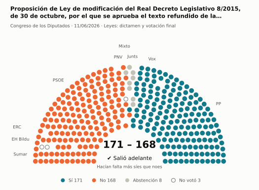
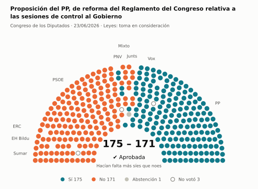
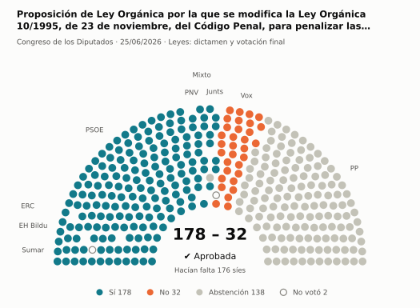
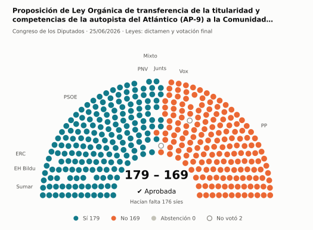
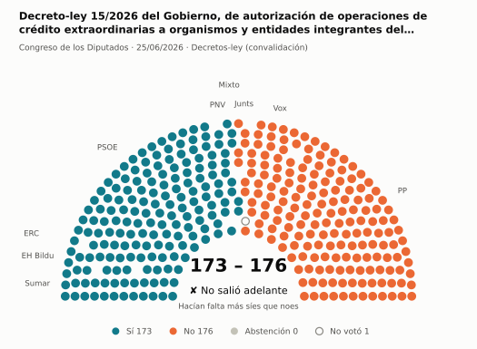
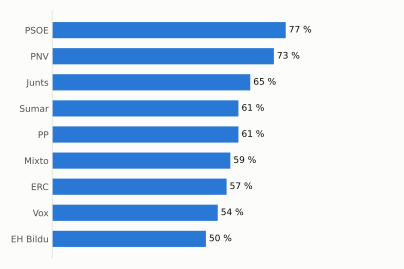
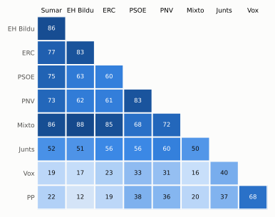

# Qué votó el Congreso en junio de 2026

Las votaciones del Pleno del Congreso de los Diputados, explicadas sin tecnicismos. Datos oficiales del [Congreso](https://www.congreso.es/es/opendata/votaciones); este resumen se actualiza solo cada mes (última vez: 10/11/2026).

## En pocas palabras

- El Congreso votó **103 veces** en 5 días de pleno. **52 propuestas salieron adelante** y 49 no; hubo además 2 empates, que se repiten.
- 58 votaciones fueron sobre leyes, decretos o presupuestos. Otras 38 fueron peticiones al Gobierno que no le obligan (proposiciones no de ley y mociones).
- El Gobierno (PSOE y Sumar) perdió **15** de las 77 votaciones en las que sus grupos votaron lo mismo.
- La votación más reñida se decidió por 1 voto: Moción del PP sobre el desempeño de la Ministra de Inclusión, Seguridad Social y Migraciones y las políticas desarrolla….
- Los diputados casi siempre votan lo mismo que su grupo: en todo el mes solo hubo 21 votos distintos (sin contar el Grupo Mixto).

## Las votaciones más importantes del mes

Elegidas por su importancia: pesan más las leyes y los decretos que las peticiones al Gobierno, y suben las que se decidieron por pocos votos o las que perdió el Gobierno. Cada punto del dibujo es un diputado, colocado con su grupo, y el color es lo que votó.

### 1. Proposición de Ley de modificación del Real Decreto Legislativo 8/2015, de 30 de octubre, por el que se aprueba el texto refundido de la Ley General…

**11 de junio · Leyes: dictamen y votación final.** Votación del texto de una ley después de trabajarla en comisión.

<picture>
  <source media="(prefers-color-scheme: dark)" srcset="img/2026-06/votacion-L15-S185-V017-oscuro.svg">
  
</picture>

**✔ Salió adelante** por 3 votos: 171 a favor, 168 en contra y 8 abstenciones.

- **A favor:** PP y Vox
- **En contra:** PSOE, Sumar, ERC, EH Bildu y PNV
- **Se abstuvieron:** Junts
- **Repartidos:** Grupo Mixto (Sí 1, No 5, Abstención 1)

Este asunto tuvo 18 votaciones este mes; aquí se muestra la más disputada. [Datos oficiales](https://www.congreso.es/webpublica/opendata/votaciones/Leg15/Sesion185/20260611/Votacion017/VOT_20260611145722.json)

### 2. Proposición del PP, de reforma del Reglamento del Congreso relativa a las sesiones de control al Gobierno

**23 de junio · Leyes: toma en consideración.** Primer paso de una ley propuesta por un grupo o una comunidad autónoma: el Congreso decide si empieza a tramitarla.

<picture>
  <source media="(prefers-color-scheme: dark)" srcset="img/2026-06/votacion-L15-S189-V001-oscuro.svg">
  
</picture>

**✔ Salió adelante** por 4 votos: 175 a favor, 171 en contra y 1 abstención.

- **A favor:** PP, Vox y PNV
- **En contra:** PSOE, Sumar, Junts, ERC y EH Bildu
- **Repartidos:** Grupo Mixto (Sí 1, No 6, Abstención 1)

[Datos oficiales](https://www.congreso.es/webpublica/opendata/votaciones/Leg15/Sesion189/20260623/Votacion001/VOT_20260623202726.json)

### 3. Proposición de Ley Orgánica por la que se modifica la Ley Orgánica 10/1995, de 23 de noviembre, del Código Penal, para penalizar las terapias de conv…

**25 de junio · Leyes: dictamen y votación final.** Votación del texto de una ley después de trabajarla en comisión.

<picture>
  <source media="(prefers-color-scheme: dark)" srcset="img/2026-06/votacion-L15-S191-V022-oscuro.svg">
  
</picture>

**✔ Salió adelante** superó los 176 síes por 2 votos: 178 a favor, 32 en contra y 138 abstenciones.

- **A favor:** PSOE, Sumar, Junts, ERC, EH Bildu y PNV
- **En contra:** Vox
- **Se abstuvieron:** PP
- **Repartidos:** Grupo Mixto (Sí 7, Abstención 1)

Este asunto tuvo 9 votaciones este mes; aquí se muestra la más disputada. [Datos oficiales](https://www.congreso.es/webpublica/opendata/votaciones/Leg15/Sesion191/20260625/Votacion022/VOT_20260625150816.json)

### 4. Proposición de Ley Orgánica de transferencia de la titularidad y competencias de la autopista del Atlántico (AP-9) a la Comunidad Autónoma de Galicia

**25 de junio · Leyes: dictamen y votación final.** Votación del texto de una ley después de trabajarla en comisión.

<picture>
  <source media="(prefers-color-scheme: dark)" srcset="img/2026-06/votacion-L15-S191-V024-oscuro.svg">
  
</picture>

**✔ Salió adelante** superó los 176 síes por 3 votos: 179 a favor, 169 en contra y ninguna abstención.

- **A favor:** PSOE, Sumar, Junts, ERC, EH Bildu y PNV
- **En contra:** PP y Vox
- **Repartidos:** Grupo Mixto (Sí 7, No 1)

Este asunto tuvo 7 votaciones este mes; aquí se muestra la más disputada. [Datos oficiales](https://www.congreso.es/webpublica/opendata/votaciones/Leg15/Sesion191/20260625/Votacion024/VOT_20260625150821.json)

### 5. Decreto-ley 15/2026 del Gobierno, de autorización de operaciones de crédito extraordinarias a organismos y entidades integrantes del sector público i…

**25 de junio · Decretos-ley (convalidación).** El Gobierno aprobó esta norma por urgencia. Ya está en vigor, pero el Congreso tiene 30 días para confirmarla o tumbarla.

<picture>
  <source media="(prefers-color-scheme: dark)" srcset="img/2026-06/votacion-L15-S191-V029-oscuro.svg">
  
</picture>

**✘ No salió adelante** por 3 votos: 173 a favor, 176 en contra y ninguna abstención.

- **A favor:** PSOE, Sumar, Grupo Mixto, ERC, EH Bildu y PNV
- **En contra:** PP, Vox y Junts

[Datos oficiales](https://www.congreso.es/webpublica/opendata/votaciones/Leg15/Sesion191/20260625/Votacion029/VOT_20260625150830.json)

## ¿Qué grupos votaron más veces lo que finalmente salió?

<picture>
  <source media="(prefers-color-scheme: dark)" srcset="img/2026-06/ganadora-oscuro.svg">
  
</picture>

Porcentaje de votaciones en que el grupo votó Sí y salió adelante, o votó No y no salió. Abstenerse no cuenta como acertar.

## ¿Quién vota con quién?

<picture>
  <source media="(prefers-color-scheme: dark)" srcset="img/2026-06/afinidad-oscuro.svg">
  
</picture>

Cada casilla dice en qué porcentaje de las votaciones dos grupos votaron lo mismo: 100 es que siempre coincidieron y 0 que nunca.

## ¿Qué tipo de cosas se votaron?

| Tipo | Votaciones | Salieron adelante | Qué es |
| --- | ---: | ---: | --- |
| Leyes: dictamen y votación final | 40 | 10 | Votación del texto de una ley después de trabajarla en comisión. |
| Mociones | 21 | 13 | Petición al Gobierno después de pedirle explicaciones en el Pleno. Expresa la opinión del Congreso, pero no obliga. |
| Proposiciones no de ley | 17 | 12 | Petición al Gobierno para que haga algo. Expresa la opinión del Congreso, pero no obliga. |
| Decretos-ley (convalidación) | 7 | 6 | El Gobierno aprobó esta norma por urgencia. Ya está en vigor, pero el Congreso tiene 30 días para confirmarla o tumbarla. |
| Tratados internacionales | 6 | 6 | El Congreso autoriza a España a comprometerse con un acuerdo con otro país u organismo. |
| Leyes: toma en consideración | 6 | 3 | Primer paso de una ley propuesta por un grupo o una comunidad autónoma: el Congreso decide si empieza a tramitarla. |
| Enmiendas a la totalidad | 5 | 1 | Un grupo intenta devolver la ley a quien la propuso o sustituirla por otra. Si no sale adelante, la ley sigue su camino. |
| Organización de la Cámara | 1 | 1 | Asunto interno del Congreso: comisiones, plazos o el estatuto de los diputados. |

## Palabras que conviene saber

- **Pleno**: La reunión de los 350 diputados, donde se vota.
- **Grupo parlamentario**: Los diputados de un partido o coalición. Los partidos pequeños van juntos en el Grupo Mixto, aunque no piensen igual.
- **Abstención**: El diputado vota, pero ni a favor ni en contra.
- **No votó**: El diputado no votó: no estaba, estaba de baja o el escaño estaba vacío.
- **Mayoría simple**: Salen adelante las votaciones con más síes que noes. Es lo normal.
- **Mayoría absoluta**: 176 votos a favor, la mitad más uno de 350. La piden las leyes orgánicas (derechos fundamentales, sistema electoral…) y la primera votación de investidura.
- **Votación por llamamiento**: Cada diputado dice su voto en voz alta. Se usa en las investiduras y otras votaciones importantes.

---

**¿Quieres más detalle?** El [análisis detallado](2026-06-detalle.md) tiene la cohesión de cada grupo, un mapa de los diputados según cómo votan, qué diputados votaron distinto de su grupo, las ausencias y la lista completa de votaciones.

_Los resultados están calculados a partir de los votos: el Congreso no publica si cada votación salió adelante. Este proyecto no tiene relación con el Congreso. Método en [docs/DOCUMENTO_FUNCIONAL.md](../docs/DOCUMENTO_FUNCIONAL.md)._
