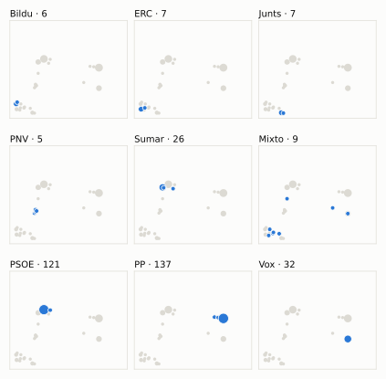
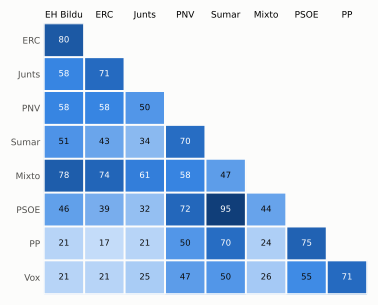

# Análisis detallado: julio de 2026

[← Volver al resumen del mes](2026-07.md)

_Generado automáticamente el 2026-11-10 con datos abiertos del [Congreso de los Diputados](https://www.congreso.es/es/opendata/votaciones). Solo plenos y Diputación Permanente. Método y límites en [docs/DOCUMENTO_FUNCIONAL.md](../docs/DOCUMENTO_FUNCIONAL.md)._

## Resumen

- **76 votaciones** en 2 días de pleno (sesiones 192 y 193).
- **18 aprobadas** y **58 rechazadas**.
- 0 votaciones se decidieron por 5 votos o menos.
- El grupo que más veces votó con el resultado final: **PSOE** (93 % de las votaciones nominales).
- Los grupos del Gobierno (PSOE y Sumar) votaron lo mismo en 71 de 76 votaciones nominales y perdieron 4 de ellas.
- 9 votos individuales se apartaron de la posición de su grupo (9 diputados).

## Cómo votó cada grupo

| Grupo | Diputados | Cohesión | Votó con el resultado | Decisivo | Posición Sí | Posición No | Posición Abst. |
| --- | ---: | ---: | ---: | ---: | ---: | ---: | ---: |
| PP | 137 | 100 % | 82 % | 4 | 17 | 55 | 4 |
| PSOE | 121 | 100 % | 93 % | 10 | 21 | 54 | 1 |
| Vox | 32 | 100 % | 62 % | 4 | 23 | 45 | 8 |
| Sumar | 26 | 100 % | 88 % | 8 | 23 | 52 | 1 |
| Mixto | 9 | 69 % | 40 % | 1 | 47 | 17 | 8 |
| Junts | 7 | 100 % | 37 % | 1 | 47 | 16 | 13 |
| ERC | 7 | 100 % | 36 % | 1 | 51 | 15 | 10 |
| EH Bildu | 6 | 100 % | 39 % | 0 | 47 | 19 | 10 |
| PNV | 5 | 99 % | 68 % | 0 | 34 | 38 | 4 |

*Cohesión*: índice de acuerdo interno (100 % = todo el grupo votó igual). *Votó con el resultado*: el grupo votó Sí y salió aprobada, o No y salió rechazada. *Decisivo*: votaciones cuyo resultado habría cambiado si el grupo se hubiera abstenido en bloque. El Grupo Mixto reúne partidos distintos: su posición es la de su mayoría.

## Mapa de diputados

<picture>
  <source media="(prefers-color-scheme: dark)" srcset="img/2026-07/mapa-oscuro.svg">
  
</picture>

Cada punto es un diputado; dos diputados están cerca si votaron parecido. Un punto más grande reúne a varios que votaron exactamente igual. En cada panel, el grupo en azul y el resto del Congreso en gris.

*Cómo se calcula*: componentes principales de los votos (Sí, No, abstención) en 73 votaciones con algún desacuerdo. El eje horizontal recoge el 51 % de la variación y el vertical el 30 %. Los ejes no tienen nombre ni sentido político propio; por convención, el PP queda a la derecha.

## Afinidad entre grupos

<picture>
  <source media="(prefers-color-scheme: dark)" srcset="img/2026-07/afinidad-oscuro.svg">
  
</picture>

Porcentaje de votaciones nominales en que los dos grupos tomaron la misma posición. Los grupos están ordenados según el mapa de diputados.

Ver la tabla

|  | PP | PSOE | Vox | Sumar | Mixto | Junts | ERC | EH Bildu | PNV |
| --- | :---: | :---: | :---: | :---: | :---: | :---: | :---: | :---: | :---: |
| PP | 100 % | 75 % | 71 % | 70 % | 24 % | 21 % | 17 % | 21 % | 50 % |
| PSOE | 75 % | 100 % | 55 % | 95 % | 44 % | 32 % | 39 % | 46 % | 72 % |
| Vox | 71 % | 55 % | 100 % | 50 % | 26 % | 25 % | 21 % | 21 % | 47 % |
| Sumar | 70 % | 95 % | 50 % | 100 % | 47 % | 34 % | 43 % | 51 % | 70 % |
| Mixto | 24 % | 44 % | 26 % | 47 % | 100 % | 61 % | 74 % | 78 % | 58 % |
| Junts | 21 % | 32 % | 25 % | 34 % | 61 % | 100 % | 71 % | 58 % | 50 % |
| ERC | 17 % | 39 % | 21 % | 43 % | 74 % | 71 % | 100 % | 80 % | 58 % |
| EH Bildu | 21 % | 46 % | 21 % | 51 % | 78 % | 58 % | 80 % | 100 % | 58 % |
| PNV | 50 % | 72 % | 47 % | 70 % | 58 % | 50 % | 58 % | 58 % | 100 % |

## Quién sacó adelante las votaciones

| Grupos que votaron Sí | Votaciones | Escaños |
| --- | ---: | ---: |
| PSOE + Sumar + Mixto + Junts + ERC + EH Bildu + PNV | 5 | 181 |
| Todos los grupos | 4 | 350 |
| PP + PSOE + Vox + Sumar + Mixto + PNV | 2 | 330 |
| PP + PSOE + Sumar + Mixto + Junts + ERC + EH Bildu + PNV | 1 | 318 |
| PP + PSOE + Vox + Sumar + Mixto + Junts + ERC + EH Bildu | 1 | 345 |
| PSOE + Sumar + Junts + ERC + EH Bildu + PNV | 1 | 172 |
| PSOE + Sumar + ERC + EH Bildu + PNV | 1 | 165 |
| PP + PSOE + Vox + Sumar + Mixto + Junts + PNV | 1 | 337 |

De 18 votaciones nominales aprobadas. Otras 2 salieron con combinaciones que se dieron menos veces. La posición de cada grupo es la de la mayoría de sus diputados.

## Votaciones que perdieron los grupos del Gobierno

| Fecha | Asunto | Tipo | PSOE y Sumar votaron | Resultado | Sí | No |
| --- | --- | --- | :---: | --- | ---: | ---: |
| 14 de julio | Proyecto de Ley por la que se modifican el Texto Refundido de la Ley General de derechos de las personas con discapacidad y de su inclusión social, aprobado po… *(Enmiendas presentadas por el Grupo Parlamentario Mixto (Sra…)* | Leyes: dictamen y votación final | Sí | Rechazada | 167 | 176 |
| 14 de julio | Acuerdo del Gobierno por el que se fijan los objetivos de estabilidad presupuestaria y de deuda pública para el conjunto de Administraciones Públicas y de cada… | Presupuestos y estabilidad | Sí | Rechazada | 167 | 178 |
| 14 de julio | Real Decreto-ley 16/2026, de 16 de junio, de medidas para garantizar la prestación del servicio público encomendado a la Corporación Radio Televisión Española,… | Decretos-ley (convalidación) | Sí | Rechazada | 172 | 178 |
| 23 de julio | Acuerdo del Gobierno por el que se fijan los objetivos de estabilidad presupuestaria y de deuda pública para el conjunto de Administraciones Públicas y de cada… | Presupuestos y estabilidad | Sí | Rechazada | 166 | 176 |

Además, PSOE y Sumar votaron distinto entre sí en 4 votaciones.

## Votaciones más ajustadas

| Fecha | Asunto | Resultado | Sí | No | Abst. |
| --- | --- | :---: | ---: | ---: | ---: |
| 14 de julio | Real Decreto-ley 16/2026, de 16 de junio, de medidas para garantizar la prestación del servicio público encomendado a la Corporación Radio Televisión Española,… | Rechazada | 172 | 178 | 0 |
| 14 de julio | Proyecto de Ley por la que se modifican el Texto Refundido de la Ley General de derechos de las personas con discapacidad y de su inclusión social, aprobado po… *(Corrección técnica. Enmienda de corrección técnica nº1 pres…)* | Aprobada | 178 | 171 | 0 |
| 14 de julio | Proposición de Ley Orgánica de reforma de la Ley Orgánica 10/1995, de 23 de noviembre, del Código Penal para la protección de la libertad de expresión. *(Enmiendas a la totalidad de texto alternativo. Enmienda a l…)* | Rechazada | 171 | 178 | 0 |
| 23 de julio | Proposición de reforma del Reglamento del Congreso. *(Enmiendas presentadas por el Grupo Parlamentario Popular en…)* | Rechazada | 170 | 177 | 0 |
| 23 de julio | Proposición de reforma del Reglamento del Congreso. *(Enmiendas presentadas por el Grupo Parlamentario VOX. Resto…)* | Rechazada | 170 | 178 | 0 |
| 23 de julio | Proposición de reforma del Reglamento del Congreso. *(Votación del dictamen.)* | Aprobada | 178 | 170 | 0 |
| 23 de julio | Votación conjunta de las enmiendas a la totalidad de devolución al Proyecto de Ley Orgánica de medidas excepcionales de sostenibilidad financiera para las comu… | Rechazada | 170 | 178 | 0 |
| 14 de julio | Proyecto de Ley por la que se modifican el Texto Refundido de la Ley General de derechos de las personas con discapacidad y de su inclusión social, aprobado po… *(Enmiendas presentadas por el Grupo Parlamentario Mixto (Sra…)* | Rechazada | 167 | 176 | 7 |
| 23 de julio | Proposición de reforma del Reglamento del Congreso. *(Votación de totalidad. Votación final de totalidad, a los e…)* | Aprobada | 178 | 169 | 1 |
| 14 de julio | Proyecto de Ley por la que se modifican el Texto Refundido de la Ley General de derechos de las personas con discapacidad y de su inclusión social, aprobado po… *(Enmienda presentada por el Grupo Parlamentario Socialista y…)* | Aprobada | 179 | 169 | 2 |

Votaciones decididas por 10 votos o menos (o a esa distancia de la mayoría que exigían). Las públicas por llamamiento no tienen hemiciclo: el voto de cada diputado solo consta en el Diario de Sesiones.

## Qué se votó, por tipo de asunto

| Tipo de asunto | Votaciones | Aprobadas | No aprobadas |
| --- | ---: | ---: | ---: |
| Leyes: dictamen y votación final | 56 | 5 | 51 |
| Leyes: enmiendas del Senado | 8 | 7 | 1 |
| Decretos-ley (convalidación) | 7 | 6 | 1 |
| Enmiendas a la totalidad | 3 | 0 | 3 |
| Presupuestos y estabilidad | 2 | 0 | 2 |

Las proposiciones no de ley y las mociones expresan la posición del Congreso pero no obligan al Gobierno. Las leyes pasan por varias votaciones (toma en consideración, totalidad, dictamen, Senado), así que una misma ley puede aparecer varias veces.

## Votos distintos de su grupo

| Diputado | Grupo | Votos distintos de su grupo |
| --- | --- | ---: |
| Agirretxea Urresti, Joseba Andoni | PNV | 1 |
| Agüera Gago, Cristina | PP | 1 |
| Iñarritu García, Jon | EH Bildu | 1 |
| López Maraver, Ángel | Vox | 1 |
| Marín Aparicio, Inmaculada | PP | 1 |
| Sagastizabal Unzetabarrenetxea, Idoia | PNV | 1 |
| Sánchez Sierra, María del Mar | PP | 1 |
| Tarno Blanco, Ricardo | PP | 1 |
| Álvarez Fanjul, Beatriz | PP | 1 |

Un voto aislado puede ser un error al pulsar, no una decisión política: el Congreso no publica las correcciones. Se excluye el Grupo Mixto.

## Diputados que más veces no votaron

| Diputado | Grupo | No votó | % de votaciones |
| --- | --- | ---: | ---: |
| Díaz Pérez, Yolanda | Sumar | 15 | 20 % |
| Melgarejo Moreno, Joaquín | PP | 15 | 20 % |
| Sánchez Pérez-Castejón, Pedro | PSOE | 5 | 7 % |
| Sánchez Serna, Javier | Mixto | 5 | 7 % |
| Ibáñez Mezquita, Alberto | Sumar | 3 | 4 % |
| Salvador i Duch, Jordi | ERC | 3 | 4 % |
| Delgado Arce, Celso Luis | PP | 2 | 3 % |
| Legarda Uriarte, Mikel | PNV | 2 | 3 % |
| Martínez Barbero, Verónica | Sumar | 2 | 3 % |
| Rego Candamil, Néstor | Mixto | 2 | 3 % |
| Renteria Lasanta, Nerea | PNV | 2 | 3 % |
| Sémper Pascual, Borja | PP | 2 | 3 % |
| Varela Pazos, Marta | PP | 2 | 3 % |
| Agüera Gago, Cristina | PP | 1 | 1 % |
| Aranda Vargas, Francisco | PSOE | 1 | 1 % |

«No vota» incluye ausencias justificadas (baja, maternidad o paternidad) y escaños vacantes; el portal no las distingue.

## Todas las votaciones

Posición de cada grupo: la opción que votó la mayoría de sus diputados (*Div.*: empate dentro del grupo). El número enlaza al JSON oficial o, en las votaciones por llamamiento, al Diario de Sesiones.

### 14 de julio (sesión 192)

| Nº | Asunto | Resultado | Sí | No | Abst. | PP | PSOE | Vox | Sumar | Mixto | Junts | ERC | EH Bildu | PNV | Decisivos |
| ---: | --- | --- | ---: | ---: | ---: | :---: | :---: | :---: | :---: | :---: | :---: | :---: | :---: | :---: | --- |
| [1](https://www.congreso.es/webpublica/opendata/votaciones/Leg15/Sesion192/20260714/Votacion001/VOT_20260714201931.json) | Proyecto de Ley por la que se modifican el Texto Refundido de la Ley General de derechos de las personas con discapacidad y de su inclusión social, aprobado po… *(Enmiendas presentadas por el Grupo Parlamentario Mixto (Sra…)* | Rechazada | 26 | 315 | 0 | No | No | No | No | Sí | Sí | Sí | Sí | No |  |
| [2](https://www.congreso.es/webpublica/opendata/votaciones/Leg15/Sesion192/20260714/Votacion002/VOT_20260714201933.json) | Proyecto de Ley por la que se modifican el Texto Refundido de la Ley General de derechos de las personas con discapacidad y de su inclusión social, aprobado po… *(Enmiendas presentadas por el Grupo Parlamentario Mixto (Sra…)* | Rechazada | 24 | 319 | 7 | No | No | No | No | Sí | Abst. | Sí | Sí | Sí |  |
| [3](https://www.congreso.es/webpublica/opendata/votaciones/Leg15/Sesion192/20260714/Votacion003/VOT_20260714201934.json) | Proyecto de Ley por la que se modifican el Texto Refundido de la Ley General de derechos de las personas con discapacidad y de su inclusión social, aprobado po… *(Enmiendas presentadas por el Grupo Parlamentario Mixto (Sra…)* | Rechazada | 11 | 331 | 8 | No | No | No | No | Sí | Abst. | No | Sí | No |  |
| [4](https://www.congreso.es/webpublica/opendata/votaciones/Leg15/Sesion192/20260714/Votacion004/VOT_20260714201935.json) | Proyecto de Ley por la que se modifican el Texto Refundido de la Ley General de derechos de las personas con discapacidad y de su inclusión social, aprobado po… *(Enmiendas presentadas por el Grupo Parlamentario Mixto (Sra…)* | Rechazada | 167 | 176 | 7 | No | Sí | No | Sí | Sí | Abst. | Sí | Sí | No | PP, Vox |
| [5](https://www.congreso.es/webpublica/opendata/votaciones/Leg15/Sesion192/20260714/Votacion005/VOT_20260714201937.json) | Proyecto de Ley por la que se modifican el Texto Refundido de la Ley General de derechos de las personas con discapacidad y de su inclusión social, aprobado po… *(Enmiendas presentadas por el Grupo Parlamentario Mixto (Sra…)* | Rechazada | 12 | 324 | 14 | No | No | No | No | Sí | Abst. | Abst. | Sí | No |  |
| [6](https://www.congreso.es/webpublica/opendata/votaciones/Leg15/Sesion192/20260714/Votacion006/VOT_20260714201939.json) | Proyecto de Ley por la que se modifican el Texto Refundido de la Ley General de derechos de las personas con discapacidad y de su inclusión social, aprobado po… *(Enmiendas presentadas por el Grupo Parlamentario Mixto (Sra…)* | Rechazada | 10 | 324 | 14 | No | No | No | No | Sí | Abst. | Abst. | Sí | No |  |
| [7](https://www.congreso.es/webpublica/opendata/votaciones/Leg15/Sesion192/20260714/Votacion007/VOT_20260714201940.json) | Proyecto de Ley por la que se modifican el Texto Refundido de la Ley General de derechos de las personas con discapacidad y de su inclusión social, aprobado po… *(Enmiendas presentadas por el Grupo Parlamentario Mixto (Sra…)* | Rechazada | 19 | 323 | 7 | No | No | No | No | Sí | Abst. | Sí | Sí | No |  |
| [8](https://www.congreso.es/webpublica/opendata/votaciones/Leg15/Sesion192/20260714/Votacion008/VOT_20260714201942.json) | Proyecto de Ley por la que se modifican el Texto Refundido de la Ley General de derechos de las personas con discapacidad y de su inclusión social, aprobado po… *(Enmienda presentada por el Grupo Parlamentario Mixto (Sr. C…)* | Rechazada | 2 | 335 | 13 | No | No | No | No | No | No | Abst. | No | Abst. |  |
| [9](https://www.congreso.es/webpublica/opendata/votaciones/Leg15/Sesion192/20260714/Votacion009/VOT_20260714201944.json) | Proyecto de Ley por la que se modifican el Texto Refundido de la Ley General de derechos de las personas con discapacidad y de su inclusión social, aprobado po… *(Enmiendas presentadas por el Grupo Parlamentario Mixto (Sr.…)* | Rechazada | 26 | 318 | 5 | No | No | No | No | Sí | Sí | Sí | Sí | Abst. |  |
| [10](https://www.congreso.es/webpublica/opendata/votaciones/Leg15/Sesion192/20260714/Votacion010/VOT_20260714201946.json) | Proyecto de Ley por la que se modifican el Texto Refundido de la Ley General de derechos de las personas con discapacidad y de su inclusión social, aprobado po… *(Enmiendas presentadas por el Grupo Parlamentario Mixto (Sr.…)* | Rechazada | 25 | 323 | 1 | No | No | No | No | Sí | Sí | Sí | Sí | No |  |
| [11](https://www.congreso.es/webpublica/opendata/votaciones/Leg15/Sesion192/20260714/Votacion011/VOT_20260714201948.json) | Proyecto de Ley por la que se modifican el Texto Refundido de la Ley General de derechos de las personas con discapacidad y de su inclusión social, aprobado po… *(Enmiendas presentadas por el Grupo Parlamentario Vasco (EAJ…)* | Rechazada | 29 | 317 | 4 | No | No | No | No | Div. | Sí | Sí | Sí | Sí |  |
| [12](https://www.congreso.es/webpublica/opendata/votaciones/Leg15/Sesion192/20260714/Votacion012/VOT_20260714201950.json) | Proyecto de Ley por la que se modifican el Texto Refundido de la Ley General de derechos de las personas con discapacidad y de su inclusión social, aprobado po… *(Enmiendas presentadas por el Grupo Parlamentario Vasco (EAJ…)* | Rechazada | 27 | 284 | 39 | No | No | Abst. | No | Sí | Sí | Sí | Abst. | Sí |  |
| [13](https://www.congreso.es/webpublica/opendata/votaciones/Leg15/Sesion192/20260714/Votacion013/VOT_20260714201953.json) | Proyecto de Ley por la que se modifican el Texto Refundido de la Ley General de derechos de las personas con discapacidad y de su inclusión social, aprobado po… *(Enmiendas presentadas por el Grupo Parlamentario Vasco (EAJ…)* | Rechazada | 28 | 317 | 5 | No | No | No | No | Div. | Sí | Sí | Sí | Sí |  |
| [14](https://www.congreso.es/webpublica/opendata/votaciones/Leg15/Sesion192/20260714/Votacion014/VOT_20260714201955.json) | Proyecto de Ley por la que se modifican el Texto Refundido de la Ley General de derechos de las personas con discapacidad y de su inclusión social, aprobado po… *(Enmiendas presentadas por el Grupo Parlamentario Vasco (EAJ…)* | Rechazada | 26 | 283 | 39 | No | No | Abst. | No | Sí | Sí | Sí | Abst. | Sí |  |
| [15](https://www.congreso.es/webpublica/opendata/votaciones/Leg15/Sesion192/20260714/Votacion015/VOT_20260714201957.json) | Proyecto de Ley por la que se modifican el Texto Refundido de la Ley General de derechos de las personas con discapacidad y de su inclusión social, aprobado po… *(Enmiendas presentadas por el Grupo Parlamentario Vasco (EAJ…)* | Rechazada | 19 | 317 | 14 | No | No | No | No | Sí | Sí | Abst. | Abst. | Sí |  |
| [16](https://www.congreso.es/webpublica/opendata/votaciones/Leg15/Sesion192/20260714/Votacion016/VOT_20260714201959.json) | Proyecto de Ley por la que se modifican el Texto Refundido de la Ley General de derechos de las personas con discapacidad y de su inclusión social, aprobado po… *(Enmiendas presentadas por el Grupo Parlamentario Vasco (EAJ…)* | Rechazada | 48 | 284 | 18 | No | No | Sí | No | Abst. | Sí | Abst. | Abst. | Sí |  |
| [17](https://www.congreso.es/webpublica/opendata/votaciones/Leg15/Sesion192/20260714/Votacion017/VOT_20260714202000.json) | Proyecto de Ley por la que se modifican el Texto Refundido de la Ley General de derechos de las personas con discapacidad y de su inclusión social, aprobado po… *(Enmiendas presentadas por el Grupo Parlamentario Vasco (EAJ…)* | Rechazada | 62 | 283 | 4 | No | No | Sí | No | Div. | Sí | Sí | Sí | Sí |  |
| [18](https://www.congreso.es/webpublica/opendata/votaciones/Leg15/Sesion192/20260714/Votacion018/VOT_20260714202002.json) | Proyecto de Ley por la que se modifican el Texto Refundido de la Ley General de derechos de las personas con discapacidad y de su inclusión social, aprobado po… *(Enmiendas presentadas por el Grupo Parlamentario Vasco (EAJ…)* | Rechazada | 66 | 283 | 0 | No | No | Sí | No | Sí | Sí | Sí | Sí | Sí |  |
| [19](https://www.congreso.es/webpublica/opendata/votaciones/Leg15/Sesion192/20260714/Votacion019/VOT_20260714202003.json) | Proyecto de Ley por la que se modifican el Texto Refundido de la Ley General de derechos de las personas con discapacidad y de su inclusión social, aprobado po… *(Enmiendas presentadas por el Grupo Parlamentario Vasco (EAJ…)* | Rechazada | 65 | 284 | 0 | No | No | Sí | No | Sí | Sí | Sí | Sí | Sí |  |
| [20](https://www.congreso.es/webpublica/opendata/votaciones/Leg15/Sesion192/20260714/Votacion020/VOT_20260714202004.json) | Proyecto de Ley por la que se modifican el Texto Refundido de la Ley General de derechos de las personas con discapacidad y de su inclusión social, aprobado po… *(Enmiendas presentadas por el Grupo Parlamentario Euskal Her…)* | Rechazada | 19 | 330 | 0 | No | No | No | No | Sí | No | Sí | Sí | No |  |
| [21](https://www.congreso.es/webpublica/opendata/votaciones/Leg15/Sesion192/20260714/Votacion021/VOT_20260714202006.json) | Proyecto de Ley por la que se modifican el Texto Refundido de la Ley General de derechos de las personas con discapacidad y de su inclusión social, aprobado po… *(Enmiendas presentadas por el Grupo Parlamentario Euskal Her…)* | Rechazada | 19 | 323 | 7 | No | No | No | No | Sí | Abst. | Sí | Sí | No |  |
| [22](https://www.congreso.es/webpublica/opendata/votaciones/Leg15/Sesion192/20260714/Votacion022/VOT_20260714202008.json) | Proyecto de Ley por la que se modifican el Texto Refundido de la Ley General de derechos de las personas con discapacidad y de su inclusión social, aprobado po… *(Enmiendas presentadas por el Grupo Parlamentario Euskal Her…)* | Rechazada | 31 | 319 | 0 | No | No | No | No | Sí | Sí | Sí | Sí | Sí |  |
| [23](https://www.congreso.es/webpublica/opendata/votaciones/Leg15/Sesion192/20260714/Votacion023/VOT_20260714202009.json) | Proyecto de Ley por la que se modifican el Texto Refundido de la Ley General de derechos de las personas con discapacidad y de su inclusión social, aprobado po… *(Enmiendas presentadas por el Grupo Parlamentario Euskal Her…)* | Rechazada | 25 | 324 | 0 | No | No | No | No | Sí | Sí | Sí | Sí | No |  |
| [24](https://www.congreso.es/webpublica/opendata/votaciones/Leg15/Sesion192/20260714/Votacion024/VOT_20260714202011.json) | Proyecto de Ley por la que se modifican el Texto Refundido de la Ley General de derechos de las personas con discapacidad y de su inclusión social, aprobado po… *(Enmiendas presentadas por el Grupo Parlamentario Junts per…)* | Rechazada | 15 | 323 | 11 | No | No | No | No | Abst. | Sí | Sí | Abst. | No |  |
| [25](https://www.congreso.es/webpublica/opendata/votaciones/Leg15/Sesion192/20260714/Votacion025/VOT_20260714202013.json) | Proyecto de Ley por la que se modifican el Texto Refundido de la Ley General de derechos de las personas con discapacidad y de su inclusión social, aprobado po… *(Enmiendas presentadas por el Grupo Parlamentario Junts per…)* | Rechazada | 15 | 335 | 0 | No | No | No | No | No | Sí | Sí | No | No |  |
| [26](https://www.congreso.es/webpublica/opendata/votaciones/Leg15/Sesion192/20260714/Votacion026/VOT_20260714202015.json) | Proyecto de Ley por la que se modifican el Texto Refundido de la Ley General de derechos de las personas con discapacidad y de su inclusión social, aprobado po… *(Enmiendas presentadas por el Grupo Parlamentario Junts per…)* | Rechazada | 11 | 338 | 1 | No | No | No | No | Sí | Sí | No | No | No |  |
| [27](https://www.congreso.es/webpublica/opendata/votaciones/Leg15/Sesion192/20260714/Votacion027/VOT_20260714202017.json) | Proyecto de Ley por la que se modifican el Texto Refundido de la Ley General de derechos de las personas con discapacidad y de su inclusión social, aprobado po… *(Enmiendas presentadas por el Grupo Parlamentario Junts per…)* | Rechazada | 30 | 319 | 1 | No | No | No | No | Sí | Sí | Sí | Sí | Sí |  |
| [28](https://www.congreso.es/webpublica/opendata/votaciones/Leg15/Sesion192/20260714/Votacion028/VOT_20260714202019.json) | Proyecto de Ley por la que se modifican el Texto Refundido de la Ley General de derechos de las personas con discapacidad y de su inclusión social, aprobado po… *(Enmiendas presentadas por el Grupo Parlamentario Junts per…)* | Rechazada | 7 | 330 | 13 | No | No | No | No | Abst. | Sí | Abst. | No | No |  |
| [29](https://www.congreso.es/webpublica/opendata/votaciones/Leg15/Sesion192/20260714/Votacion029/VOT_20260714202021.json) | Proyecto de Ley por la que se modifican el Texto Refundido de la Ley General de derechos de las personas con discapacidad y de su inclusión social, aprobado po… *(Enmiendas presentadas por el Grupo Parlamentario Junts per…)* | Rechazada | 57 | 287 | 6 | No | No | Sí | No | Sí | Sí | Sí | Abst. | Sí |  |
| [30](https://www.congreso.es/webpublica/opendata/votaciones/Leg15/Sesion192/20260714/Votacion030/VOT_20260714202022.json) | Proyecto de Ley por la que se modifican el Texto Refundido de la Ley General de derechos de las personas con discapacidad y de su inclusión social, aprobado po… *(Enmiendas presentadas por el Grupo Parlamentario Junts per…)* | Rechazada | 52 | 291 | 7 | No | No | Sí | No | Sí | Sí | Sí | Abst. | No |  |
| [31](https://www.congreso.es/webpublica/opendata/votaciones/Leg15/Sesion192/20260714/Votacion031/VOT_20260714202023.json) | Proyecto de Ley por la que se modifican el Texto Refundido de la Ley General de derechos de las personas con discapacidad y de su inclusión social, aprobado po… *(Enmiendas presentadas por el Grupo Parlamentario Junts per…)* | Rechazada | 16 | 297 | 37 | No | No | Abst. | No | Abst. | Sí | Sí | No | No |  |
| [32](https://www.congreso.es/webpublica/opendata/votaciones/Leg15/Sesion192/20260714/Votacion032/VOT_20260714202025.json) | Proyecto de Ley por la que se modifican el Texto Refundido de la Ley General de derechos de las personas con discapacidad y de su inclusión social, aprobado po… *(Enmiendas presentadas por el Grupo Parlamentario Junts per…)* | Rechazada | 7 | 301 | 41 | No | No | Abst. | No | No | Sí | Abst. | No | No |  |
| [33](https://www.congreso.es/webpublica/opendata/votaciones/Leg15/Sesion192/20260714/Votacion033/VOT_20260714202027.json) | Proyecto de Ley por la que se modifican el Texto Refundido de la Ley General de derechos de las personas con discapacidad y de su inclusión social, aprobado po… *(Enmiendas presentadas por el Grupo Parlamentario Junts per…)* | Rechazada | 7 | 342 | 1 | No | No | No | No | No | Sí | No | No | No |  |
| [34](https://www.congreso.es/webpublica/opendata/votaciones/Leg15/Sesion192/20260714/Votacion034/VOT_20260714202028.json) | Proyecto de Ley por la que se modifican el Texto Refundido de la Ley General de derechos de las personas con discapacidad y de su inclusión social, aprobado po… *(Enmiendas presentadas por el Grupo Parlamentario Junts per…)* | Rechazada | 7 | 309 | 34 | No | No | Abst. | No | No | Sí | No | No | No |  |
| [35](https://www.congreso.es/webpublica/opendata/votaciones/Leg15/Sesion192/20260714/Votacion035/VOT_20260714202030.json) | Proyecto de Ley por la que se modifican el Texto Refundido de la Ley General de derechos de las personas con discapacidad y de su inclusión social, aprobado po… *(Enmiendas presentadas por el Grupo Parlamentario Junts per…)* | Rechazada | 26 | 291 | 33 | No | No | Abst. | No | Sí | Sí | Sí | Sí | No |  |
| [36](https://www.congreso.es/webpublica/opendata/votaciones/Leg15/Sesion192/20260714/Votacion036/VOT_20260714202031.json) | Proyecto de Ley por la que se modifican el Texto Refundido de la Ley General de derechos de las personas con discapacidad y de su inclusión social, aprobado po… *(Enmiendas presentadas por el Grupo Parlamentario Junts per…)* | Rechazada | 31 | 286 | 33 | No | No | Abst. | No | Sí | Sí | Sí | Sí | Sí |  |
| [37](https://www.congreso.es/webpublica/opendata/votaciones/Leg15/Sesion192/20260714/Votacion037/VOT_20260714202032.json) | Proyecto de Ley por la que se modifican el Texto Refundido de la Ley General de derechos de las personas con discapacidad y de su inclusión social, aprobado po… *(Enmiendas presentadas por el Grupo Parlamentario Junts per…)* | Rechazada | 21 | 324 | 5 | No | No | No | No | Abst. | Sí | Sí | Sí | No |  |
| [38](https://www.congreso.es/webpublica/opendata/votaciones/Leg15/Sesion192/20260714/Votacion038/VOT_20260714202034.json) | Proyecto de Ley por la que se modifican el Texto Refundido de la Ley General de derechos de las personas con discapacidad y de su inclusión social, aprobado po… *(Enmiendas presentadas por el Grupo Parlamentario Republican…)* | Rechazada | 31 | 319 | 0 | No | No | No | No | Sí | Sí | Sí | Sí | Sí |  |
| [39](https://www.congreso.es/webpublica/opendata/votaciones/Leg15/Sesion192/20260714/Votacion039/VOT_20260714202035.json) | Proyecto de Ley por la que se modifican el Texto Refundido de la Ley General de derechos de las personas con discapacidad y de su inclusión social, aprobado po… *(Enmiendas presentadas por el Grupo Parlamentario Republican…)* | Rechazada | 19 | 322 | 7 | No | No | No | No | Sí | Abst. | Sí | Sí | No |  |
| [40](https://www.congreso.es/webpublica/opendata/votaciones/Leg15/Sesion192/20260714/Votacion040/VOT_20260714202037.json) | Proyecto de Ley por la que se modifican el Texto Refundido de la Ley General de derechos de las personas con discapacidad y de su inclusión social, aprobado po… *(Enmiendas presentadas por el Grupo Parlamentario Republican…)* | Rechazada | 26 | 323 | 0 | No | No | No | No | Sí | Sí | Sí | Sí | No |  |
| [41](https://www.congreso.es/webpublica/opendata/votaciones/Leg15/Sesion192/20260714/Votacion041/VOT_20260714202038.json) | Proyecto de Ley por la que se modifican el Texto Refundido de la Ley General de derechos de las personas con discapacidad y de su inclusión social, aprobado po… *(Enmiendas presentadas por el Grupo Parlamentario Republican…)* | Rechazada | 31 | 317 | 0 | No | No | No | No | Sí | Sí | Sí | Sí | Sí |  |
| [42](https://www.congreso.es/webpublica/opendata/votaciones/Leg15/Sesion192/20260714/Votacion042/VOT_20260714202040.json) | Proyecto de Ley por la que se modifican el Texto Refundido de la Ley General de derechos de las personas con discapacidad y de su inclusión social, aprobado po… *(Enmiendas presentadas por el Grupo Parlamentario Republican…)* | Rechazada | 26 | 323 | 0 | No | No | No | No | Sí | Sí | Sí | Sí | No |  |
| [43](https://www.congreso.es/webpublica/opendata/votaciones/Leg15/Sesion192/20260714/Votacion043/VOT_20260714202041.json) | Proyecto de Ley por la que se modifican el Texto Refundido de la Ley General de derechos de las personas con discapacidad y de su inclusión social, aprobado po… *(Enmiendas presentadas por el Grupo Parlamentario Republican…)* | Rechazada | 19 | 324 | 7 | No | No | No | No | Sí | Abst. | Sí | Sí | No |  |
| [44](https://www.congreso.es/webpublica/opendata/votaciones/Leg15/Sesion192/20260714/Votacion044/VOT_20260714202043.json) | Proyecto de Ley por la que se modifican el Texto Refundido de la Ley General de derechos de las personas con discapacidad y de su inclusión social, aprobado po… *(Enmiendas presentadas por el Grupo Parlamentario Plurinacio…)* | Rechazada | 33 | 301 | 15 | No | No | No | Sí | No | Abst. | Abst. | Sí | No |  |
| [45](https://www.congreso.es/webpublica/opendata/votaciones/Leg15/Sesion192/20260714/Votacion045/VOT_20260714202044.json) | Proyecto de Ley por la que se modifican el Texto Refundido de la Ley General de derechos de las personas con discapacidad y de su inclusión social, aprobado po… *(Enmiendas presentadas por el Grupo Parlamentario Plurinacio…)* | Rechazada | 44 | 297 | 7 | No | No | No | Sí | Sí | Abst. | Sí | Sí | No |  |
| [46](https://www.congreso.es/webpublica/opendata/votaciones/Leg15/Sesion192/20260714/Votacion046/VOT_20260714202046.json) | Proyecto de Ley por la que se modifican el Texto Refundido de la Ley General de derechos de las personas con discapacidad y de su inclusión social, aprobado po… *(Enmiendas presentadas por el Grupo Parlamentario Plurinacio…)* | Rechazada | 52 | 298 | 0 | No | No | No | Sí | Sí | Sí | Sí | Sí | No |  |
| [47](https://www.congreso.es/webpublica/opendata/votaciones/Leg15/Sesion192/20260714/Votacion047/VOT_20260714202048.json) | Proyecto de Ley por la que se modifican el Texto Refundido de la Ley General de derechos de las personas con discapacidad y de su inclusión social, aprobado po… *(Enmiendas presentadas por el Grupo Parlamentario VOX Votaci…)* | Rechazada | 32 | 317 | 0 | No | No | Sí | No | No | No | No | No | No |  |
| [48](https://www.congreso.es/webpublica/opendata/votaciones/Leg15/Sesion192/20260714/Votacion048/VOT_20260714202050.json) | Proyecto de Ley por la que se modifican el Texto Refundido de la Ley General de derechos de las personas con discapacidad y de su inclusión social, aprobado po… *(Enmienda presentada por el Grupo Parlamentario Socialista y…)* | Aprobada | 179 | 169 | 2 | No | Sí | No | Sí | Sí | Sí | Sí | Sí | Sí | PSOE, Sumar |
| [49](https://www.congreso.es/webpublica/opendata/votaciones/Leg15/Sesion192/20260714/Votacion049/VOT_20260714202052.json) | Proyecto de Ley por la que se modifican el Texto Refundido de la Ley General de derechos de las personas con discapacidad y de su inclusión social, aprobado po… *(Corrección técnica. Enmienda de corrección técnica nº1 pres…)* | Aprobada | 178 | 171 | 0 | No | Sí | No | Sí | Sí | Sí | Sí | Sí | Sí | Mixto, ERC, PSOE, Sumar |
| [50](https://www.congreso.es/webpublica/opendata/votaciones/Leg15/Sesion192/20260714/Votacion050/VOT_20260714202054.json) | Acuerdo del Gobierno por el que se fijan los objetivos de estabilidad presupuestaria y de deuda pública para el conjunto de Administraciones Públicas y de cada… | Rechazada | 167 | 178 | 5 | No | Sí | No | Sí | Abst. | No | Sí | Sí | Sí | PP, Vox |
| [51](https://www.congreso.es/webpublica/opendata/votaciones/Leg15/Sesion192/20260714/Votacion051/VOT_20260714202056.json) | Real Decreto-ley 16/2026, de 16 de junio, de medidas para garantizar la prestación del servicio público encomendado a la Corporación Radio Televisión Española,… | Rechazada | 172 | 178 | 0 | No | Sí | No | Sí | Sí | No | Sí | Sí | Sí | Junts, PP, Vox |
| [52](https://www.congreso.es/webpublica/opendata/votaciones/Leg15/Sesion192/20260714/Votacion052/VOT_20260714202058.json) | Real Decreto-ley 17/2026, de 23 de junio, de medidas extraordinarias para el fortalecimiento y consolidación del Sistema para la Autonomía y Atención a la Depe… | Aprobada | 317 | 33 | 0 | Sí | Sí | No | Sí | Sí | Sí | Sí | Sí | Sí |  |
| [53](https://www.congreso.es/webpublica/opendata/votaciones/Leg15/Sesion192/20260714/Votacion053/VOT_20260714202100.json) | Tramitación como Proyecto de Ley por el procedimiento de urgencia del Real Decreto-ley 17/2026, de 23 de junio, de medidas extraordinarias para el fortalecimie… | Aprobada | 344 | 0 | 5 | Sí | Sí | Sí | Sí | Sí | Sí | Sí | Sí | Abst. |  |
| [54](https://www.congreso.es/webpublica/opendata/votaciones/Leg15/Sesion192/20260714/Votacion054/VOT_20260714202101.json) | Votación del dictamen del Proyecto de Ley por la que se modifican el Texto Refundido de la Ley General de derechos de las personas con discapacidad y de su inc… | Aprobada | 179 | 33 | 137 | Abst. | Sí | No | Sí | Sí | Sí | Sí | Sí | Sí |  |
| [55](https://www.congreso.es/webpublica/opendata/votaciones/Leg15/Sesion192/20260714/Votacion055/VOT_20260714202103.json) | Proposición de Ley Orgánica de reforma de la Ley Orgánica 10/1995, de 23 de noviembre, del Código Penal para la protección de la libertad de expresión. *(Enmiendas a la totalidad de texto alternativo. Enmienda a l…)* | Rechazada | 33 | 179 | 138 | Abst. | No | Sí | No | No | No | No | No | No |  |
| [56](https://www.congreso.es/webpublica/opendata/votaciones/Leg15/Sesion192/20260714/Votacion056/VOT_20260714202105.json) | Proposición de Ley Orgánica de reforma de la Ley Orgánica 10/1995, de 23 de noviembre, del Código Penal para la protección de la libertad de expresión. *(Enmiendas a la totalidad de texto alternativo. Enmienda a l…)* | Rechazada | 171 | 178 | 0 | Sí | No | Sí | No | No | No | No | No | No | PSOE, Sumar |

### 23 de julio (sesión 193)

| Nº | Asunto | Resultado | Sí | No | Abst. | PP | PSOE | Vox | Sumar | Mixto | Junts | ERC | EH Bildu | PNV | Decisivos |
| ---: | --- | --- | ---: | ---: | ---: | :---: | :---: | :---: | :---: | :---: | :---: | :---: | :---: | :---: | --- |
| [1](https://www.congreso.es/webpublica/opendata/votaciones/Leg15/Sesion193/20260723/Votacion001/VOT_20260723211929.json) | Proposición de reforma del Reglamento del Congreso. *(Enmiendas presentadas por el Grupo Parlamentario VOX. Enmie…)* | Rechazada | 33 | 315 | 0 | No | No | Sí | No | No | No | No | No | No |  |
| [2](https://www.congreso.es/webpublica/opendata/votaciones/Leg15/Sesion193/20260723/Votacion002/VOT_20260723211930.json) | Proposición de reforma del Reglamento del Congreso. *(Enmiendas presentadas por el Grupo Parlamentario VOX. Resto…)* | Rechazada | 170 | 178 | 0 | Sí | No | Sí | No | No | No | No | No | No | PSOE, Sumar |
| [3](https://www.congreso.es/webpublica/opendata/votaciones/Leg15/Sesion193/20260723/Votacion003/VOT_20260723211932.json) | Proposición de reforma del Reglamento del Congreso. *(Enmiendas presentadas por el Grupo Parlamentario Popular en…)* | Rechazada | 137 | 178 | 33 | Sí | No | Abst. | No | No | No | No | No | No | PSOE |
| [4](https://www.congreso.es/webpublica/opendata/votaciones/Leg15/Sesion193/20260723/Votacion004/VOT_20260723211934.json) | Proposición de reforma del Reglamento del Congreso. *(Enmiendas presentadas por el Grupo Parlamentario Popular en…)* | Rechazada | 170 | 177 | 0 | Sí | No | Sí | No | No | No | No | No | No | PSOE, Sumar |
| [5](https://www.congreso.es/webpublica/opendata/votaciones/Leg15/Sesion193/20260723/Votacion005/VOT_20260723211936.json) | Proposición de Ley Orgánica de transferencia de la titularidad y competencias de la autopista del Atlántico (AP-9) a la Comunidad Autónoma de Galicia. Votación… | Rechazada | 138 | 210 | 0 | Sí | No | No | No | No | No | No | No | No | PSOE |
| [6](https://www.congreso.es/webpublica/opendata/votaciones/Leg15/Sesion193/20260723/Votacion006/VOT_20260723211938.json) | Real Decreto-ley 18/2026, de 29 de junio, por el que se adoptan determinadas medidas en el marco del Plan Integral de Respuesta a la Crisis en Oriente Medio. | Aprobada | 175 | 33 | 140 | Abst. | Sí | No | Sí | Div. | Sí | Sí | Sí | Sí |  |
| [7](https://www.congreso.es/webpublica/opendata/votaciones/Leg15/Sesion193/20260723/Votacion007/VOT_20260723211940.json) | Tramitación como Proyecto de Ley por el procedimiento de urgencia del Real Decreto-ley 18/2026, de 29 de junio, por el que se adoptan determinadas medidas en e… | Aprobada | 344 | 0 | 0 | Sí | Sí | Sí | Sí | Sí | Sí | Sí | Sí | Sí |  |
| [8](https://www.congreso.es/webpublica/opendata/votaciones/Leg15/Sesion193/20260723/Votacion008/VOT_20260723211941.json) | Real Decreto-ley 19/2026, de 29 de junio, de medidas urgentes en materia de jubilación parcial anticipada del personal laboral de las Administraciones Públicas… | Aprobada | 167 | 37 | 144 | Abst. | Sí | No | Sí | No | Abst. | Sí | Sí | Sí |  |
| [9](https://www.congreso.es/webpublica/opendata/votaciones/Leg15/Sesion193/20260723/Votacion009/VOT_20260723211943.json) | Tramitación como Proyecto de Ley por el procedimiento de urgencia del Real Decreto-ley 19/2026, de 29 de junio, de medidas urgentes en materia de jubilación pa… | Aprobada | 347 | 0 | 0 | Sí | Sí | Sí | Sí | Sí | Sí | Sí | Sí | Sí |  |
| [10](https://www.congreso.es/webpublica/opendata/votaciones/Leg15/Sesion193/20260723/Votacion010/VOT_20260723211944.json) | Proposición de reforma del Reglamento del Congreso. *(Votación del dictamen.)* | Aprobada | 178 | 170 | 0 | No | Sí | No | Sí | Sí | Sí | Sí | Sí | Sí | PSOE, Sumar |
| [11](https://www.congreso.es/webpublica/opendata/votaciones/Leg15/Sesion193/20260723/Votacion011/VOT_20260723211945.json) | Proposición de reforma del Reglamento del Congreso. *(Votación de totalidad. Votación final de totalidad, a los e…)* | Aprobada | 178 | 169 | 1 | No | Sí | No | Sí | Sí | Sí | Sí | Sí | Sí | PSOE, Sumar |
| [12](https://www.congreso.es/webpublica/opendata/votaciones/Leg15/Sesion193/20260723/Votacion012/VOT_20260723211947.json) | Proposición de Ley de modificación del Real Decreto Legislativo 8/2015, de 30 de octubre, por el que se aprueba el texto refundido de la Ley General de la Segu… *(Votación separada de las enmiendas. Enmiendas al último pár…)* | Aprobada | 334 | 0 | 13 | Sí | Sí | Sí | Sí | Sí | Sí | Abst. | Abst. | Sí |  |
| [13](https://www.congreso.es/webpublica/opendata/votaciones/Leg15/Sesion193/20260723/Votacion013/VOT_20260723211949.json) | Proposición de Ley de modificación del Real Decreto Legislativo 8/2015, de 30 de octubre, por el que se aprueba el texto refundido de la Ley General de la Segu… *(Votación separada de las enmiendas. Enmienda al párrafo qui…)* | Aprobada | 324 | 24 | 0 | Sí | Sí | Sí | Sí | Sí | No | No | No | Sí |  |
| [14](https://www.congreso.es/webpublica/opendata/votaciones/Leg15/Sesion193/20260723/Votacion014/VOT_20260723211950.json) | Proposición de Ley de modificación del Real Decreto Legislativo 8/2015, de 30 de octubre, por el que se aprueba el texto refundido de la Ley General de la Segu… *(Votación separada de las enmiendas. Enmienda al Artículo Ún…)* | Aprobada | 326 | 0 | 20 | Sí | Sí | Sí | Sí | Sí | Abst. | Abst. | Abst. | Sí |  |
| [15](https://www.congreso.es/webpublica/opendata/votaciones/Leg15/Sesion193/20260723/Votacion015/VOT_20260723211952.json) | Proposición de Ley de modificación del Real Decreto Legislativo 8/2015, de 30 de octubre, por el que se aprueba el texto refundido de la Ley General de la Segu… *(Votación separada de las enmiendas. Enmienda al Artículo Ún…)* | Aprobada | 290 | 57 | 0 | Sí | Sí | Sí | No | No | No | No | No | No |  |
| [16](https://www.congreso.es/webpublica/opendata/votaciones/Leg15/Sesion193/20260723/Votacion016/VOT_20260723211953.json) | Proposición de Ley de modificación del Real Decreto Legislativo 8/2015, de 30 de octubre, por el que se aprueba el texto refundido de la Ley General de la Segu… *(Votación separada de las enmiendas. Enmienda al Artículo Ún…)* | Aprobada | 347 | 1 | 0 | Sí | Sí | Sí | Sí | Sí | Sí | Sí | Sí | Sí |  |
| [17](https://www.congreso.es/webpublica/opendata/votaciones/Leg15/Sesion193/20260723/Votacion017/VOT_20260723211955.json) | Proposición de Ley de modificación del Real Decreto Legislativo 8/2015, de 30 de octubre, por el que se aprueba el texto refundido de la Ley General de la Segu… *(Votación separada de las enmiendas. Resto de las enmiendas.)* | Aprobada | 348 | 0 | 0 | Sí | Sí | Sí | Sí | Sí | Sí | Sí | Sí | Sí |  |
| [18](https://www.congreso.es/webpublica/opendata/votaciones/Leg15/Sesion193/20260723/Votacion018/VOT_20260723211957.json) | Proposición de Ley de modificación de normas sobre el programa de cribado neonatal del Sistema Nacional de Salud y de otra normativa. Votación de la enmienda. | Aprobada | 185 | 0 | 163 | Sí | Abst. | Sí | Abst. | Abst. | Sí | Sí | Abst. | Abst. |  |
| [19](https://www.congreso.es/webpublica/opendata/votaciones/Leg15/Sesion193/20260723/Votacion019/VOT_20260723212000.json) | Votación conjunta de las enmiendas a la totalidad de devolución al Proyecto de Ley Orgánica de medidas excepcionales de sostenibilidad financiera para las comu… | Rechazada | 170 | 178 | 0 | Sí | No | Sí | No | No | No | No | No | No | PSOE, Sumar |
| [20](https://www.congreso.es/webpublica/opendata/votaciones/Leg15/Sesion193/20260723/Votacion020/VOT_20260723212002.json) | Acuerdo del Gobierno por el que se fijan los objetivos de estabilidad presupuestaria y de deuda pública para el conjunto de Administraciones Públicas y de cada… | Rechazada | 166 | 176 | 5 | No | Sí | No | Sí | Abst. | No | Sí | Sí | Sí | PP, Vox |
