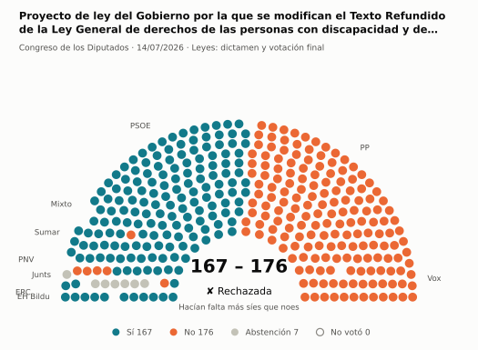
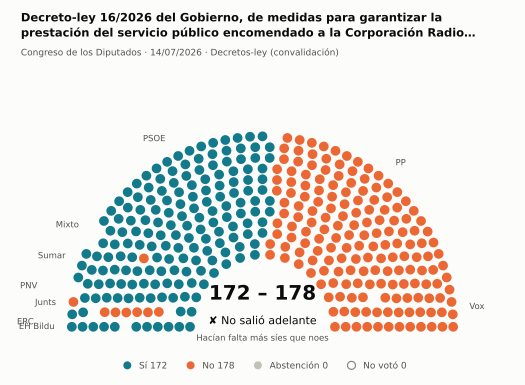
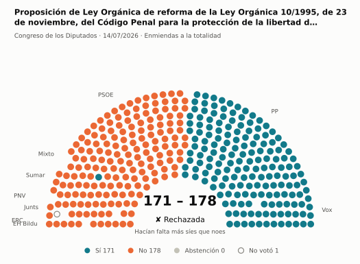
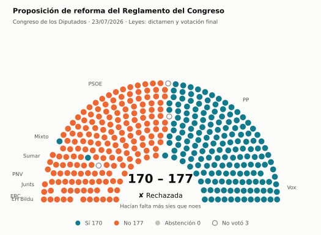
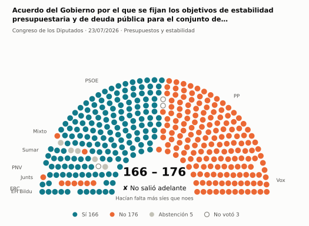
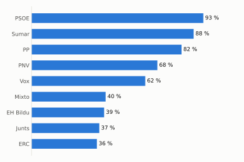
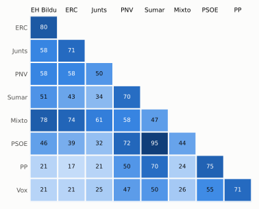

# Qué votó el Congreso en julio de 2026

Las votaciones del Pleno del Congreso de los Diputados, explicadas sin tecnicismos. Datos oficiales del [Congreso](https://www.congreso.es/es/opendata/votaciones); este resumen se actualiza solo cada mes (última vez: 10/11/2026).

## En pocas palabras

- El Congreso votó **76 veces** en 2 días de pleno. **18 propuestas salieron adelante** y 58 no.
- 76 votaciones fueron sobre leyes, decretos o presupuestos.
- El Gobierno (PSOE y Sumar) perdió **4** de las 71 votaciones en las que sus grupos votaron lo mismo.
- La votación más reñida se decidió por 6 votos: Decreto-ley 16/2026 del Gobierno, de medidas para garantizar la prestación del servicio público encomendado a la Corpor….
- Los diputados casi siempre votan lo mismo que su grupo: en todo el mes solo hubo 9 votos distintos (sin contar el Grupo Mixto).

## Las votaciones más importantes del mes

Elegidas por su importancia: pesan más las leyes y los decretos que las peticiones al Gobierno, y suben las que se decidieron por pocos votos o las que perdió el Gobierno. Cada punto del dibujo es un diputado, colocado con su grupo, y el color es lo que votó.

### 1. Proyecto de ley del Gobierno por la que se modifican el Texto Refundido de la Ley General de derechos de las personas con discapacidad y de su inclus…

**14 de julio · Leyes: dictamen y votación final.** Votación del texto de una ley después de trabajarla en comisión.

<picture>
  <source media="(prefers-color-scheme: dark)" srcset="img/2026-07/votacion-L15-S192-V004-oscuro.svg">
  
</picture>

**✘ No salió adelante** por 9 votos: 167 a favor, 176 en contra y 7 abstenciones.

- **A favor:** PSOE, Sumar, ERC y EH Bildu
- **En contra:** PP, Vox y PNV
- **Se abstuvieron:** Junts
- **Repartidos:** Grupo Mixto (Sí 7, No 1)

Este asunto tuvo 49 votaciones este mes; aquí se muestra la más disputada. [Datos oficiales](https://www.congreso.es/webpublica/opendata/votaciones/Leg15/Sesion192/20260714/Votacion004/VOT_20260714201935.json)

### 2. Decreto-ley 16/2026 del Gobierno, de medidas para garantizar la prestación del servicio público encomendado a la Corporación Radio Televisión Español…

**14 de julio · Decretos-ley (convalidación).** El Gobierno aprobó esta norma por urgencia. Ya está en vigor, pero el Congreso tiene 30 días para confirmarla o tumbarla.

<picture>
  <source media="(prefers-color-scheme: dark)" srcset="img/2026-07/votacion-L15-S192-V051-oscuro.svg">
  
</picture>

**✘ No salió adelante** por 6 votos: 172 a favor, 178 en contra y ninguna abstención.

- **A favor:** PSOE, Sumar, ERC, EH Bildu y PNV
- **En contra:** PP, Vox y Junts
- **Repartidos:** Grupo Mixto (Sí 7, No 1)

[Datos oficiales](https://www.congreso.es/webpublica/opendata/votaciones/Leg15/Sesion192/20260714/Votacion051/VOT_20260714202056.json)

### 3. Proposición de Ley Orgánica de reforma de la Ley Orgánica 10/1995, de 23 de noviembre, del Código Penal para la protección de la libertad de expresión

**14 de julio · Enmiendas a la totalidad.** Un grupo intenta devolver la ley a quien la propuso o sustituirla por otra. Si no sale adelante, la ley sigue su camino.

<picture>
  <source media="(prefers-color-scheme: dark)" srcset="img/2026-07/votacion-L15-S192-V056-oscuro.svg">
  
</picture>

**✘ No salió adelante** por 7 votos: 171 a favor, 178 en contra y ninguna abstención.

- **A favor:** PP y Vox
- **En contra:** PSOE, Sumar, Junts, ERC, EH Bildu y PNV
- **Repartidos:** Grupo Mixto (Sí 1, No 7)

Este asunto tuvo 2 votaciones este mes; aquí se muestra la más disputada. [Datos oficiales](https://www.congreso.es/webpublica/opendata/votaciones/Leg15/Sesion192/20260714/Votacion056/VOT_20260714202105.json)

### 4. Proposición de reforma del Reglamento del Congreso

**23 de julio · Leyes: dictamen y votación final.** Votación del texto de una ley después de trabajarla en comisión.

<picture>
  <source media="(prefers-color-scheme: dark)" srcset="img/2026-07/votacion-L15-S193-V004-oscuro.svg">
  
</picture>

**✘ No salió adelante** por 7 votos: 170 a favor, 177 en contra y ninguna abstención.

- **A favor:** PP y Vox
- **En contra:** PSOE, Sumar, Junts, ERC, EH Bildu y PNV
- **Repartidos:** Grupo Mixto (Sí 2, No 6)

Este asunto tuvo 6 votaciones este mes; aquí se muestra la más disputada. [Datos oficiales](https://www.congreso.es/webpublica/opendata/votaciones/Leg15/Sesion193/20260723/Votacion004/VOT_20260723211934.json)

### 5. Acuerdo del Gobierno por el que se fijan los objetivos de estabilidad presupuestaria y de deuda pública para el conjunto de Administraciones Públicas…

**23 de julio · Presupuestos y estabilidad.** Cuentas públicas: límites de déficit y deuda o cuentas del Estado.

<picture>
  <source media="(prefers-color-scheme: dark)" srcset="img/2026-07/votacion-L15-S193-V020-oscuro.svg">
  
</picture>

**✘ No salió adelante** por 10 votos: 166 a favor, 176 en contra y 5 abstenciones.

- **A favor:** PSOE, Sumar, ERC, EH Bildu y PNV
- **En contra:** PP, Vox y Junts
- **Repartidos:** Grupo Mixto (Sí 2, No 2, Abstención 5)

Este asunto tuvo 2 votaciones este mes; aquí se muestra la más disputada. [Datos oficiales](https://www.congreso.es/webpublica/opendata/votaciones/Leg15/Sesion193/20260723/Votacion020/VOT_20260723212002.json)

## ¿Qué grupos votaron más veces lo que finalmente salió?

<picture>
  <source media="(prefers-color-scheme: dark)" srcset="img/2026-07/ganadora-oscuro.svg">
  
</picture>

Porcentaje de votaciones en que el grupo votó Sí y salió adelante, o votó No y no salió. Abstenerse no cuenta como acertar.

## ¿Quién vota con quién?

<picture>
  <source media="(prefers-color-scheme: dark)" srcset="img/2026-07/afinidad-oscuro.svg">
  
</picture>

Cada casilla dice en qué porcentaje de las votaciones dos grupos votaron lo mismo: 100 es que siempre coincidieron y 0 que nunca.

## ¿Qué tipo de cosas se votaron?

| Tipo | Votaciones | Salieron adelante | Qué es |
| --- | ---: | ---: | --- |
| Leyes: dictamen y votación final | 56 | 5 | Votación del texto de una ley después de trabajarla en comisión. |
| Leyes: enmiendas del Senado | 8 | 7 | El Senado propuso cambios a esta ley y el Congreso decide si los acepta. Es uno de los últimos pasos antes de que la ley se publique. |
| Decretos-ley (convalidación) | 7 | 6 | El Gobierno aprobó esta norma por urgencia. Ya está en vigor, pero el Congreso tiene 30 días para confirmarla o tumbarla. |
| Enmiendas a la totalidad | 3 | 0 | Un grupo intenta devolver la ley a quien la propuso o sustituirla por otra. Si no sale adelante, la ley sigue su camino. |
| Presupuestos y estabilidad | 2 | 0 | Cuentas públicas: límites de déficit y deuda o cuentas del Estado. |

## Palabras que conviene saber

- **Pleno**: La reunión de los 350 diputados, donde se vota.
- **Grupo parlamentario**: Los diputados de un partido o coalición. Los partidos pequeños van juntos en el Grupo Mixto, aunque no piensen igual.
- **Abstención**: El diputado vota, pero ni a favor ni en contra.
- **No votó**: El diputado no votó: no estaba, estaba de baja o el escaño estaba vacío.
- **Mayoría simple**: Salen adelante las votaciones con más síes que noes. Es lo normal.
- **Mayoría absoluta**: 176 votos a favor, la mitad más uno de 350. La piden las leyes orgánicas (derechos fundamentales, sistema electoral…) y la primera votación de investidura.
- **Votación por llamamiento**: Cada diputado dice su voto en voz alta. Se usa en las investiduras y otras votaciones importantes.

---

**¿Quieres más detalle?** El [análisis detallado](2026-07-detalle.md) tiene la cohesión de cada grupo, un mapa de los diputados según cómo votan, qué diputados votaron distinto de su grupo, las ausencias y la lista completa de votaciones.

_Los resultados están calculados a partir de los votos: el Congreso no publica si cada votación salió adelante. Este proyecto no tiene relación con el Congreso. Método en [docs/DOCUMENTO_FUNCIONAL.md](../docs/DOCUMENTO_FUNCIONAL.md)._
