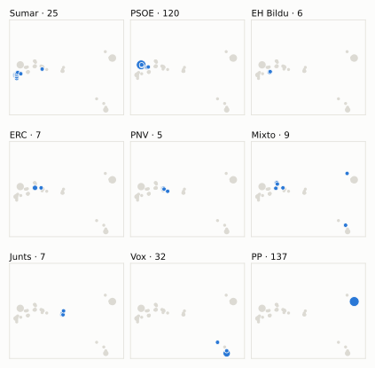
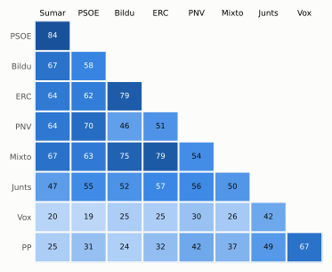

# Análisis detallado: septiembre de 2026

[← Volver al resumen del mes](2026-09.md)

_Generado automáticamente el 2026-11-10 con datos abiertos del [Congreso de los Diputados](https://www.congreso.es/es/opendata/votaciones). Solo plenos y Diputación Permanente. Método y límites en [docs/DOCUMENTO_FUNCIONAL.md](../docs/DOCUMENTO_FUNCIONAL.md)._

## Resumen

- **119 votaciones** en 8 días de pleno (sesiones 195, 196, 197, 198, 199, 200, 201 y 202).
- **71 aprobadas** y **48 rechazadas**; de ellas, 1 secreta.
- 17 votaciones se decidieron por 5 votos o menos.
- El grupo que más veces votó con el resultado final: **PP** (69 % de las votaciones nominales).
- Los grupos del Gobierno (PSOE y Sumar) votaron lo mismo en 91 de 118 votaciones nominales y perdieron 28 de ellas.
- 51 votos individuales se apartaron de la posición de su grupo (24 diputados).

## Cómo votó cada grupo

| Grupo | Diputados | Cohesión | Votó con el resultado | Decisivo | Posición Sí | Posición No | Posición Abst. |
| --- | ---: | ---: | ---: | ---: | ---: | ---: | ---: |
| PP | 137 | 100 % | 69 % | 33 | 90 | 18 | 10 |
| PSOE | 121 | 100 % | 60 % | 27 | 43 | 57 | 18 |
| Vox | 32 | 100 % | 56 % | 20 | 66 | 32 | 20 |
| Sumar | 26 | 99 % | 54 % | 21 | 41 | 65 | 12 |
| Mixto | 9 | 64 % | 59 % | 14 | 64 | 46 | 6 |
| Junts | 7 | 100 % | 67 % | 16 | 45 | 45 | 28 |
| ERC | 7 | 100 % | 57 % | 14 | 58 | 45 | 15 |
| EH Bildu | 6 | 100 % | 47 % | 13 | 45 | 50 | 23 |
| PNV | 5 | 100 % | 66 % | 5 | 41 | 57 | 19 |

*Cohesión*: índice de acuerdo interno (100 % = todo el grupo votó igual). *Votó con el resultado*: el grupo votó Sí y salió aprobada, o No y salió rechazada. *Decisivo*: votaciones cuyo resultado habría cambiado si el grupo se hubiera abstenido en bloque. El Grupo Mixto reúne partidos distintos: su posición es la de su mayoría.

## Mapa de diputados

<picture>
  <source media="(prefers-color-scheme: dark)" srcset="img/2026-09/mapa-oscuro.svg">
  
</picture>

Cada punto es un diputado; dos diputados están cerca si votaron parecido. Un punto más grande reúne a varios que votaron exactamente igual. En cada panel, el grupo en azul y el resto del Congreso en gris.

*Cómo se calcula*: componentes principales de los votos (Sí, No, abstención) en 112 votaciones con algún desacuerdo. El eje horizontal recoge el 80 % de la variación y el vertical el 8 %. Los ejes no tienen nombre ni sentido político propio; por convención, el PP queda a la derecha. No se sitúa a 3 diputados que votó en menos de la mitad.

## Afinidad entre grupos

<picture>
  <source media="(prefers-color-scheme: dark)" srcset="img/2026-09/afinidad-oscuro.svg">
  
</picture>

Porcentaje de votaciones nominales en que los dos grupos tomaron la misma posición. Los grupos están ordenados según el mapa de diputados.

Ver la tabla

|  | PP | PSOE | Vox | Sumar | Mixto | Junts | ERC | EH Bildu | PNV |
| --- | :---: | :---: | :---: | :---: | :---: | :---: | :---: | :---: | :---: |
| PP | 100 % | 31 % | 67 % | 25 % | 37 % | 49 % | 32 % | 24 % | 42 % |
| PSOE | 31 % | 100 % | 19 % | 84 % | 63 % | 55 % | 62 % | 58 % | 70 % |
| Vox | 67 % | 19 % | 100 % | 20 % | 26 % | 42 % | 25 % | 25 % | 30 % |
| Sumar | 25 % | 84 % | 20 % | 100 % | 67 % | 47 % | 64 % | 67 % | 64 % |
| Mixto | 37 % | 63 % | 26 % | 67 % | 100 % | 50 % | 79 % | 75 % | 54 % |
| Junts | 49 % | 55 % | 42 % | 47 % | 50 % | 100 % | 57 % | 52 % | 56 % |
| ERC | 32 % | 62 % | 25 % | 64 % | 79 % | 57 % | 100 % | 79 % | 51 % |
| EH Bildu | 24 % | 58 % | 25 % | 67 % | 75 % | 52 % | 79 % | 100 % | 46 % |
| PNV | 42 % | 70 % | 30 % | 64 % | 54 % | 56 % | 51 % | 46 % | 100 % |

## Quién sacó adelante las votaciones

| Grupos que votaron Sí | Votaciones | Escaños |
| --- | ---: | ---: |
| Todos los grupos | 9 | 350 |
| PP + Vox | 7 | 169 |
| PP + Vox + Junts | 5 | 176 |
| PP + Vox + PNV | 4 | 174 |
| PP + PSOE + Vox + Sumar + Mixto + Junts + ERC + EH Bildu | 3 | 345 |
| PP + PSOE + Sumar + Mixto + PNV | 3 | 298 |
| PP + PSOE + Sumar + Mixto + Junts + ERC + EH Bildu + PNV | 2 | 318 |
| PP + Vox + Mixto + ERC + PNV | 2 | 190 |

De 70 votaciones nominales aprobadas. Otras 35 salieron con combinaciones que se dieron menos veces. La posición de cada grupo es la de la mayoría de sus diputados.

## Votaciones que perdieron los grupos del Gobierno

| Fecha | Asunto | Tipo | PSOE y Sumar votaron | Resultado | Sí | No |
| --- | --- | --- | :---: | --- | ---: | ---: |
| 10 de septiembre | Proposición no de Ley del Grupo Parlamentario Socialista, sobre la necesidad de transparencia. | Proposiciones no de ley | Sí | Rechazada | 163 | 174 |
| 10 de septiembre | Moción consecuencia de interpelación urgente del Grupo Parlamentario Popular en el Congreso, sobre la política en materia de vivienda del Gobierno. *(Votación separada por puntos. Punto 1.a)* | Mociones | No | Aprobada | 170 | 168 |
| 10 de septiembre | Dictamen de la Comisión Mixta para las Relaciones con el Tribunal de Cuentas en relación con la Declaración sobre la Cuenta General del Estado del ejercicio 20… | Presupuestos y estabilidad | No | Aprobada | 177 | 168 |
| 16 de septiembre | Proposición no de Ley del Grupo Parlamentario Plurinacional SUMAR, contra las medidas de coerción de Estados Unidos contra Cuba y la defensa del derecho intern… | Proposiciones no de ley | Sí | Rechazada | 163 | 170 |
| 16 de septiembre | Moción consecuencia de interpelación urgente del Grupo Parlamentario Popular en el Congreso, sobre la crisis que atraviesa la Ciudad Autónoma de Ceuta. *(Votación separada por puntos. Primer apartado.)* | Mociones | No | Aprobada | 184 | 149 |
| 16 de septiembre | Moción consecuencia de interpelación urgente del Grupo Parlamentario Popular en el Congreso, sobre la crisis que atraviesa la Ciudad Autónoma de Ceuta. *(Votación separada por puntos. Punto 1 del segundo apartado.)* | Mociones | No | Aprobada | 172 | 163 |
| 16 de septiembre | Moción consecuencia de interpelación urgente del Grupo Parlamentario Popular en el Congreso, sobre la crisis que atraviesa la Ciudad Autónoma de Ceuta. *(Votación separada por puntos. Punto 2 del segundo apartado.)* | Mociones | No | Aprobada | 183 | 163 |
| 16 de septiembre | Real Decreto-ley 21/2026, de 25 de agosto, de transparencia e integridad de las actividades de los grupos de interés. | Decretos-ley (convalidación) | Sí | Rechazada | 155 | 179 |
| 16 de septiembre | Proyecto de Ley por la que se modifican el Texto Refundido de la Ley General de derechos de las personas con discapacidad y de su inclusión social, aprobado po… *(Votación separada de las enmiendas. Enmienda al artículo pr…)* | Leyes: enmiendas del Senado | No | Aprobada | 164 | 150 |
| 16 de septiembre | Proyecto de Ley por la que se modifican el Texto Refundido de la Ley General de derechos de las personas con discapacidad y de su inclusión social, aprobado po… *(Votación separada de las enmiendas. Enmienda al artículo pr…)* | Leyes: enmiendas del Senado | No | Aprobada | 196 | 145 |
| 16 de septiembre | Proyecto de Ley por la que se modifican el Texto Refundido de la Ley General de derechos de las personas con discapacidad y de su inclusión social, aprobado po… *(Votación separada de las enmiendas. Enmienda al artículo pr…)* | Leyes: enmiendas del Senado | No | Aprobada | 189 | 152 |
| 16 de septiembre | Proyecto de Ley por la que se modifican el Texto Refundido de la Ley General de derechos de las personas con discapacidad y de su inclusión social, aprobado po… *(Votación separada de las enmiendas. Enmienda al artículo se…)* | Leyes: enmiendas del Senado | No | Aprobada | 179 | 150 |
| 16 de septiembre | Proyecto de Ley por la que se modifican el Texto Refundido de la Ley General de derechos de las personas con discapacidad y de su inclusión social, aprobado po… *(Votación separada de las enmiendas. Enmienda al artículo se…)* | Leyes: enmiendas del Senado | No | Aprobada | 158 | 150 |
| 16 de septiembre | Proyecto de Ley por la que se modifican el Texto Refundido de la Ley General de derechos de las personas con discapacidad y de su inclusión social, aprobado po… *(Votación separada de las enmiendas. Enmienda al artículo se…)* | Leyes: enmiendas del Senado | No | Aprobada | 178 | 168 |
| 16 de septiembre | Proyecto de Ley por la que se modifican el Texto Refundido de la Ley General de derechos de las personas con discapacidad y de su inclusión social, aprobado po… *(Votación separada de las enmiendas. Enmienda al artículo se…)* | Leyes: enmiendas del Senado | No | Aprobada | 159 | 154 |

Y 13 más (ver «Todas las votaciones»).

Además, PSOE y Sumar votaron distinto entre sí en 19 votaciones.

## Votaciones más ajustadas

| Fecha | Asunto | Resultado | Sí | No | Abst. |
| --- | --- | :---: | ---: | ---: | ---: |
| 30 de septiembre | Moción consecuencia de interpelación urgente del Grupo Parlamentario Popular en el Congreso, sobre la gestión del Ministerio de Defensa durante la reciente cri… *(Votación separada por puntos. Punto 3 del primer bloque.)* | Aprobada | 171 | 170 | 6 |
| 10 de septiembre | Moción consecuencia de interpelación urgente del Grupo Parlamentario Popular en el Congreso, sobre la política en materia de vivienda del Gobierno. *(Votación separada por puntos. Punto 1.a)* | Aprobada | 170 | 168 | 8 |
| 23 de septiembre | Moción consecuencia de interpelación urgente del Grupo Parlamentario Popular en el Congreso, sobre la nefasta política educativa de su Gobierno. *(Votación separada por puntos. Punto II.2.)* | Aprobada | 172 | 170 | 6 |
| 30 de septiembre | Moción consecuencia de interpelación urgente del Grupo Parlamentario Popular en el Congreso, sobre la gestión del Ministerio de Defensa durante la reciente cri… *(Votación separada por puntos. Punto 1, 2 y 4 del primer blo…)* | Rechazada | 172 | 174 | 0 |
| 30 de septiembre | Moción consecuencia de interpelación urgente del Grupo Parlamentario Popular en el Congreso, sobre la gestión del Ministerio de Defensa durante la reciente cri… *(Votación separada por puntos. Segundo bloque.)* | Aprobada | 172 | 170 | 5 |
| 16 de septiembre | Proyecto de Ley por la que se modifican el Texto Refundido de la Ley General de derechos de las personas con discapacidad y de su inclusión social, aprobado po… *(Votación separada de las enmiendas. Enmienda a la disposici…)* | Rechazada | 171 | 174 | 0 |
| 16 de septiembre | Proyecto de Ley por la que se modifican el Texto Refundido de la Ley General de derechos de las personas con discapacidad y de su inclusión social, aprobado po… *(Votación separada de las enmiendas. Enmiendas al artículo s…)* | Rechazada | 171 | 175 | 0 |
| 16 de septiembre | Proyecto de Ley por la que se modifican el Texto Refundido de la Ley General de derechos de las personas con discapacidad y de su inclusión social, aprobado po… *(Votación separada de las enmiendas. Enmienda a la disposici…)* | Rechazada | 171 | 175 | 0 |
| 16 de septiembre | Proyecto de Ley por la que se modifican el Texto Refundido de la Ley General de derechos de las personas con discapacidad y de su inclusión social, aprobado po… *(Votación separada de las enmiendas. Resto de las enmiendas.)* | Rechazada | 171 | 175 | 0 |
| 23 de septiembre | Moción consecuencia de interpelación urgente del Grupo Parlamentario Popular en el Congreso, sobre la nefasta política educativa de su Gobierno. *(Votación separada por puntos. Punto II.3.)* | Rechazada | 172 | 176 | 0 |

Votaciones decididas por 10 votos o menos (o a esa distancia de la mayoría que exigían). Las públicas por llamamiento no tienen hemiciclo: el voto de cada diputado solo consta en el Diario de Sesiones.

## Qué se votó, por tipo de asunto

| Tipo de asunto | Votaciones | Aprobadas | No aprobadas |
| --- | ---: | ---: | ---: |
| Leyes: enmiendas del Senado | 39 | 23 | 16 |
| Mociones | 36 | 18 | 18 |
| Tratados internacionales | 9 | 9 | 0 |
| Leyes: toma en consideración | 8 | 5 | 3 |
| Proposiciones no de ley | 8 | 1 | 7 |
| Decretos-ley (convalidación) | 7 | 6 | 1 |
| Organización de la Cámara | 6 | 6 | 0 |
| Leyes: dictamen y votación final | 4 | 2 | 2 |
| Presupuestos y estabilidad | 1 | 1 | 0 |
| Enmiendas a la totalidad | 1 | 0 | 1 |

Las proposiciones no de ley y las mociones expresan la posición del Congreso pero no obligan al Gobierno. Las leyes pasan por varias votaciones (toma en consideración, totalidad, dictamen, Senado), así que una misma ley puede aparecer varias veces.

## Votos distintos de su grupo

| Diputado | Grupo | Votos distintos de su grupo |
| --- | --- | ---: |
| Vidal Sáez, Aina | Sumar | 5 |
| Fagúndez Campo, Antidio | PSOE | 4 |
| López Zamora, Cristina | PSOE | 4 |
| Maldonado López, Adriana | PSOE | 4 |
| Otero García, Mercedes | PSOE | 4 |
| Pose Mesura, Modesto | PSOE | 4 |
| Serrano Martínez, Juan Francisco | PSOE | 4 |
| Vidal Matas, Vicenç | Sumar | 4 |
| Pisarello Prados, Gerardo | Sumar | 2 |
| Santos Maraver, Agustín | Sumar | 2 |
| Borrego Cortés, Isabel María | PP | 1 |
| Bravo Baena, Juan | PP | 1 |
| Hernando Fraile, Rafael Antonio | PP | 1 |
| Ibáñez Mezquita, Alberto | Sumar | 1 |
| Martín Blanco, Nacho | PP | 1 |

Un voto aislado puede ser un error al pulsar, no una decisión política: el Congreso no publica las correcciones. Se excluye el Grupo Mixto.

## Diputados que más veces no votaron

| Diputado | Grupo | No votó | % de votaciones |
| --- | --- | ---: | ---: |
| Díaz Pérez, Yolanda | Sumar | 84 | 71 % |
| Sánchez Pérez-Castejón, Pedro | PSOE | 83 | 70 % |
| Martínez Barbero, Verónica | Sumar | 58 | 49 % |
| González-Robatto Perote, Jacobo | Vox | 25 | 21 % |
| Bolaños García, Félix | PSOE | 20 | 17 % |
| Nogueras i Camero, Míriam | Junts | 20 | 17 % |
| Puente Santiago, Óscar | PSOE | 19 | 16 % |
| Salvador i Duch, Jordi | ERC | 19 | 16 % |
| Cruset Domènech, Josep Maria | Junts | 13 | 11 % |
| Vaquero Montero, Maribel | PNV | 13 | 11 % |
| Martínez Hierro, Lander | Sumar | 12 | 10 % |
| Rego Candamil, Néstor | Mixto | 12 | 10 % |
| Núñez Feijóo, Alberto | PP | 9 | 8 % |
| Ibáñez Mezquita, Alberto | Sumar | 4 | 3 % |
| Varela Pazos, Marta | PP | 4 | 3 % |

«No vota» incluye ausencias justificadas (baja, maternidad o paternidad) y escaños vacantes; el portal no las distingue.

## Todas las votaciones

Posición de cada grupo: la opción que votó la mayoría de sus diputados (*Div.*: empate dentro del grupo). El número enlaza al JSON oficial o, en las votaciones por llamamiento, al Diario de Sesiones.

### 9 de septiembre (sesión 195)

| Nº | Asunto | Resultado | Sí | No | Abst. | PP | PSOE | Vox | Sumar | Mixto | Junts | ERC | EH Bildu | PNV | Decisivos |
| ---: | --- | --- | ---: | ---: | ---: | :---: | :---: | :---: | :---: | :---: | :---: | :---: | :---: | :---: | --- |
| [1](https://www.congreso.es/webpublica/opendata/votaciones/Leg15/Sesion195/20260909/Votacion001/VOT_20260909195430.json) | Real Decreto-ley 20/2026, de 29 de julio, por el que se establecen medidas urgentes de protección laboral y social frente a los incendios forestales. | Aprobada | 312 | 30 | 1 | Sí | Sí | No | Sí | Sí | Sí | Sí | Sí | Sí |  |
| [2](https://www.congreso.es/webpublica/opendata/votaciones/Leg15/Sesion195/20260909/Votacion002/VOT_20260909195432.json) | Tramitación como Proyecto de Ley por el procedimiento de urgencia del Real Decreto-ley 20/2026, de 29 de julio, por el que se establecen medidas urgentes de pr… | Aprobada | 342 | 0 | 0 | Sí | Sí | Sí | Sí | Sí | Sí | Sí | Sí | Sí |  |

### 10 de septiembre (sesión 196)

| Nº | Asunto | Resultado | Sí | No | Abst. | PP | PSOE | Vox | Sumar | Mixto | Junts | ERC | EH Bildu | PNV | Decisivos |
| ---: | --- | --- | ---: | ---: | ---: | :---: | :---: | :---: | :---: | :---: | :---: | :---: | :---: | :---: | --- |
| [1](https://www.congreso.es/webpublica/opendata/votaciones/Leg15/Sesion196/20260910/Votacion001/VOT_20260910180627.json) | Proposición de Ley sobre concesión de nacionalidad española a las y los saharauis nacidos bajo la administración española. *(Enmiendas presentadas por el Grupo Parlamentario Popular en…)* | Rechazada | 139 | 207 | 1 | Sí | No | No | No | No | No | No | No | No | PSOE |
| [2](https://www.congreso.es/webpublica/opendata/votaciones/Leg15/Sesion196/20260910/Votacion002/VOT_20260910180629.json) | Proposición de Ley sobre concesión de nacionalidad española a las y los saharauis nacidos bajo la administración española. *(Enmiendas presentadas por el Grupo Parlamentario Popular en…)* | Rechazada | 169 | 177 | 1 | Sí | No | Sí | No | No | No | No | No | No | PSOE, Sumar |
| [3](https://www.congreso.es/webpublica/opendata/votaciones/Leg15/Sesion196/20260910/Votacion003/VOT_20260910180631.json) | Votación del dictamen de la Proposición de Ley sobre concesión de nacionalidad española a las y los saharauis nacidos bajo la administración española. | Aprobada | 168 | 31 | 145 | Abst. | Sí | No | Sí | Sí | Abst. | Sí | Sí | Sí |  |
| [4](https://www.congreso.es/webpublica/opendata/votaciones/Leg15/Sesion196/20260910/Votacion004/VOT_20260910180632.json) | Proposición no de Ley del Grupo Parlamentario Popular en el Congreso, para una respuesta de Estado ante la crisis de seguridad nacional en Ceuta y para garanti… | Rechazada | 170 | 175 | 1 | Sí | No | Sí | No | No | No | No | No | No | EH Bildu, Junts, Mixto, ERC, PSOE, Sumar |
| [5](https://www.congreso.es/webpublica/opendata/votaciones/Leg15/Sesion196/20260910/Votacion005/VOT_20260910180633.json) | Proposición no de Ley del Grupo Parlamentario Socialista, sobre la necesidad de transparencia. | Rechazada | 163 | 174 | 8 | No | Sí | No | Sí | Sí | Abst. | Sí | Sí | No | PP, Vox |
| [6](https://www.congreso.es/webpublica/opendata/votaciones/Leg15/Sesion196/20260910/Votacion006/VOT_20260910180635.json) | Moción consecuencia de interpelación urgente del Grupo Parlamentario VOX, sobre la estrategia que seguirá el Gobierno para revertir el empobrecimiento de los e… | Rechazada | 32 | 177 | 137 | Abst. | No | Sí | No | No | No | No | No | No |  |
| [7](https://www.congreso.es/webpublica/opendata/votaciones/Leg15/Sesion196/20260910/Votacion007/VOT_20260910180637.json) | Moción consecuencia de interpelación urgente del Grupo Parlamentario Popular en el Congreso, sobre la política en materia de vivienda del Gobierno. *(Votación separada por puntos. Punto 1.a)* | Aprobada | 170 | 168 | 8 | Sí | No | Sí | No | No | Abst. | No | No | No | PP, Vox |
| [8](https://www.congreso.es/webpublica/opendata/votaciones/Leg15/Sesion196/20260910/Votacion008/VOT_20260910180639.json) | Moción consecuencia de interpelación urgente del Grupo Parlamentario Popular en el Congreso, sobre la política en materia de vivienda del Gobierno. *(Votación separada por puntos. Punto 1.b)* | Aprobada | 176 | 43 | 127 | Sí | Abst. | Sí | No | No | Abst. | No | No | Sí | PP |
| [9](https://www.congreso.es/webpublica/opendata/votaciones/Leg15/Sesion196/20260910/Votacion009/VOT_20260910180641.json) | Moción consecuencia de interpelación urgente del Grupo Parlamentario Popular en el Congreso, sobre la política en materia de vivienda del Gobierno. *(Votación separada por puntos. Punto 1.c)* | Aprobada | 171 | 44 | 131 | Sí | Abst. | Sí | No | No | Abst. | No | No | Abst. | PP |
| [10](https://www.congreso.es/webpublica/opendata/votaciones/Leg15/Sesion196/20260910/Votacion010/VOT_20260910180642.json) | Moción consecuencia de interpelación urgente del Grupo Parlamentario Popular en el Congreso, sobre la política en materia de vivienda del Gobierno. *(Votación separada por puntos. Punto 1.d)* | Aprobada | 183 | 36 | 127 | Sí | Abst. | Sí | No | Div. | Abst. | Sí | No | Sí |  |
| [11](https://www.congreso.es/webpublica/opendata/votaciones/Leg15/Sesion196/20260910/Votacion011/VOT_20260910180643.json) | Moción consecuencia de interpelación urgente del Grupo Parlamentario Popular en el Congreso, sobre la política en materia de vivienda del Gobierno. *(Votación separada por puntos. Punto 1.e)* | Aprobada | 183 | 36 | 126 | Sí | Abst. | Sí | No | Sí | Abst. | Sí | No | Sí |  |
| [12](https://www.congreso.es/webpublica/opendata/votaciones/Leg15/Sesion196/20260910/Votacion012/VOT_20260910180645.json) | Moción consecuencia de interpelación urgente del Grupo Parlamentario Popular en el Congreso, sobre la política en materia de vivienda del Gobierno. *(Votación separada por puntos. Punto 1.f)* | Aprobada | 175 | 36 | 135 | Sí | Abst. | Sí | No | No | Abst. | Abst. | No | Sí |  |
| [13](https://www.congreso.es/webpublica/opendata/votaciones/Leg15/Sesion196/20260910/Votacion013/VOT_20260910180646.json) | Moción consecuencia de interpelación urgente del Grupo Parlamentario Popular en el Congreso, sobre la política en materia de vivienda del Gobierno. *(Votación separada por puntos. Punto 1.g)* | Aprobada | 176 | 44 | 126 | Sí | Abst. | Sí | No | No | Abst. | No | No | Sí | PP |
| [14](https://www.congreso.es/webpublica/opendata/votaciones/Leg15/Sesion196/20260910/Votacion014/VOT_20260910180647.json) | Moción consecuencia de interpelación urgente del Grupo Parlamentario Popular en el Congreso, sobre la política en materia de vivienda del Gobierno. *(Votación separada por puntos. Punto 1.h)* | Aprobada | 176 | 36 | 133 | Sí | Abst. | Sí | No | Div. | Abst. | Abst. | No | Sí |  |
| [15](https://www.congreso.es/webpublica/opendata/votaciones/Leg15/Sesion196/20260910/Votacion015/VOT_20260910180649.json) | Proposición de Ley del Grupo Parlamentario Popular en el Congreso, Orgánica de modificación de la Ley Orgánica 6/1985, de 1 de julio, del Poder Judicial, para… | Rechazada | 170 | 175 | 0 | Sí | No | Sí | No | No | No | No | No | No | EH Bildu, Junts, Mixto, ERC, PSOE, Sumar |
| [16](https://www.congreso.es/webpublica/opendata/votaciones/Leg15/Sesion196/20260910/Votacion016/VOT_20260910180650.json) | Proposición de Ley del Grupo Parlamentario Socialista, sobre el reconocimiento de la profesión de biólogo y trabajador social como profesión sanitaria. | Aprobada | 165 | 32 | 148 | Abst. | Sí | No | Sí | Sí | Abst. | Sí | Sí | Abst. |  |
| [17](https://www.congreso.es/webpublica/opendata/votaciones/Leg15/Sesion196/20260910/Votacion017/VOT_20260910180652.json) | Acuerdo Internacional entre el Reino de España y la Organización de las Naciones Unidas para la Educación, la Ciencia y la Cultura (UNESCO) relativo a la desig… | Aprobada | 263 | 57 | 25 | Sí | Sí | No | No | Sí | Abst. | Abst. | Abst. | Abst. |  |
| [18](https://www.congreso.es/webpublica/opendata/votaciones/Leg15/Sesion196/20260910/Votacion018/VOT_20260910180653.json) | Segundo Protocolo de Revisión del Convenio sobre cooperación para la protección y el aprovechamiento sostenible de las aguas de las cuencas hidrográficas hispa… | Aprobada | 156 | 0 | 189 | Abst. | Sí | Abst. | Sí | Sí | Abst. | Abst. | Abst. | Sí |  |
| [19](https://www.congreso.es/webpublica/opendata/votaciones/Leg15/Sesion196/20260910/Votacion019/VOT_20260910180654.json) | Acuerdo entre el Reino de España y Australia para la protección mutua de información clasificada de interés para la defensa, hecho en Bruselas el 12 de febrero… | Aprobada | 268 | 0 | 77 | Sí | Sí | Abst. | Abst. | Sí | Abst. | Abst. | Abst. | Sí |  |
| [20](https://www.congreso.es/webpublica/opendata/votaciones/Leg15/Sesion196/20260910/Votacion020/VOT_20260910180656.json) | Dictamen de la Comisión Mixta para las Relaciones con el Tribunal de Cuentas en relación con la Declaración sobre la Cuenta General del Estado del ejercicio 20… | Aprobada | 177 | 168 | 0 | Sí | No | Sí | No | No | Sí | No | No | No | PP, Vox |
| [21](https://www.congreso.es/webpublica/opendata/votaciones/Leg15/Sesion196/20260910/Votacion021/VOT_20260910180657.json) | Propuesta de la Comisión de Interior, de creación de una Subcomisión para la elaboración de un Estatuto jurídico básico de las personas desaparecidas sin causa… | Aprobada | 314 | 0 | 32 | Sí | Sí | Abst. | Sí | Sí | Sí | Sí | Sí | Sí |  |

### 15 de septiembre (sesión 197)

| Nº | Asunto | Resultado | Sí | No | Abst. | PP | PSOE | Vox | Sumar | Mixto | Junts | ERC | EH Bildu | PNV | Decisivos |
| ---: | --- | --- | ---: | ---: | ---: | :---: | :---: | :---: | :---: | :---: | :---: | :---: | :---: | :---: | --- |
| [1](https://www.congreso.es/webpublica/opendata/votaciones/Leg15/Sesion197/20260915/Votacion001/VOT_20260915204520.json) | Proposición de Ley del Grupo Parlamentario VOX, Orgánica de modificación de la Ley Orgánica 5/2005, de 17 de noviembre, de la Defensa Nacional. | Rechazada | 168 | 178 | 0 | Sí | No | Sí | No | No | No | No | No | No | PSOE, Sumar |
| [2](https://www.congreso.es/webpublica/opendata/votaciones/Leg15/Sesion197/20260915/Votacion002/VOT_20260915204523.json) | Proposición de Ley del Grupo Parlamentario Plurinacional SUMAR, para la modificación de la Ley 12/2023, de 24 de mayo, por el derecho a la vivienda. | Rechazada | 44 | 175 | 127 | No | Abst. | No | Sí | Sí | No | Sí | Sí | Abst. | PP |

### 16 de septiembre (sesión 198)

| Nº | Asunto | Resultado | Sí | No | Abst. | PP | PSOE | Vox | Sumar | Mixto | Junts | ERC | EH Bildu | PNV | Decisivos |
| ---: | --- | --- | ---: | ---: | ---: | :---: | :---: | :---: | :---: | :---: | :---: | :---: | :---: | :---: | --- |
| [1](https://www.congreso.es/webpublica/opendata/votaciones/Leg15/Sesion198/20260916/Votacion001/VOT_20260916195336.json) | Proposición no de Ley del Grupo Parlamentario VOX, relativa al cumplimiento del Acuerdo entre el Reino de España y el Reino de Marruecos sobre la cooperación e… | Rechazada | 170 | 177 | 0 | Sí | No | Sí | No | No | No | No | No | No | Mixto, PSOE, Sumar |
| [2](https://www.congreso.es/webpublica/opendata/votaciones/Leg15/Sesion198/20260916/Votacion002/VOT_20260916195338.json) | Proposición no de Ley del Grupo Parlamentario Plurinacional SUMAR, contra las medidas de coerción de Estados Unidos contra Cuba y la defensa del derecho intern… | Rechazada | 163 | 170 | 13 | No | Sí | No | Sí | Sí | Abst. | Sí | Sí | Abst. | PP, Vox |
| [3](https://www.congreso.es/webpublica/opendata/votaciones/Leg15/Sesion198/20260916/Votacion003/VOT_20260916195340.json) | Moción consecuencia de interpelación urgente del Grupo Parlamentario Mixto (Sra. Belarra Urteaga), relativa a los planes del Gobierno sobre el encarecimiento d… *(Votación separada por puntos. Punto 1.)* | Rechazada | 19 | 183 | 144 | No | Abst. | No | Abst. | Sí | No | Sí | Sí | No |  |
| [4](https://www.congreso.es/webpublica/opendata/votaciones/Leg15/Sesion198/20260916/Votacion004/VOT_20260916195343.json) | Moción consecuencia de interpelación urgente del Grupo Parlamentario Mixto (Sra. Belarra Urteaga), relativa a los planes del Gobierno sobre el encarecimiento d… *(Votación separada por puntos. Punto 2.)* | Rechazada | 18 | 183 | 145 | No | Abst. | No | Abst. | Sí | No | Sí | Sí | No |  |
| [5](https://www.congreso.es/webpublica/opendata/votaciones/Leg15/Sesion198/20260916/Votacion005/VOT_20260916195345.json) | Moción consecuencia de interpelación urgente del Grupo Parlamentario Mixto (Sra. Belarra Urteaga), relativa a los planes del Gobierno sobre el encarecimiento d… *(Votación separada por puntos. Punto 3.)* | Rechazada | 19 | 183 | 144 | No | Abst. | No | Abst. | Sí | No | Sí | Sí | No |  |
| [6](https://www.congreso.es/webpublica/opendata/votaciones/Leg15/Sesion198/20260916/Votacion006/VOT_20260916195347.json) | Moción consecuencia de interpelación urgente del Grupo Parlamentario Mixto (Sra. Belarra Urteaga), relativa a los planes del Gobierno sobre el encarecimiento d… *(Votación separada por puntos. Punto 4.)* | Rechazada | 19 | 304 | 24 | No | No | No | Abst. | Sí | No | Sí | Sí | No |  |
| [7](https://www.congreso.es/webpublica/opendata/votaciones/Leg15/Sesion198/20260916/Votacion007/VOT_20260916195348.json) | Moción consecuencia de interpelación urgente del Grupo Parlamentario Mixto (Sra. Belarra Urteaga), relativa a los planes del Gobierno sobre el encarecimiento d… *(Votación separada por puntos. Punto 5.)* | Rechazada | 19 | 304 | 24 | No | No | No | Abst. | Sí | No | Sí | Sí | No |  |
| [8](https://www.congreso.es/webpublica/opendata/votaciones/Leg15/Sesion198/20260916/Votacion008/VOT_20260916195351.json) | Moción consecuencia de interpelación urgente del Grupo Parlamentario Mixto (Sra. Belarra Urteaga), relativa a los planes del Gobierno sobre el encarecimiento d… *(Votación separada por puntos. Punto 6.)* | Rechazada | 18 | 171 | 157 | No | Abst. | No | Abst. | Sí | Abst. | Sí | Sí | Abst. |  |
| [9](https://www.congreso.es/webpublica/opendata/votaciones/Leg15/Sesion198/20260916/Votacion009/VOT_20260916195352.json) | Moción consecuencia de interpelación urgente del Grupo Parlamentario Mixto (Sra. Belarra Urteaga), relativa a los planes del Gobierno sobre el encarecimiento d… *(Votación separada por puntos. Punto 7.)* | Rechazada | 20 | 168 | 158 | No | Abst. | No | Abst. | Sí | Abst. | Sí | Sí | Abst. |  |
| [10](https://www.congreso.es/webpublica/opendata/votaciones/Leg15/Sesion198/20260916/Votacion010/VOT_20260916195355.json) | Moción consecuencia de interpelación urgente del Grupo Parlamentario VOX, sobre las medidas que va a adoptar el Gobierno para revertir la situación de inseguri… | Rechazada | 33 | 174 | 137 | Abst. | No | Sí | No | No | No | No | No | No |  |
| [11](https://www.congreso.es/webpublica/opendata/votaciones/Leg15/Sesion198/20260916/Votacion011/VOT_20260916195357.json) | Moción consecuencia de interpelación urgente del Grupo Parlamentario Popular en el Congreso, sobre la crisis que atraviesa la Ciudad Autónoma de Ceuta. *(Votación separada por puntos. Primer apartado.)* | Aprobada | 184 | 149 | 11 | Sí | No | Sí | No | Abst. | Sí | Sí | Abst. | No | PP |
| [12](https://www.congreso.es/webpublica/opendata/votaciones/Leg15/Sesion198/20260916/Votacion012/VOT_20260916195359.json) | Moción consecuencia de interpelación urgente del Grupo Parlamentario Popular en el Congreso, sobre la crisis que atraviesa la Ciudad Autónoma de Ceuta. *(Votación separada por puntos. Punto 1 del segundo apartado.)* | Aprobada | 172 | 163 | 12 | Sí | No | Sí | No | No | Abst. | No | No | Abst. | PP, Vox |
| [13](https://www.congreso.es/webpublica/opendata/votaciones/Leg15/Sesion198/20260916/Votacion013/VOT_20260916195400.json) | Moción consecuencia de interpelación urgente del Grupo Parlamentario Popular en el Congreso, sobre la crisis que atraviesa la Ciudad Autónoma de Ceuta. *(Votación separada por puntos. Punto 2 del segundo apartado.)* | Aprobada | 183 | 163 | 1 | Sí | No | Sí | No | No | Sí | No | No | Sí | PP, Vox |
| [14](https://www.congreso.es/webpublica/opendata/votaciones/Leg15/Sesion198/20260916/Votacion014/VOT_20260916195402.json) | Moción consecuencia de interpelación urgente del Grupo Parlamentario Popular en el Congreso, sobre la crisis que atraviesa la Ciudad Autónoma de Ceuta. *(Votación separada por puntos. Punto 3 del segundo apartado.)* | Aprobada | 195 | 139 | 13 | Sí | No | Sí | Sí | No | Abst. | No | No | Abst. | PP |
| [15](https://www.congreso.es/webpublica/opendata/votaciones/Leg15/Sesion198/20260916/Votacion015/VOT_20260916195404.json) | Moción consecuencia de interpelación urgente del Grupo Parlamentario Mixto (Sr. Catalán Higueras), para que el Gobierno explique los motivos por los que el Min… | Aprobada | 172 | 17 | 157 | Sí | Abst. | Sí | Abst. | No | No | Abst. | No | Abst. |  |
| [16](https://www.congreso.es/webpublica/opendata/votaciones/Leg15/Sesion198/20260916/Votacion016/VOT_20260916195406.json) | Real Decreto-ley 21/2026, de 25 de agosto, de transparencia e integridad de las actividades de los grupos de interés. | Rechazada | 155 | 179 | 12 | No | Sí | No | Sí | Abst. | No | Sí | Sí | Abst. | PP, Vox |
| [17](https://www.congreso.es/webpublica/opendata/votaciones/Leg15/Sesion198/20260916/Votacion017/VOT_20260916195408.json) | Real Decreto-ley 22/2026, de 1 de septiembre, por el que se aprueban medidas urgentes de carácter social y económico de apoyo a la ciudad de Ceuta. | Aprobada | 304 | 33 | 7 | Sí | Sí | No | Sí | Sí | Abst. | Sí | Sí | Sí |  |
| [18](https://www.congreso.es/webpublica/opendata/votaciones/Leg15/Sesion198/20260916/Votacion018/VOT_20260916195409.json) | Tramitación como Proyecto de Ley por el procedimiento de urgencia del Real Decreto-ley 22/2026, de 1 de septiembre, por el que se aprueban medidas urgentes de… | Aprobada | 345 | 0 | 0 | Sí | Sí | Sí | Sí | Sí | Sí | Sí | Sí | Sí |  |
| [19](https://www.congreso.es/webpublica/opendata/votaciones/Leg15/Sesion198/20260916/Votacion019/VOT_20260916195411.json) | Proyecto de Ley por la que se modifican el Texto Refundido de la Ley General de derechos de las personas con discapacidad y de su inclusión social, aprobado po… *(Votación separada de las enmiendas. Enmienda al primer párr…)* | Aprobada | 338 | 0 | 8 | Sí | Sí | Sí | Sí | Sí | Sí | Abst. | Sí | Sí |  |
| [20](https://www.congreso.es/webpublica/opendata/votaciones/Leg15/Sesion198/20260916/Votacion020/VOT_20260916195412.json) | Proyecto de Ley por la que se modifican el Texto Refundido de la Ley General de derechos de las personas con discapacidad y de su inclusión social, aprobado po… *(Votación separada de las enmiendas. Enmienda al artículo pr…)* | Aprobada | 164 | 150 | 33 | Sí | No | Abst. | No | Sí | Sí | Sí | Sí | No | PP |
| [21](https://www.congreso.es/webpublica/opendata/votaciones/Leg15/Sesion198/20260916/Votacion021/VOT_20260916195414.json) | Proyecto de Ley por la que se modifican el Texto Refundido de la Ley General de derechos de las personas con discapacidad y de su inclusión social, aprobado po… *(Votación separada de las enmiendas. Enmienda al artículo pr…)* | Rechazada | 143 | 157 | 47 | Sí | No | Abst. | No | Sí | No | Abst. | Abst. | No | PSOE, Sumar |
| [22](https://www.congreso.es/webpublica/opendata/votaciones/Leg15/Sesion198/20260916/Votacion022/VOT_20260916195415.json) | Proyecto de Ley por la que se modifican el Texto Refundido de la Ley General de derechos de las personas con discapacidad y de su inclusión social, aprobado po… *(Votación separada de las enmiendas. Enmiendas al artículo p…)* | Rechazada | 170 | 176 | 0 | Sí | No | Sí | No | No | No | No | No | No | Junts, Mixto, ERC, PSOE, Sumar |
| [23](https://www.congreso.es/webpublica/opendata/votaciones/Leg15/Sesion198/20260916/Votacion023/VOT_20260916195417.json) | Proyecto de Ley por la que se modifican el Texto Refundido de la Ley General de derechos de las personas con discapacidad y de su inclusión social, aprobado po… *(Votación separada de las enmiendas. Enmienda al artículo pr…)* | Rechazada | 138 | 169 | 40 | Sí | No | Abst. | No | No | No | No | Abst. | No | PSOE |
| [24](https://www.congreso.es/webpublica/opendata/votaciones/Leg15/Sesion198/20260916/Votacion024/VOT_20260916195418.json) | Proyecto de Ley por la que se modifican el Texto Refundido de la Ley General de derechos de las personas con discapacidad y de su inclusión social, aprobado po… *(Votación separada de las enmiendas. Enmienda al artículo pr…)* | Aprobada | 196 | 145 | 6 | Sí | No | Sí | No | Sí | Sí | Sí | Abst. | Sí | PP |
| [25](https://www.congreso.es/webpublica/opendata/votaciones/Leg15/Sesion198/20260916/Votacion025/VOT_20260916195419.json) | Proyecto de Ley por la que se modifican el Texto Refundido de la Ley General de derechos de las personas con discapacidad y de su inclusión social, aprobado po… *(Votación separada de las enmiendas. Enmienda al artículo pr…)* | Aprobada | 189 | 152 | 6 | Sí | No | Sí | No | Sí | No | Sí | Abst. | Sí | PP |
| [26](https://www.congreso.es/webpublica/opendata/votaciones/Leg15/Sesion198/20260916/Votacion026/VOT_20260916195420.json) | Proyecto de Ley por la que se modifican el Texto Refundido de la Ley General de derechos de las personas con discapacidad y de su inclusión social, aprobado po… *(Votación separada de las enmiendas. Enmiendas al artículo p…)* | Rechazada | 144 | 165 | 37 | Sí | No | Abst. | No | Abst. | Sí | No | No | No | PSOE, Sumar |
| [27](https://www.congreso.es/webpublica/opendata/votaciones/Leg15/Sesion198/20260916/Votacion027/VOT_20260916195421.json) | Proyecto de Ley por la que se modifican el Texto Refundido de la Ley General de derechos de las personas con discapacidad y de su inclusión social, aprobado po… *(Votación separada de las enmiendas. Enmienda al artículo pr…)* | Aprobada | 336 | 0 | 11 | Sí | Sí | Sí | Sí | Sí | Sí | Sí | Abst. | Abst. |  |
| [28](https://www.congreso.es/webpublica/opendata/votaciones/Leg15/Sesion198/20260916/Votacion028/VOT_20260916195423.json) | Proyecto de Ley por la que se modifican el Texto Refundido de la Ley General de derechos de las personas con discapacidad y de su inclusión social, aprobado po… *(Votación separada de las enmiendas. Enmienda al artículo se…)* | Rechazada | 171 | 176 | 0 | Sí | No | Sí | No | No | No | No | No | No | EH Bildu, Junts, Mixto, ERC, PSOE, Sumar |
| [29](https://www.congreso.es/webpublica/opendata/votaciones/Leg15/Sesion198/20260916/Votacion029/VOT_20260916195424.json) | Proyecto de Ley por la que se modifican el Texto Refundido de la Ley General de derechos de las personas con discapacidad y de su inclusión social, aprobado po… *(Votación separada de las enmiendas. Enmienda al artículo se…)* | Aprobada | 179 | 150 | 18 | Sí | No | Sí | No | Abst. | Sí | Abst. | Abst. | No | PP, Vox |
| [30](https://www.congreso.es/webpublica/opendata/votaciones/Leg15/Sesion198/20260916/Votacion030/VOT_20260916195426.json) | Proyecto de Ley por la que se modifican el Texto Refundido de la Ley General de derechos de las personas con discapacidad y de su inclusión social, aprobado po… *(Votación separada de las enmiendas. Enmiendas al artículo s…)* | Rechazada | 138 | 171 | 38 | Sí | No | Abst. | No | Abst. | No | No | No | No | PSOE |
| [31](https://www.congreso.es/webpublica/opendata/votaciones/Leg15/Sesion198/20260916/Votacion031/VOT_20260916195427.json) | Proyecto de Ley por la que se modifican el Texto Refundido de la Ley General de derechos de las personas con discapacidad y de su inclusión social, aprobado po… *(Votación separada de las enmiendas. Enmiendas al artículo s…)* | Rechazada | 171 | 175 | 0 | Sí | No | Sí | No | No | No | No | No | No | EH Bildu, Junts, Mixto, ERC, PSOE, Sumar, PNV |
| [32](https://www.congreso.es/webpublica/opendata/votaciones/Leg15/Sesion198/20260916/Votacion032/VOT_20260916195429.json) | Proyecto de Ley por la que se modifican el Texto Refundido de la Ley General de derechos de las personas con discapacidad y de su inclusión social, aprobado po… *(Votación separada de las enmiendas. Enmienda al artículo se…)* | Aprobada | 158 | 150 | 39 | Sí | No | Abst. | No | Sí | Sí | Sí | Abst. | No | PP |
| [33](https://www.congreso.es/webpublica/opendata/votaciones/Leg15/Sesion198/20260916/Votacion033/VOT_20260916195432.json) | Proyecto de Ley por la que se modifican el Texto Refundido de la Ley General de derechos de las personas con discapacidad y de su inclusión social, aprobado po… *(Votación separada de las enmiendas. Enmienda al artículo se…)* | Aprobada | 178 | 168 | 0 | Sí | No | Sí | No | No | Sí | No | No | No | PP, Vox |
| [34](https://www.congreso.es/webpublica/opendata/votaciones/Leg15/Sesion198/20260916/Votacion034/VOT_20260916195434.json) | Proyecto de Ley por la que se modifican el Texto Refundido de la Ley General de derechos de las personas con discapacidad y de su inclusión social, aprobado po… *(Votación separada de las enmiendas. Enmienda al artículo se…)* | Aprobada | 159 | 154 | 33 | Sí | No | Abst. | No | No | Sí | Sí | Sí | No | EH Bildu, Junts, PP, ERC |
| [35](https://www.congreso.es/webpublica/opendata/votaciones/Leg15/Sesion198/20260916/Votacion035/VOT_20260916195435.json) | Proyecto de Ley por la que se modifican el Texto Refundido de la Ley General de derechos de las personas con discapacidad y de su inclusión social, aprobado po… *(Votación separada de las enmiendas. Enmienda al artículo se…)* | Aprobada | 191 | 150 | 6 | Sí | No | Sí | No | Sí | Sí | Sí | Abst. | No | PP |
| [36](https://www.congreso.es/webpublica/opendata/votaciones/Leg15/Sesion198/20260916/Votacion036/VOT_20260916195437.json) | Proyecto de Ley por la que se modifican el Texto Refundido de la Ley General de derechos de las personas con discapacidad y de su inclusión social, aprobado po… *(Votación separada de las enmiendas. Enmiendas al artículo s…)* | Rechazada | 142 | 172 | 33 | Sí | No | Abst. | No | Sí | No | No | No | No | PSOE |
| [37](https://www.congreso.es/webpublica/opendata/votaciones/Leg15/Sesion198/20260916/Votacion037/VOT_20260916195439.json) | Proyecto de Ley por la que se modifican el Texto Refundido de la Ley General de derechos de las personas con discapacidad y de su inclusión social, aprobado po… *(Votación separada de las enmiendas. Enmienda al artículo se…)* | Rechazada | 162 | 179 | 6 | Sí | No | No | No | Sí | Sí | Sí | Abst. | Sí | PSOE, Sumar, Vox |
| [38](https://www.congreso.es/webpublica/opendata/votaciones/Leg15/Sesion198/20260916/Votacion038/VOT_20260916195440.json) | Proyecto de Ley por la que se modifican el Texto Refundido de la Ley General de derechos de las personas con discapacidad y de su inclusión social, aprobado po… *(Votación separada de las enmiendas. Enmienda al artículo se…)* | Aprobada | 338 | 2 | 6 | Sí | Sí | Sí | Sí | Sí | Sí | Sí | Sí | Abst. |  |
| [39](https://www.congreso.es/webpublica/opendata/votaciones/Leg15/Sesion198/20260916/Votacion039/VOT_20260916195442.json) | Proyecto de Ley por la que se modifican el Texto Refundido de la Ley General de derechos de las personas con discapacidad y de su inclusión social, aprobado po… *(Votación separada de las enmiendas. Enmienda al artículo se…)* | Aprobada | 195 | 150 | 1 | Sí | No | Sí | No | Sí | Sí | Sí | Sí | No | PP |
| [40](https://www.congreso.es/webpublica/opendata/votaciones/Leg15/Sesion198/20260916/Votacion040/VOT_20260916195443.json) | Proyecto de Ley por la que se modifican el Texto Refundido de la Ley General de derechos de las personas con discapacidad y de su inclusión social, aprobado po… *(Votación separada de las enmiendas. Enmiendas a la disposic…)* | Rechazada | 150 | 160 | 37 | Sí | No | Abst. | No | Abst. | Sí | No | No | Sí | PSOE, Sumar |
| [41](https://www.congreso.es/webpublica/opendata/votaciones/Leg15/Sesion198/20260916/Votacion041/VOT_20260916195444.json) | Proyecto de Ley por la que se modifican el Texto Refundido de la Ley General de derechos de las personas con discapacidad y de su inclusión social, aprobado po… *(Votación separada de las enmiendas. Enmienda a la disposici…)* | Aprobada | 174 | 157 | 15 | Sí | No | Sí | No | Sí | No | Abst. | Abst. | No | PP, Vox |
| [42](https://www.congreso.es/webpublica/opendata/votaciones/Leg15/Sesion198/20260916/Votacion042/VOT_20260916195446.json) | Proyecto de Ley por la que se modifican el Texto Refundido de la Ley General de derechos de las personas con discapacidad y de su inclusión social, aprobado po… *(Votación separada de las enmiendas. Enmiendas a la disposic…)* | Aprobada | 310 | 34 | 2 | Sí | Sí | Sí | No | Sí | Sí | Sí | Sí | No |  |
| [43](https://www.congreso.es/webpublica/opendata/votaciones/Leg15/Sesion198/20260916/Votacion043/VOT_20260916195448.json) | Proyecto de Ley por la que se modifican el Texto Refundido de la Ley General de derechos de las personas con discapacidad y de su inclusión social, aprobado po… *(Votación separada de las enmiendas. Enmienda a la disposici…)* | Aprobada | 197 | 149 | 0 | Sí | No | Sí | No | Sí | Sí | Sí | Sí | No | PP |
| [44](https://www.congreso.es/webpublica/opendata/votaciones/Leg15/Sesion198/20260916/Votacion044/VOT_20260916195449.json) | Proyecto de Ley por la que se modifican el Texto Refundido de la Ley General de derechos de las personas con discapacidad y de su inclusión social, aprobado po… *(Votación separada de las enmiendas. Enmienda a la disposici…)* | Aprobada | 345 | 0 | 0 | Sí | Sí | Sí | Sí | Sí | Sí | Sí | Sí | Sí |  |
| [45](https://www.congreso.es/webpublica/opendata/votaciones/Leg15/Sesion198/20260916/Votacion045/VOT_20260916195451.json) | Proyecto de Ley por la que se modifican el Texto Refundido de la Ley General de derechos de las personas con discapacidad y de su inclusión social, aprobado po… *(Votación separada de las enmiendas. Enmienda a la disposici…)* | Aprobada | 345 | 0 | 0 | Sí | Sí | Sí | Sí | Sí | Sí | Sí | Sí | Sí |  |
| [46](https://www.congreso.es/webpublica/opendata/votaciones/Leg15/Sesion198/20260916/Votacion046/VOT_20260916195452.json) | Proyecto de Ley por la que se modifican el Texto Refundido de la Ley General de derechos de las personas con discapacidad y de su inclusión social, aprobado po… *(Votación separada de las enmiendas. Enmiendas a la disposic…)* | Aprobada | 338 | 6 | 0 | Sí | Sí | Sí | Sí | Sí | Sí | Sí | Sí | Sí |  |
| [47](https://www.congreso.es/webpublica/opendata/votaciones/Leg15/Sesion198/20260916/Votacion047/VOT_20260916195453.json) | Proyecto de Ley por la que se modifican el Texto Refundido de la Ley General de derechos de las personas con discapacidad y de su inclusión social, aprobado po… *(Votación separada de las enmiendas. Enmienda a la disposici…)* | Rechazada | 171 | 174 | 0 | Sí | No | Sí | No | No | No | No | No | No | EH Bildu, Junts, Mixto, ERC, PSOE, Sumar, PNV |
| [48](https://www.congreso.es/webpublica/opendata/votaciones/Leg15/Sesion198/20260916/Votacion048/VOT_20260916195454.json) | Proyecto de Ley por la que se modifican el Texto Refundido de la Ley General de derechos de las personas con discapacidad y de su inclusión social, aprobado po… *(Votación separada de las enmiendas. Enmienda a la disposici…)* | Rechazada | 171 | 175 | 0 | Sí | No | Sí | No | No | No | No | No | No | EH Bildu, Junts, Mixto, ERC, PSOE, Sumar, PNV |
| [49](https://www.congreso.es/webpublica/opendata/votaciones/Leg15/Sesion198/20260916/Votacion049/VOT_20260916195455.json) | Proyecto de Ley por la que se modifican el Texto Refundido de la Ley General de derechos de las personas con discapacidad y de su inclusión social, aprobado po… *(Votación separada de las enmiendas. Enmienda a la disposici…)* | Rechazada | 142 | 170 | 33 | Sí | No | Abst. | No | No | Sí | No | No | No | PSOE |
| [50](https://www.congreso.es/webpublica/opendata/votaciones/Leg15/Sesion198/20260916/Votacion050/VOT_20260916195457.json) | Proyecto de Ley por la que se modifican el Texto Refundido de la Ley General de derechos de las personas con discapacidad y de su inclusión social, aprobado po… *(Votación separada de las enmiendas. Resto de la enmienda a…)* | Aprobada | 289 | 19 | 38 | Sí | Sí | Abst. | Sí | No | Sí | No | No | Abst. |  |
| [51](https://www.congreso.es/webpublica/opendata/votaciones/Leg15/Sesion198/20260916/Votacion051/VOT_20260916195458.json) | Proyecto de Ley por la que se modifican el Texto Refundido de la Ley General de derechos de las personas con discapacidad y de su inclusión social, aprobado po… *(Votación separada de las enmiendas. Enmienda a la disposici…)* | Rechazada | 171 | 176 | 0 | Sí | No | Sí | No | No | No | No | No | No | EH Bildu, Junts, Mixto, ERC, PSOE, Sumar |
| [52](https://www.congreso.es/webpublica/opendata/votaciones/Leg15/Sesion198/20260916/Votacion052/VOT_20260916195500.json) | Proyecto de Ley por la que se modifican el Texto Refundido de la Ley General de derechos de las personas con discapacidad y de su inclusión social, aprobado po… *(Votación separada de las enmiendas. Enmienda a la disposici…)* | Aprobada | 201 | 144 | 1 | Sí | No | Sí | No | Sí | Sí | Sí | Sí | Sí | PP |
| [53](https://www.congreso.es/webpublica/opendata/votaciones/Leg15/Sesion198/20260916/Votacion053/VOT_20260916195503.json) | Proyecto de Ley por la que se modifican el Texto Refundido de la Ley General de derechos de las personas con discapacidad y de su inclusión social, aprobado po… *(Votación separada de las enmiendas. Enmienda a la disposici…)* | Rechazada | 164 | 182 | 0 | Sí | No | No | No | Sí | Sí | Sí | Sí | No | PSOE, Sumar, Vox |
| [54](https://www.congreso.es/webpublica/opendata/votaciones/Leg15/Sesion198/20260916/Votacion054/VOT_20260916195505.json) | Proyecto de Ley por la que se modifican el Texto Refundido de la Ley General de derechos de las personas con discapacidad y de su inclusión social, aprobado po… *(Votación separada de las enmiendas. Enmienda a la disposici…)* | Aprobada | 335 | 11 | 0 | Sí | Sí | Sí | Sí | Sí | Sí | Sí | Sí | No |  |
| [55](https://www.congreso.es/webpublica/opendata/votaciones/Leg15/Sesion198/20260916/Votacion055/VOT_20260916195507.json) | Proyecto de Ley por la que se modifican el Texto Refundido de la Ley General de derechos de las personas con discapacidad y de su inclusión social, aprobado po… *(Votación separada de las enmiendas. Enmienda a la disposici…)* | Aprobada | 157 | 149 | 40 | Sí | No | Abst. | No | Sí | Sí | Sí | Abst. | No | PP |
| [56](https://www.congreso.es/webpublica/opendata/votaciones/Leg15/Sesion198/20260916/Votacion056/VOT_20260916195509.json) | Proyecto de Ley por la que se modifican el Texto Refundido de la Ley General de derechos de las personas con discapacidad y de su inclusión social, aprobado po… *(Votación separada de las enmiendas. Enmienda a la disposici…)* | Aprobada | 331 | 8 | 6 | Sí | Sí | Sí | Sí | Sí | Sí | Sí | Abst. | Sí |  |
| [57](https://www.congreso.es/webpublica/opendata/votaciones/Leg15/Sesion198/20260916/Votacion057/VOT_20260916195511.json) | Proyecto de Ley por la que se modifican el Texto Refundido de la Ley General de derechos de las personas con discapacidad y de su inclusión social, aprobado po… *(Votación separada de las enmiendas. Resto de las enmiendas.)* | Rechazada | 171 | 175 | 0 | Sí | No | Sí | No | No | No | No | No | No | EH Bildu, Junts, Mixto, ERC, PSOE, Sumar, PNV |
| [58](https://www.congreso.es/webpublica/opendata/votaciones/Leg15/Sesion198/20260916/Votacion058/VOT_20260916195513.json) | Dictamen de la Comisión del Estatuto sobre declaración de actividades de Excmos. Sres. Diputados. | Aprobada | 346 | 0 | 1 | Sí | Sí | Sí | Sí | Sí | Sí | Sí | Sí | Sí |  |

### 22 de septiembre (sesión 199)

| Nº | Asunto | Resultado | Sí | No | Abst. | PP | PSOE | Vox | Sumar | Mixto | Junts | ERC | EH Bildu | PNV | Decisivos |
| ---: | --- | --- | ---: | ---: | ---: | :---: | :---: | :---: | :---: | :---: | :---: | :---: | :---: | :---: | --- |
| [1](https://www.congreso.es/webpublica/opendata/votaciones/Leg15/Sesion199/20260922/Votacion001/VOT_20260922205120.json) | Proposición de Ley del Grupo Parlamentario Vasco (EAJ-PNV), de reforma de la Ley Orgánica 1/2025, de 2 de enero, de medidas en materia de eficiencia en el Serv… | Aprobada | 340 | 7 | 0 | Sí | Sí | Sí | Sí | Sí | Sí | No | Sí | Sí |  |
| [2](https://www.congreso.es/webpublica/opendata/votaciones/Leg15/Sesion199/20260922/Votacion002/VOT_20260922205122.json) | Proposición de Ley del Grupo Parlamentario Mixto, de jubilación sin penalización. | Aprobada | 178 | 33 | 136 | Abst. | Sí | No | Sí | Sí | Sí | Sí | Sí | Sí |  |

### 23 de septiembre (sesión 200)

| Nº | Asunto | Resultado | Sí | No | Abst. | PP | PSOE | Vox | Sumar | Mixto | Junts | ERC | EH Bildu | PNV | Decisivos |
| ---: | --- | --- | ---: | ---: | ---: | :---: | :---: | :---: | :---: | :---: | :---: | :---: | :---: | :---: | --- |
| [1](https://www.congreso.es/webpublica/opendata/votaciones/Leg15/Sesion200/20260923/Votacion001/VOT_20260923145112.json) | Proposición no de Ley del Grupo Parlamentario Vasco (EAJ-PNV), sobre la Variante sur Ferroviaria, mercancías por la Y vasca y medidas mitigadoras a nivel munic… | Aprobada | 270 | 70 | 8 | Sí | Sí | No | No | No | Sí | Abst. | No | Sí |  |
| [2](https://www.congreso.es/webpublica/opendata/votaciones/Leg15/Sesion200/20260923/Votacion002/VOT_20260923145115.json) | Proposición no de Ley del Grupo Parlamentario Mixto (Sra. Belarra Urteaga y Sra. Santana Perera), relativa a la aprobación de la Ley de Familias. Se vota en lo… | Rechazada | 19 | 177 | 147 | No | Abst. | No | Abst. | Sí | No | Sí | Sí | — |  |
| [3](https://www.congreso.es/webpublica/opendata/votaciones/Leg15/Sesion200/20260923/Votacion003/VOT_20260923145117.json) | Moción consecuencia de interpelación urgente del Grupo Parlamentario Mixto (Sra. Valido García), sobre la reforma del Estatuto Marco del personal estatutario d… | Rechazada | 15 | 39 | 294 | Abst. | Abst. | No | Abst. | Sí | No | Sí | Abst. | Abst. | Vox |
| [4](https://www.congreso.es/webpublica/opendata/votaciones/Leg15/Sesion200/20260923/Votacion004/VOT_20260923145118.json) | Moción consecuencia de interpelación urgente del Grupo Parlamentario VOX, sobre las medidas que va a adoptar el Gobierno para revertir los pésimos resultados d… | Rechazada | 33 | 178 | 137 | Abst. | No | Sí | No | No | No | No | No | No |  |
| [5](https://www.congreso.es/webpublica/opendata/votaciones/Leg15/Sesion200/20260923/Votacion005/VOT_20260923145119.json) | Moción consecuencia de interpelación urgente del Grupo Parlamentario Popular en el Congreso, sobre la nefasta política educativa de su Gobierno. *(Votación separada por puntos. Punto I.)* | Aprobada | 177 | 171 | 0 | Sí | No | Sí | No | No | Sí | No | No | No | Junts, PP, Vox |
| [6](https://www.congreso.es/webpublica/opendata/votaciones/Leg15/Sesion200/20260923/Votacion006/VOT_20260923145121.json) | Moción consecuencia de interpelación urgente del Grupo Parlamentario Popular en el Congreso, sobre la nefasta política educativa de su Gobierno. *(Votación separada por puntos. Punto II.1.)* | Aprobada | 177 | 171 | 0 | Sí | No | Sí | No | No | Sí | No | No | No | Junts, PP, Vox |
| [7](https://www.congreso.es/webpublica/opendata/votaciones/Leg15/Sesion200/20260923/Votacion007/VOT_20260923145123.json) | Moción consecuencia de interpelación urgente del Grupo Parlamentario Popular en el Congreso, sobre la nefasta política educativa de su Gobierno. *(Votación separada por puntos. Punto II.2.)* | Aprobada | 172 | 170 | 6 | Sí | No | Sí | No | No | Abst. | No | No | No | PP, Vox |
| [8](https://www.congreso.es/webpublica/opendata/votaciones/Leg15/Sesion200/20260923/Votacion008/VOT_20260923145125.json) | Moción consecuencia de interpelación urgente del Grupo Parlamentario Popular en el Congreso, sobre la nefasta política educativa de su Gobierno. *(Votación separada por puntos. Punto II.3.)* | Rechazada | 172 | 176 | 0 | Sí | No | Sí | No | No | No | No | No | No | EH Bildu, Junts, Mixto, ERC, PSOE, Sumar |
| [9](https://www.congreso.es/webpublica/opendata/votaciones/Leg15/Sesion200/20260923/Votacion009/VOT_20260923145126.json) | Moción consecuencia de interpelación urgente del Grupo Parlamentario Popular en el Congreso, sobre la nefasta política educativa de su Gobierno. *(Votación separada por puntos. Punto II.4.)* | Rechazada | 171 | 176 | 0 | Sí | No | Sí | No | No | No | No | No | No | EH Bildu, Junts, Mixto, ERC, PSOE, Sumar |
| [10](https://www.congreso.es/webpublica/opendata/votaciones/Leg15/Sesion200/20260923/Votacion010/VOT_20260923145128.json) | Real Decreto-ley 23/2026, de 8 de septiembre, por el que se adoptan medidas fiscales y financieras urgentes que contribuyan a la reconstrucción económica y soc… | Aprobada | 300 | 38 | 10 | Sí | Sí | No | Sí | Sí | No | Abst. | Sí | Sí |  |
| [11](https://www.congreso.es/webpublica/opendata/votaciones/Leg15/Sesion200/20260923/Votacion011/VOT_20260923145130.json) | Tramitación como Proyecto de Ley por el procedimiento de urgencia del Real Decreto-ley 23/2026, de 8 de septiembre, por el que se adoptan medidas fiscales y fi… | Aprobada | 345 | 0 | 0 | Sí | Sí | Sí | Sí | Sí | Sí | Sí | Sí | Sí |  |

### 29 de septiembre (sesión 201)

| Nº | Asunto | Resultado | Sí | No | Abst. | PP | PSOE | Vox | Sumar | Mixto | Junts | ERC | EH Bildu | PNV | Decisivos |
| ---: | --- | --- | ---: | ---: | ---: | :---: | :---: | :---: | :---: | :---: | :---: | :---: | :---: | :---: | --- |
| [1](https://www.congreso.es/webpublica/opendata/votaciones/Leg15/Sesion201/20260929/Votacion001/VOT_20260929202712.json) | Proposición de Ley del Grupo Parlamentario Popular en el Congreso, de modificación del artículo 307 de la Ley Orgánica 6/1985, de 1 de julio, del Poder Judicia… | Aprobada | 295 | 36 | 15 | Sí | Sí | Sí | No | No | Abst. | Abst. | No | Sí |  |
| [2](https://www.congreso.es/webpublica/opendata/votaciones/Leg15/Sesion201/20260929/Votacion002/VOT_20260929202713.json) | Proposición de Ley del Grupo Parlamentario Socialista, por la que se modifica el Real Decreto Legislativo 6/2015, de 30 de octubre, por el que se aprueba el te… | Aprobada | 173 | 168 | 5 | No | Sí | No | Sí | Sí | Sí | Sí | Sí | Abst. | EH Bildu, Junts, Mixto, ERC, PSOE, Sumar |

### 30 de septiembre (sesión 202)

| Nº | Asunto | Resultado | Sí | No | Abst. | PP | PSOE | Vox | Sumar | Mixto | Junts | ERC | EH Bildu | PNV | Decisivos |
| ---: | --- | --- | ---: | ---: | ---: | :---: | :---: | :---: | :---: | :---: | :---: | :---: | :---: | :---: | --- |
| [1](https://www.congreso.es/webpublica/opendata/votaciones/Leg15/Sesion202/20260930/Votacion001/VOT_20260930153547.json) | Proposición no de Ley del Grupo Parlamentario Popular en el Congreso, para garantizar la correcta implementación del Pacto Europeo sobre Migración y Asilo en E… | Rechazada | 137 | 175 | 34 | Sí | No | Abst. | No | No | No | No | No | No | PSOE |
| [2](https://www.congreso.es/webpublica/opendata/votaciones/Leg15/Sesion202/20260930/Votacion002/VOT_20260930153550.json) | Proposición no de Ley del Grupo Parlamentario Socialista, para la puesta en marcha de un instrumento europeo excepcional de contribución sobre los beneficios e… | Rechazada | 166 | 176 | 5 | No | Sí | No | Sí | Sí | No | Sí | Sí | Abst. | PP, Vox |
| [3](https://www.congreso.es/webpublica/opendata/votaciones/Leg15/Sesion202/20260930/Votacion003/VOT_20260930153552.json) | Moción consecuencia de interpelación urgente del Grupo Parlamentario Mixto (Sra. Belarra Urteaga), relativa a las medidas que va a adoptar el Gobierno para evi… *(Votación separada por puntos. Punto 1.)* | Rechazada | 44 | 181 | 122 | No | Abst. | No | Sí | Sí | No | Sí | Sí | No |  |
| [4](https://www.congreso.es/webpublica/opendata/votaciones/Leg15/Sesion202/20260930/Votacion004/VOT_20260930153555.json) | Moción consecuencia de interpelación urgente del Grupo Parlamentario Mixto (Sra. Belarra Urteaga), relativa a las medidas que va a adoptar el Gobierno para evi… *(Votación separada por puntos. Punto 2.)* | Rechazada | 166 | 179 | 0 | No | Sí | No | Sí | Sí | No | Sí | Sí | No | PP, Vox |
| [5](https://www.congreso.es/webpublica/opendata/votaciones/Leg15/Sesion202/20260930/Votacion005/VOT_20260930153557.json) | Moción consecuencia de interpelación urgente del Grupo Parlamentario Mixto (Sra. Belarra Urteaga), relativa a las medidas que va a adoptar el Gobierno para evi… *(Votación separada por puntos. Punto 3.)* | Rechazada | 39 | 181 | 126 | No | Abst. | No | Sí | Sí | No | Sí | Abst. | No |  |
| [6](https://www.congreso.es/webpublica/opendata/votaciones/Leg15/Sesion202/20260930/Votacion006/VOT_20260930153600.json) | Moción consecuencia de interpelación urgente del Grupo Parlamentario VOX, sobre las medidas adoptadas en relación con la situación de interés para la seguridad… | Rechazada | 33 | 176 | 138 | Abst. | No | Sí | No | No | No | No | No | No |  |
| [7](https://www.congreso.es/webpublica/opendata/votaciones/Leg15/Sesion202/20260930/Votacion007/VOT_20260930153602.json) | Moción consecuencia de interpelación urgente del Grupo Parlamentario Popular en el Congreso, sobre la gestión del Ministerio de Defensa durante la reciente cri… *(Votación separada por puntos. Punto 1, 2 y 4 del primer blo…)* | Rechazada | 172 | 174 | 0 | Sí | No | Sí | No | No | No | No | No | No | EH Bildu, Junts, Mixto, ERC, PSOE, Sumar, PNV |
| [8](https://www.congreso.es/webpublica/opendata/votaciones/Leg15/Sesion202/20260930/Votacion008/VOT_20260930153605.json) | Moción consecuencia de interpelación urgente del Grupo Parlamentario Popular en el Congreso, sobre la gestión del Ministerio de Defensa durante la reciente cri… *(Votación separada por puntos. Punto 3 del primer bloque.)* | Aprobada | 171 | 170 | 6 | Sí | No | Sí | No | No | No | No | No | Abst. | PP, Vox |
| [9](https://www.congreso.es/webpublica/opendata/votaciones/Leg15/Sesion202/20260930/Votacion009/VOT_20260930153607.json) | Moción consecuencia de interpelación urgente del Grupo Parlamentario Popular en el Congreso, sobre la gestión del Ministerio de Defensa durante la reciente cri… *(Votación separada por puntos. Segundo bloque.)* | Aprobada | 172 | 170 | 5 | Sí | No | Sí | No | No | No | No | No | Abst. | PP, Vox |
| [10](https://www.congreso.es/webpublica/opendata/votaciones/Leg15/Sesion202/20260930/Votacion010/VOT_20260930153609.json) | Votación de la enmienda a la totalidad de devolución al Proyecto de Ley Orgánica de medidas en materia de violencia vicaria, presentada por el Grupo Parlamenta… | Rechazada | 34 | 312 | 0 | No | No | Sí | No | No | No | No | No | No |  |
| [11](https://www.congreso.es/webpublica/opendata/votaciones/Leg15/Sesion202/20260930/Votacion011/VOT_20260930153611.json) | Acuerdo entre el Reino de España y el Gobierno de Ucrania sobre cooperación técnica y financiera, hecho en Madrid el 18 de marzo de 2026. | Aprobada | 290 | 4 | 46 | Sí | Sí | Abst. | Sí | No | Abst. | Sí | Abst. | Sí |  |
| [12](https://www.congreso.es/webpublica/opendata/votaciones/Leg15/Sesion202/20260930/Votacion012/VOT_20260930153613.json) | Convenio por el que se establece una Comisión Internacional de Reclamaciones para Ucrania, hecho en La Haya el 16 de diciembre de 2025. | Aprobada | 272 | 4 | 63 | Sí | Sí | Abst. | Abst. | No | Abst. | Sí | Abst. | Sí |  |
| [13](https://www.congreso.es/webpublica/opendata/votaciones/Leg15/Sesion202/20260930/Votacion013/VOT_20260930153615.json) | Acuerdo entre el Reino de España y la República de Uzbekistán sobre exención recíproca de visados para titulares de pasaportes diplomáticos, hecho en Madrid el… | Aprobada | 293 | 0 | 53 | Sí | Sí | Abst. | Sí | Sí | Abst. | Abst. | Abst. | Sí |  |
| [14](https://www.congreso.es/webpublica/opendata/votaciones/Leg15/Sesion202/20260930/Votacion014/VOT_20260930153616.json) | Acuerdo sobre Transporte Aéreo entre el Reino de España y la República Federativa de Brasil, hecho en Barcelona el 17 de abril de 2026. | Aprobada | 293 | 32 | 21 | Sí | Sí | No | Sí | Sí | Abst. | Abst. | Abst. | Sí |  |
| [15](https://www.congreso.es/webpublica/opendata/votaciones/Leg15/Sesion202/20260930/Votacion015/VOT_20260930153618.json) | Protocolo Adicional a la Convención Iberoamericana de Derechos de los Jóvenes, hecho ad referendum en Cartagena de Indias el 25 de octubre de 2016. | Aprobada | 301 | 33 | 12 | Sí | Sí | No | Sí | Sí | Abst. | Sí | Abst. | Sí |  |
| [16](https://www.congreso.es/webpublica/opendata/votaciones/Leg15/Sesion202/20260930/Votacion016/VOT_20260930153620.json) | Acuerdo entre el Reino de España y el Reino de Arabia Saudí sobre exención recíproca de visados para titulares de pasaportes diplomáticos, especiales y de serv… | Aprobada | 293 | 14 | 39 | Sí | Sí | Abst. | Sí | Sí | Abst. | No | No | Sí |  |
| [17](https://www.congreso.es/webpublica/opendata/votaciones/Leg15/Sesion202/20260930/Votacion017/VOT_20260930153623.json) | Solicitud de prórroga por seis meses del plazo para la realización del Dictamen de la Comisión de Investigación de la interrupción del suministro eléctrico el… | Aprobada | 347 | 0 | 0 | Sí | Sí | Sí | Sí | Sí | Sí | Sí | Sí | Sí |  |
| [18](https://www.congreso.es/webpublica/opendata/votaciones/Leg15/Sesion202/20260930/Votacion018/VOT_20260930153624.json) | Solicitud de la Comisión de Igualdad, de prórroga de seis meses del plazo para la conclusión de los trabajos de la Subcomisión relativa a la lucha contra los d… | Aprobada | 176 | 33 | 138 | Abst. | Sí | No | Sí | Sí | Sí | Sí | Sí | Sí |  |
| [19](https://www.congreso.es/webpublica/opendata/votaciones/Leg15/Sesion202/20260930/Votacion019/VOT_20260930153626.json) | Votación de las solicitudes de avocación por el Pleno de la Cámara de la deliberación y votación final del Proyecto de Ley por la que se modifican la Ley Orgán… | Aprobada | 342 | 5 | 0 | Sí | Sí | Sí | Sí | Sí | Sí | Sí | Sí | No |  |
| [20](https://www.congreso.es/webpublica/opendata/votaciones/Leg15/Sesion202/20260930/Votacion020/VOT_20260930153628.json) | Dictamen de la Comisión del Estatuto sobre declaración de actividades de Excmos. Sres. Diputados. | Aprobada | 343 | 1 | 2 | Sí | Sí | Sí | Sí | Sí | Sí | Sí | Sí | Sí |  |
| [21](https://www.congreso.es/webpublica/opendata/votaciones/Leg15/Sesion202/20260930/Votacion021/VOT_20260930153628.json) | Dictamen de la Comisión del Estatuto acerca del suplicatorio formulado en relación con un Sr. Diputado. | Aprobada (secreta) | 340 | 0 | 0 |  |  |  |  |  |  |  |  |  |  |
