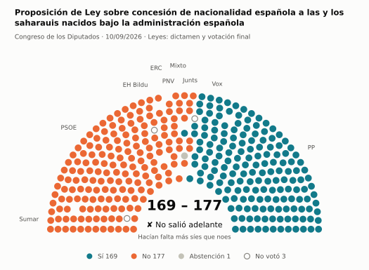
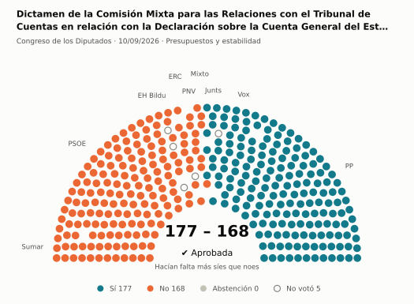
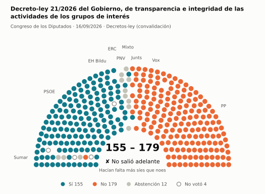
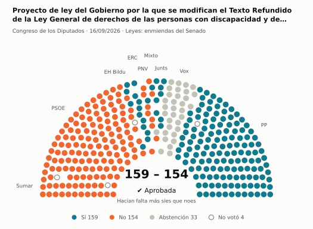
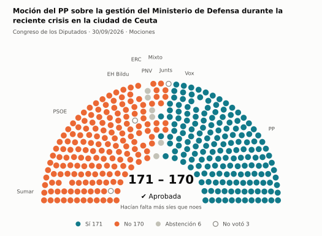
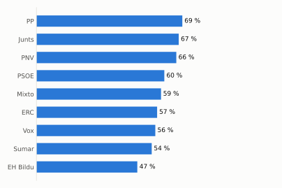
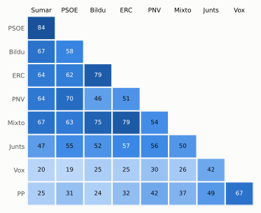

# Qué votó el Congreso en septiembre de 2026

Las votaciones del Pleno del Congreso de los Diputados, explicadas sin tecnicismos. Datos oficiales del [Congreso](https://www.congreso.es/es/opendata/votaciones); este resumen se actualiza solo cada mes (última vez: 11/11/2026).

## En pocas palabras

- El Congreso votó **119 veces** en 8 días de pleno. **71 propuestas salieron adelante** y 48 no.
- 60 votaciones fueron sobre leyes, decretos o presupuestos. Otras 44 fueron peticiones al Gobierno que no le obligan (proposiciones no de ley y mociones).
- El Gobierno (PSOE y Sumar) perdió **28** de las 91 votaciones en las que sus grupos votaron lo mismo.
- La votación más reñida se decidió por 1 voto: Moción del PP sobre la gestión del Ministerio de Defensa durante la reciente crisis en la ciudad de Ceuta.
- Los diputados casi siempre votan lo mismo que su grupo: en todo el mes solo hubo 51 votos distintos (sin contar el Grupo Mixto).

## Las votaciones más importantes del mes

Elegidas por su importancia: pesan más las leyes y los decretos que las peticiones al Gobierno, y suben las que se decidieron por pocos votos o las que perdió el Gobierno. Cada punto del dibujo es un diputado, colocado con su grupo, y el color es lo que votó.

### 1. Proposición de Ley sobre concesión de nacionalidad española a las y los saharauis nacidos bajo la administración española

**10 de septiembre · Leyes: dictamen y votación final.** Votación del texto de una ley después de trabajarla en comisión.

<picture>
  <source media="(prefers-color-scheme: dark)" srcset="img/2026-09/votacion-L15-S196-V002-oscuro.svg">
  
</picture>

**✘ No salió adelante** por 8 votos: 169 a favor, 177 en contra y 1 abstención.

- **A favor:** PP y Vox
- **En contra:** PSOE, Sumar, Junts, ERC, EH Bildu y PNV
- **Repartidos:** Grupo Mixto (Sí 1, No 7, Abstención 1)

Este asunto tuvo 2 votaciones este mes; aquí se muestra la más disputada. [Datos oficiales](https://www.congreso.es/webpublica/opendata/votaciones/Leg15/Sesion196/20260910/Votacion002/VOT_20260910180629.json)

### 2. Dictamen de la Comisión Mixta para las Relaciones con el Tribunal de Cuentas en relación con la Declaración sobre la Cuenta General del Estado del…

**10 de septiembre · Presupuestos y estabilidad.** Cuentas públicas: límites de déficit y deuda o cuentas del Estado.

<picture>
  <source media="(prefers-color-scheme: dark)" srcset="img/2026-09/votacion-L15-S196-V020-oscuro.svg">
  
</picture>

**✔ Salió adelante** por 9 votos: 177 a favor, 168 en contra y ninguna abstención.

- **A favor:** PP, Vox y Junts
- **En contra:** PSOE, Sumar, ERC, EH Bildu y PNV
- **Repartidos:** Grupo Mixto (Sí 2, No 7)

[Datos oficiales](https://www.congreso.es/webpublica/opendata/votaciones/Leg15/Sesion196/20260910/Votacion020/VOT_20260910180656.json)

### 3. Decreto-ley 21/2026 del Gobierno, de transparencia e integridad de las actividades de los grupos de interés

**16 de septiembre · Decretos-ley (convalidación).** El Gobierno aprobó esta norma por urgencia. Ya está en vigor, pero el Congreso tiene 30 días para confirmarla o tumbarla.

<picture>
  <source media="(prefers-color-scheme: dark)" srcset="img/2026-09/votacion-L15-S198-V016-oscuro.svg">
  
</picture>

**✘ No salió adelante** por 24 votos: 155 a favor, 179 en contra y 12 abstenciones.

- **A favor:** PSOE, Sumar (19 de 23), ERC y EH Bildu
- **En contra:** PP, Vox y Junts
- **Se abstuvieron:** PNV
- **Repartidos:** Grupo Mixto (Sí 3, No 2, Abstención 4)

[Datos oficiales](https://www.congreso.es/webpublica/opendata/votaciones/Leg15/Sesion198/20260916/Votacion016/VOT_20260916195406.json)

### 4. Proyecto de ley del Gobierno por la que se modifican el Texto Refundido de la Ley General de derechos de las personas con discapacidad y de su…

**16 de septiembre · Leyes: enmiendas del Senado.** El Senado propuso cambios a esta ley y el Congreso decide si los acepta. Es uno de los últimos pasos antes de que la ley se publique.

<picture>
  <source media="(prefers-color-scheme: dark)" srcset="img/2026-09/votacion-L15-S198-V034-oscuro.svg">
  
</picture>

**✔ Salió adelante** por 5 votos: 159 a favor, 154 en contra y 33 abstenciones.

- **A favor:** PP, Junts, ERC y EH Bildu
- **En contra:** PSOE, Sumar y PNV
- **Se abstuvieron:** Vox
- **Repartidos:** Grupo Mixto (Sí 3, No 5, Abstención 1)

Este asunto tuvo 39 votaciones este mes; aquí se muestra la más disputada. [Datos oficiales](https://www.congreso.es/webpublica/opendata/votaciones/Leg15/Sesion198/20260916/Votacion034/VOT_20260916195434.json)

### 5. Moción del PP sobre la gestión del Ministerio de Defensa durante la reciente crisis en la ciudad de Ceuta

**30 de septiembre · Mociones.** Petición al Gobierno después de pedirle explicaciones en el Pleno. Expresa la opinión del Congreso, pero no obliga.

<picture>
  <source media="(prefers-color-scheme: dark)" srcset="img/2026-09/votacion-L15-S202-V008-oscuro.svg">
  
</picture>

**✔ Salió adelante** por 1 voto: 171 a favor, 170 en contra y 6 abstenciones.

- **A favor:** PP y Vox
- **En contra:** PSOE, Sumar, Junts, ERC y EH Bildu
- **Se abstuvieron:** PNV
- **Repartidos:** Grupo Mixto (Sí 2, No 6, Abstención 1)

Este asunto tuvo 3 votaciones este mes; aquí se muestra la más disputada. [Datos oficiales](https://www.congreso.es/webpublica/opendata/votaciones/Leg15/Sesion202/20260930/Votacion008/VOT_20260930153605.json)

## ¿Qué grupos votaron más veces lo que finalmente salió?

<picture>
  <source media="(prefers-color-scheme: dark)" srcset="img/2026-09/ganadora-oscuro.svg">
  
</picture>

Porcentaje de votaciones en que el grupo votó Sí y salió adelante, o votó No y no salió. Abstenerse no cuenta como acertar.

## ¿Quién vota con quién?

<picture>
  <source media="(prefers-color-scheme: dark)" srcset="img/2026-09/afinidad-oscuro.svg">
  
</picture>

Cada casilla dice en qué porcentaje de las votaciones dos grupos votaron lo mismo: 100 es que siempre coincidieron y 0 que nunca.

## ¿Qué tipo de cosas se votaron?

| Tipo | Votaciones | Salieron adelante | Qué es |
| --- | ---: | ---: | --- |
| Leyes: enmiendas del Senado | 39 | 23 | El Senado propuso cambios a esta ley y el Congreso decide si los acepta. Es uno de los últimos pasos antes de que la ley se publique. |
| Mociones | 36 | 18 | Petición al Gobierno después de pedirle explicaciones en el Pleno. Expresa la opinión del Congreso, pero no obliga. |
| Tratados internacionales | 9 | 9 | El Congreso autoriza a España a comprometerse con un acuerdo con otro país u organismo. |
| Leyes: toma en consideración | 8 | 5 | Primer paso de una ley propuesta por un grupo o una comunidad autónoma: el Congreso decide si empieza a tramitarla. |
| Proposiciones no de ley | 8 | 1 | Petición al Gobierno para que haga algo. Expresa la opinión del Congreso, pero no obliga. |
| Decretos-ley (convalidación) | 7 | 6 | El Gobierno aprobó esta norma por urgencia. Ya está en vigor, pero el Congreso tiene 30 días para confirmarla o tumbarla. |
| Organización de la Cámara | 6 | 6 | Asunto interno del Congreso: comisiones, plazos o el estatuto de los diputados. |
| Leyes: dictamen y votación final | 4 | 2 | Votación del texto de una ley después de trabajarla en comisión. |
| Presupuestos y estabilidad | 1 | 1 | Cuentas públicas: límites de déficit y deuda o cuentas del Estado. |
| Enmiendas a la totalidad | 1 | 0 | Un grupo intenta devolver la ley a quien la propuso o sustituirla por otra. Si no sale adelante, la ley sigue su camino. |

## Palabras que conviene saber

- **Pleno**: La reunión de los 350 diputados, donde se vota.
- **Grupo parlamentario**: Los diputados de un partido o coalición. Los partidos pequeños van juntos en el Grupo Mixto, aunque no piensen igual.
- **Abstención**: El diputado vota, pero ni a favor ni en contra.
- **No votó**: El diputado no votó: no estaba, estaba de baja o el escaño estaba vacío.
- **Mayoría simple**: Salen adelante las votaciones con más síes que noes. Es lo normal.
- **Mayoría absoluta**: 176 votos a favor, la mitad más uno de 350. La piden las leyes orgánicas (derechos fundamentales, sistema electoral…) y la primera votación de investidura.
- **Votación por llamamiento**: Cada diputado dice su voto en voz alta. Se usa en las investiduras y otras votaciones importantes.

---

**¿Quieres más detalle?** El [análisis detallado](2026-09-detalle.md) tiene la cohesión de cada grupo, un mapa de los diputados según cómo votan, qué diputados votaron distinto de su grupo, las ausencias y la lista completa de votaciones.

_Los resultados están calculados a partir de los votos: el Congreso no publica si cada votación salió adelante. Este proyecto no tiene relación con el Congreso. Método en [docs/DOCUMENTO_FUNCIONAL.md](../docs/DOCUMENTO_FUNCIONAL.md)._
